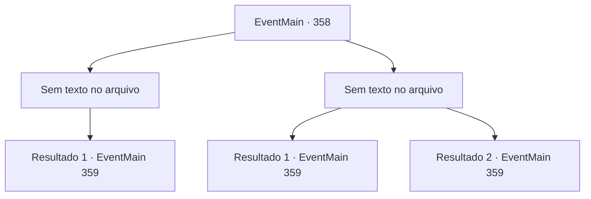

# Eventos principais · 358

[Índice da tabela](index.md) · [Índice geral](../index.md)

ID: `pt:EventMain:358` · Fonte: `EventMain4` · Versão: 1.2.47.

Mapeamento estático dos arquivos; a disponibilidade e a execução dependem do estado da run.

## Texto do evento

*Sem texto no arquivo.*

## Dados de entrada

```json
{
  "id": 358,
  "grade": 1,
  "normalGoal": "",
  "required": ""
}
```

## Mapa das escolhas



## Escolhas e resultados

### Escolha 1

*Sem texto no arquivo; o papel dessa opção depende da interface do jogo.*

Requisitos e outros campos da escolha:

```json
{
  "required": ""
}
```

#### Resultado 1.1

Depois de uma feroz batalha, você derrota os vampiros. Então, Anton aparece de repente, e ao pusar os olhos em você solta um berro. <link=shake>

 "V...VOCÊ..! SEU LIXO INGRATO...!!"

</link> Ele empurra os humanos próximos e avança em sua direção.

Continuação registrada: [Evento 359](0359.md) na mesma tabela.

```json
{
  "required": "",
  "chance": "1",
  "nextEvent": 359,
  "type": 2,
  "reward": "6_0_125",
  "place": 7
}
```

### Escolha 2

*Sem texto no arquivo; o papel dessa opção depende da interface do jogo.*

Requisitos e outros campos da escolha:

```json
{
  "required": ""
}
```

#### Resultado 2.1

Vampiros são, como esperado, inimigos difíceis. Seu grupo está lentamente perdendo espaço. Fiana, protejendo suas costas atravessa um dos monstros com sua arma improvisada. Então, Anton aparece de repente, e ao pusar os olhos em você solta um berro. <link=shake>

 "V...VOCÊ..! SEU LIXO INGRATO...!!"

</link> Ele empurra os humanos próximos e avança em sua direção.

Continuação registrada: [Evento 359](0359.md) na mesma tabela.

```json
{
  "required": "18_256_1",
  "chance": "1",
  "nextEvent": 359,
  "type": 2,
  "reward": "6_0_125",
  "place": 7
}
```

#### Resultado 2.2

Vampiros são, como esperado, inimigos difíceis. Quando seu grupo começa a perder espaço na batalha, um dardo de prata atravessa o pescoço de um dos vampiros. O vampiro explode em uma pilha de cinzas, e Luan pisca na distância. Então, Anton aparece de repente, e ao pusar os olhos em você solta um berro. <link=shake>

 "V...VOCÊ..! SEU LIXO INGRATO...!!"

</link> Ele empurra os humanos próximos e avança em sua direção.

Continuação registrada: [Evento 359](0359.md) na mesma tabela.

```json
{
  "required": "5_256_1",
  "chance": "1",
  "nextEvent": 359,
  "type": 2,
  "reward": "6_0_125",
  "place": 7
}
```

## Referências que chegam a este evento

- [Evento 357 · escolha 1 · resultado 1](0357.md#escolha-1)
- [Evento 357 · escolha 2 · resultado 2](0357.md#escolha-2)
