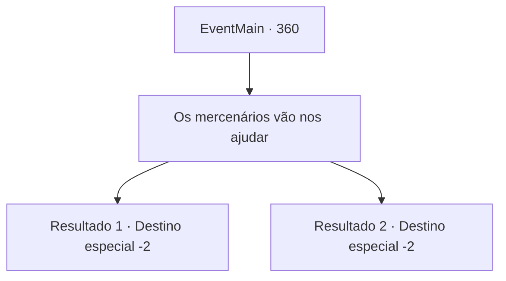

# Eventos principais · 360

[Índice da tabela](index.md) · [Índice geral](../index.md)

ID: `pt:EventMain:360` · Fonte: `EventMain4` · Versão: 1.2.47.

Mapeamento estático dos arquivos; a disponibilidade e a execução dependem do estado da run.

## Texto do evento

*Sem texto no arquivo.*

## Dados de entrada

```json
{
  "id": 360,
  "grade": 1,
  "normalGoal": "",
  "required": ""
}
```

## Mapa das escolhas



## Escolhas e resultados

### Escolha 1

Os mercenários vão nos ajudar

Requisitos e outros campos da escolha:

```json
{
  "required": ""
}
```

#### Resultado 1.1

Você decide pedir a ajuda dos mercenários de Ziwa. Sua irmã parece não saber do que você está falando, mas parece confiar na sua decisão. Ela acena. Você volta para a Ilha Illaha, para relatar os eventos que aconteceram em 'Romb' e trazer reforços. Enquanto você está fora, Fiana decide se abrigar em um posto próximo de Ziwa Mercenaries. 

 "Cuidado."

 Ela sorri e acena com as mãos para você.

Continuação registrada: [Destino especial `-2`](../destinos-especiais.md).

```json
{
  "required": "18_256_1",
  "chance": "1",
  "nextEvent": -2,
  "type": 2,
  "reward": "13_3_10"
}
```

#### Resultado 1.2

Você decide pedir a ajuda dos mercenários de Ziwa. Sua irmã parece não saber do que você está falando, mas parece confiar na sua decisão. Ela acena. Luan parece concordar com você também. 

 "Eu vou escoltar a Srta. Fiana para um local seguro, então."

 Você volta para a Ilha Illaha, para relatar os eventos que aconteceram em 'Romb' e trazer reforços. Enquanto você está fora, Fiana decide se abrigar em um posto próximo de Ziwa Mercenaries. 

 "Cuidado."

 Ela sorri e acena com as mãos para você.

Continuação registrada: [Destino especial `-2`](../destinos-especiais.md).

```json
{
  "required": "5_256_1",
  "chance": "1",
  "nextEvent": -2,
  "type": 2,
  "reward": "13_3_10|5_256_2"
}
```

## Referências que chegam a este evento

- [Evento 359 · escolha 1 · resultado 1](0359.md#escolha-1)
- [Evento 368 · escolha 2 · resultado 1](0368.md#escolha-2)
