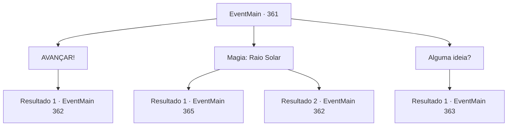

# Eventos principais · 361

[Índice da tabela](index.md) · [Índice geral](../index.md)

ID: `pt:EventMain:361` · Fonte: `EventMain4` · Versão: 1.2.47.

Mapeamento estático dos arquivos; a disponibilidade e a execução dependem do estado da run.

## Texto do evento

*Sem texto no arquivo.*

## Dados de entrada

```json
{
  "id": 361,
  "grade": 1,
  "normalGoal": "",
  "required": ""
}
```

## Mapa das escolhas



## Escolhas e resultados

### Escolha 1

AVANÇAR!

Requisitos e outros campos da escolha:

```json
{
  "required": ""
}
```

#### Resultado 1.1

Um corredor longo e estreito. Dois porteiros guardando a porta. Você não vê outra solução senão lidar com eles. Você prepara sua arma e corre em direção aos porteiros. Fiana puxa uma das espadas da decoração para ajudá-lo. Eles avistam você de longe e vêm correndo em sua direção, com suas presas expostas.

Continuação registrada: [Evento 362](0362.md) na mesma tabela.

```json
{
  "required": "",
  "chance": "1",
  "nextEvent": 362,
  "type": 2,
  "reward": "6_3_123",
  "place": 7
}
```

### Escolha 2

Magia: Raio Solar

Requisitos e outros campos da escolha:

```json
{
  "required": "20_0_3|1_1_2"
}
```

#### Resultado 2.1

Você lança um feitiço para invocar os raios do sol. Um raio de sol irrompe pelo corredor. Os vampiros guardiões são transformados em cinzas sem sequer ter a chance de reagir. Você caminha orgulhosamente até a porta. A porta bem decorada é pesada, mas não está trancada. Dentro do que parece ser o escritório de Anton há uma pequena lâmpada, algumas mesas, estantes e documentos espalhados. |drawing_antonRoom|

Continuação registrada: [Evento 365](0365.md) na mesma tabela.

```json
{
  "required": "",
  "chance": "1|0_7_1|0_12_1",
  "nextEvent": 365,
  "type": 0,
  "reward": "0_1_-1"
}
```

#### Resultado 2.2

Você lança um feitiço para invocar os raios do sol. Mas o feitiço não foi lançado corretamente... Você percebe que a única opção que resta é o combate. Você prepara sua arma e corre em direção aos porteiros. Fiana puxa uma das espadas da decoração para ajudá-lo. Eles avistam você de longe e vêm correndo em sua direção, com suas presas expostas.

Continuação registrada: [Evento 362](0362.md) na mesma tabela.

```json
{
  "required": "",
  "chance": "20",
  "nextEvent": 362,
  "type": 1,
  "reward": "6_3_123|0_1_-1",
  "place": 7
}
```

### Escolha 3

Alguma ideia?

Requisitos e outros campos da escolha:

```json
{
  "required": "5_256_1"
}
```

#### Resultado 3.1

Luan responde com um estalar de língua. 

 "...eu acho que a senhorita Fiana precisa ser nossa isca."

 Ele diz que se parece que Fiana estava tentando escapar da prisão, a atenção dos porteiros estaria voltada para ela, o que dará a você e Luan a oportunidade de emboscá-los facilmente.

Continuação registrada: [Evento 363](0363.md) na mesma tabela.

```json
{
  "required": "",
  "chance": "1",
  "nextEvent": 363,
  "type": 2,
  "reward": ""
}
```

## Referências que chegam a este evento

- [Evento 356 · escolha 2 · resultado 1](0356.md#escolha-2)
- [Evento 356 · escolha 2 · resultado 2](0356.md#escolha-2)
