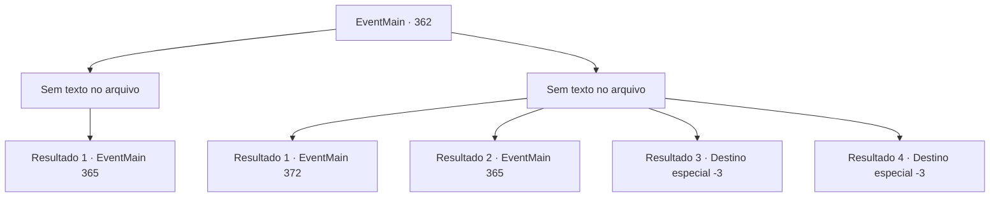

# Eventos principais · 362

[Índice da tabela](index.md) · [Índice geral](../index.md)

ID: `pt:EventMain:362` · Fonte: `EventMain4` · Versão: 1.2.47.

Mapeamento estático dos arquivos; a disponibilidade e a execução dependem do estado da run.

## Texto do evento

*Sem texto no arquivo.*

## Dados de entrada

```json
{
  "id": 362,
  "grade": 1,
  "normalGoal": "",
  "required": ""
}
```

## Mapa das escolhas



## Escolhas e resultados

### Escolha 1

*Sem texto no arquivo; o papel dessa opção depende da interface do jogo.*

Requisitos e outros campos da escolha:

```json
{
  "required": ""
}
```

#### Resultado 1.1

Os porteiros caem. Você abre a porta decorada. A porta é pesada, mas não está trancada. Dentro do que parece ser o escritório de Anton há uma pequena lâmpada, algumas mesas, estantes e documentos espalhados. |drawing_antonRoom|

Continuação registrada: [Evento 365](0365.md) na mesma tabela.

```json
{
  "required": "",
  "chance": "1",
  "nextEvent": 365,
  "type": 2,
  "reward": ""
}
```

### Escolha 2

*Sem texto no arquivo; o papel dessa opção depende da interface do jogo.*

Requisitos e outros campos da escolha:

```json
{
  "required": ""
}
```

#### Resultado 2.1

Você é derrubado pelos golpes incessantes dos vampiros. Inundado com chutes e garras, você desmaia. 

 Depois de algum tempo, você acorda com os sons de aplausos. Quando sua visão volta, você percebe que está sentado nos assentos de audiência do coliseu. 

 "Então, qual é a sensação de ocupar o assento de um VIP?"

 Anton pergunta com um sorriso malicioso no rosto. Ele está sentado ao seu lado. Você tenta responder com os punhos, mas suas mãos e pés estão firmemente presos por correntes. 

 "Ei, você deveria me agradecer por  dar esse assento. Esta é uma partida que você DEVE assistir."


Continuação registrada: [Evento 372](0372.md) na mesma tabela.

```json
{
  "required": "1_0_2|1_1_2|18_256_1",
  "chance": "1",
  "nextEvent": 372,
  "type": 2,
  "reward": "0_0_-1|0_1_-1"
}
```

#### Resultado 2.2

Você é derrubado no chão pelos golpes rápidos dos vampiros. Os vampiros o sufocam, e quando você está prestes a desmaiar, Fiana e Luan vêm em seu auxílio. A lâmina de Fiana corta o braço do vampiro, e o dardo prateado de Luan perfura seu pescoço. 

 "Você está bem?"

 Fiana ajuda você a se levantar. Os porteiros caem. Você abre a porta decorada. A porta é pesada, mas não está trancada. Dentro do que parece ser o escritório de Anton há uma pequena lâmpada, algumas mesas, estantes e documentos espalhados. |drawing_antonRoom|

Continuação registrada: [Evento 365](0365.md) na mesma tabela.

```json
{
  "required": "1_0_2|1_1_2|5_256_1",
  "chance": "1",
  "nextEvent": 365,
  "type": 2,
  "reward": "0_0_-1|0_1_-1"
}
```

#### Resultado 2.3

Você é derrubado pelos golpes incessantes dos vampiros. Inundado com chutes e garras, você desmaia.

Continuação registrada: [Destino especial `-3`](../destinos-especiais.md).

```json
{
  "required": "2_0_2",
  "chance": "1",
  "nextEvent": -3,
  "type": 2,
  "reward": "0_0_-1|0_1_-1"
}
```

#### Resultado 2.4

Você é derrubado pelos golpes incessantes dos vampiros. Inundado com chutes e garras, você desmaia.

Continuação registrada: [Destino especial `-3`](../destinos-especiais.md).

```json
{
  "required": "2_1_2",
  "chance": "1",
  "nextEvent": -3,
  "type": 2,
  "reward": "0_0_-1|0_1_-1"
}
```

## Referências que chegam a este evento

- [Evento 361 · escolha 1 · resultado 1](0361.md#escolha-1)
- [Evento 361 · escolha 2 · resultado 2](0361.md#escolha-2)
- [Evento 363 · escolha 2 · resultado 1](0363.md#escolha-2)
