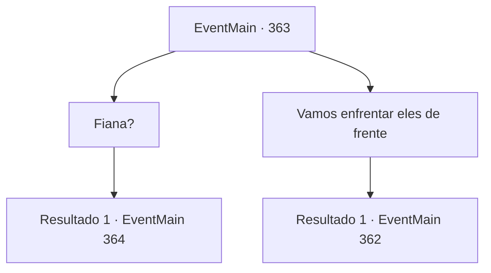

# Eventos principais · 363

[Índice da tabela](index.md) · [Índice geral](../index.md)

ID: `pt:EventMain:363` · Fonte: `EventMain4` · Versão: 1.2.47.

Mapeamento estático dos arquivos; a disponibilidade e a execução dependem do estado da run.

## Texto do evento

*Sem texto no arquivo.*

## Dados de entrada

```json
{
  "id": 363,
  "grade": 1,
  "normalGoal": "",
  "required": ""
}
```

## Mapa das escolhas



## Escolhas e resultados

### Escolha 1

Fiana?

Requisitos e outros campos da escolha:

```json
{
  "required": ""
}
```

#### Resultado 1.1

Você pergunta a Fiana qual é a posição dela sobre isso. Sem hesitar, Fiana acena com a cabeça e fala. 

 "Não tem problema. Deixe comigo."

 Você se esconde atrás das colunas com Luan. Fiana faz passos barulhentos de propósito, pulando para cima e para baixo nas escadas. Ela então aparece brevemente diante dos guardiões do portão. Eles gritam com uma voz aguda. 

 "EI! Essa pequena...!"

 Eles mostram suas presas e correm em direção a Fiana.

Continuação registrada: [Evento 364](0364.md) na mesma tabela.

```json
{
  "required": "",
  "chance": "1",
  "nextEvent": 364,
  "type": 2,
  "reward": "3_232_1"
}
```

### Escolha 2

Vamos enfrentar eles de frente

Requisitos e outros campos da escolha:

```json
{
  "required": ""
}
```

#### Resultado 2.1

Você simplesmente não pode concordar em usar sua irmãzinha como isca. Você saca sua arma e caminha em direção aos guardiões do portão. Fiana pega uma das espadas das decorações para te ajudar. Eles te avistam de longe e correm em sua direção, com suas presas expostas.

Continuação registrada: [Evento 362](0362.md) na mesma tabela.

```json
{
  "required": "",
  "chance": "1",
  "nextEvent": 362,
  "type": 2,
  "reward": "6_3_123",
  "place": 7
}
```

## Referências que chegam a este evento

- [Evento 361 · escolha 3 · resultado 1](0361.md#escolha-3)
