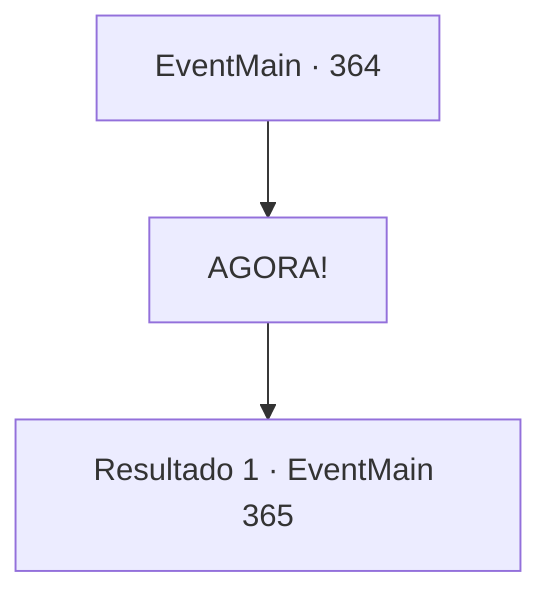

# Eventos principais · 364

[Índice da tabela](index.md) · [Índice geral](../index.md)

ID: `pt:EventMain:364` · Fonte: `EventMain4` · Versão: 1.2.47.

Mapeamento estático dos arquivos; a disponibilidade e a execução dependem do estado da run.

## Texto do evento

*Sem texto no arquivo.*

## Dados de entrada

```json
{
  "id": 364,
  "grade": 1,
  "normalGoal": "",
  "required": ""
}
```

## Mapa das escolhas



## Escolhas e resultados

### Escolha 1

AGORA!

Requisitos e outros campos da escolha:

```json
{
  "required": ""
}
```

#### Resultado 1.1

Assim que você sinaliza Luan, ele joga seu dardo prateado. O dardo mágico perfura suas cabeças em um instante, e os vampiros são transformados em pilhas de cinzas. Os porteiros caem. Você abre a porta decorada. A porta é pesada, mas não está trancada. Dentro do que parece ser o escritório de Anton, há uma pequena lâmpada, algumas mesas, estantes de livros e documentos importantes. |drawing_antonRoom|

Continuação registrada: [Evento 365](0365.md) na mesma tabela.

```json
{
  "required": "",
  "chance": "1",
  "nextEvent": 365,
  "type": 2,
  "reward": ""
}
```

## Referências que chegam a este evento

- [Evento 363 · escolha 1 · resultado 1](0363.md#escolha-1)
