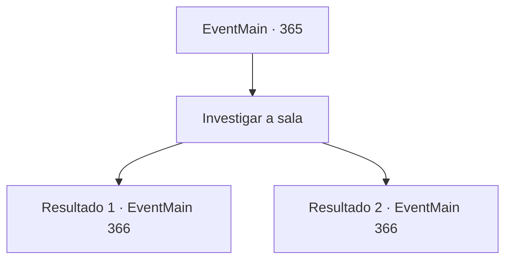

# Eventos principais · 365

[Índice da tabela](index.md) · [Índice geral](../index.md)

ID: `pt:EventMain:365` · Fonte: `EventMain4` · Versão: 1.2.47.

Mapeamento estático dos arquivos; a disponibilidade e a execução dependem do estado da run.

## Texto do evento

*Sem texto no arquivo.*

## Dados de entrada

```json
{
  "id": 365,
  "grade": 1,
  "normalGoal": "",
  "required": ""
}
```

## Mapa das escolhas



## Escolhas e resultados

### Escolha 1

Investigar a sala

Requisitos e outros campos da escolha:

```json
{
  "required": ""
}
```

#### Resultado 1.1

Você examina os documentos sobre a mesa. Nos documentos estão escritas as listas de pessoas que não puderam pagar a dívida e foram transformadas em gladiadores. Enquanto você está examinando os documentos, de repente a luz desaparece da sala, e a voz de Anton enche o ar. 

 "Ah... {1}. Eu nunca esperava que você me causasse tanta dor."

 Assim que você e Fiana ouvem a voz de Anton, os dois instintivamente alcançam suas armas. 

 "O bom senso dita que quando você pega algo emprestado, você deve devolver... E ainda assim você tenta tanto me matar, como se eu fosse o vilão. Mas... mas eu entendo você."

 Você não consegue vê-lo na escuridão, mas já consegue ver seu rosto, simbolizado por seu sorriso ganancioso. 

 "Eu... sou uma pessoa muito generosa. Então, se você puder fazer um 'pequeno favor' para mim... Eu vou resolver a sua dívida e a de sua irmãzinha de graça. Interessado?"


Continuação registrada: [Evento 366](0366.md) na mesma tabela.

```json
{
  "required": "18_256_1",
  "chance": "1",
  "nextEvent": 366,
  "type": 2,
  "reward": ""
}
```

#### Resultado 1.2

Você examina os documentos sobre a mesa. Nos documentos estão escritas as listas de pessoas que não puderam pagar a dívida e foram transformadas em gladiadores. Enquanto você está examinando os documentos, de repente a luz desaparece da sala, e a voz de Anton enche o ar. 

 "Ah... {1}. Eu nunca esperava que você me causasse tanta dor."

 Luan fica assustado e grita. 

 "A...ACK!! É... é um fantasma!!"

 Você e Fiana instintivamente pegam suas armas. 

 "O bom senso dita que quando você pega algo emprestado, você deve devolver... E ainda assim você tenta tanto me matar, como se eu fosse o vilão. Mas... mas eu entendo você."

 Você não consegue vê-lo na escuridão, mas já consegue ver seu rosto, simbolizado por seu sorriso ganancioso. 

 "Eu... sou uma pessoa muito generosa. Então, se você puder fazer um 'pequeno favor' para mim... Eu vou resolver sua dívida e a dívida de sua irmãzinha de graça. Interessado?"


Continuação registrada: [Evento 366](0366.md) na mesma tabela.

```json
{
  "required": "5_256_1",
  "chance": "1",
  "nextEvent": 366,
  "type": 2,
  "reward": ""
}
```

## Referências que chegam a este evento

- [Evento 361 · escolha 2 · resultado 1](0361.md#escolha-2)
- [Evento 362 · escolha 1 · resultado 1](0362.md#escolha-1)
- [Evento 362 · escolha 2 · resultado 2](0362.md#escolha-2)
- [Evento 364 · escolha 1 · resultado 1](0364.md#escolha-1)
