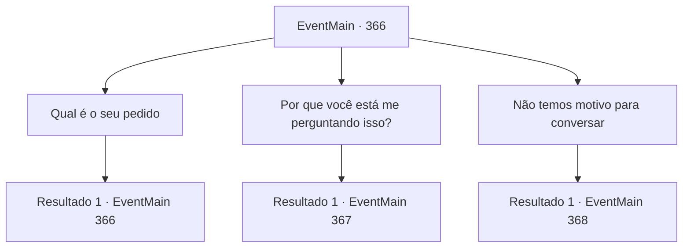

# Eventos principais · 366

[Índice da tabela](index.md) · [Índice geral](../index.md)

ID: `pt:EventMain:366` · Fonte: `EventMain4` · Versão: 1.2.47.

Mapeamento estático dos arquivos; a disponibilidade e a execução dependem do estado da run.

## Texto do evento

*Sem texto no arquivo.*

## Dados de entrada

```json
{
  "id": 366,
  "grade": 1,
  "normalGoal": "",
  "required": ""
}
```

## Mapa das escolhas



## Escolhas e resultados

### Escolha 1

Qual é o seu pedido

Requisitos e outros campos da escolha:

```json
{
  "required": "5_284_0"
}
```

#### Resultado 1.1

Fiana olha preocupada para você, mas você decide ouvir o que ele tem a dizer. Usando suas garras afiadas, Anton corta seu próprio pulso. Mas em vez de sangue escorrendo do corte, a ferida se recupera quase instantaneamente. 

 "Eu nunca quis me tornar um vampiro. Já faz anos desde que tive que me esconder do sol como um ratozinho, incapaz de ver meu filho enquanto ele está acordado... Eu... Eu nunca poderei perdoar aquele que me fez assim... o Senhor."

 Ele acrescenta que sempre odiou vampiros, dizendo que se o Senhor dos Vampiros desaparecesse, ele também poderia viver como um 'ser humano comum'. 

 "Este coliseu bárbaro? Também pertence ao Senhor. Eu não sou nada além de um fantoche. Espero que você e seus amigos mercenários possam me ajudar a derrotar o senhor do 'Castelo Moneaskur'."


Continuação registrada: [Evento 366](0366.md) na mesma tabela.

```json
{
  "required": "",
  "chance": "1",
  "nextEvent": 366,
  "type": 2,
  "reward": "5_284_1"
}
```

### Escolha 2

Por que você está me perguntando isso?

Requisitos e outros campos da escolha:

```json
{
  "required": "5_284_1"
}
```

#### Resultado 2.1

Você questiona por que você é a pessoa que ele decidiu pedir ajuda. Anton solta um pequeno suspiro e responde. 

 "Eu poderia ter contatado diretamente os Mercenários Ziwa. Mas isso notificaria o Senhor das minhas ações, o que certamente resultaria na minha morte. Então, eu vazei deliberadamente algumas informações para poder entrar em contato com alguém dessa organização. Eu estava planejando capturar o Senhor com a ajuda deles."

 Ele hesita antes de continuar. 

 "...Embora eu não esperasse que essa pessoa fosse VOCÊ"

.

Continuação registrada: [Evento 367](0367.md) na mesma tabela.

```json
{
  "required": "",
  "chance": "1",
  "nextEvent": 367,
  "type": 2,
  "reward": "5_284_2"
}
```

### Escolha 3

Não temos motivo para conversar

Requisitos e outros campos da escolha:

```json
{
  "required": ""
}
```

#### Resultado 3.1

Você diz a ele que não tem nada para ouvir. Então a névoa começa a se formar ao redor de Anton enquanto ele se revela. Ele está completamente coberto por uma armadura pesada. 

 "Não... se arrependa. Essa última chance que eu te dei, que você jogou fora com sua própria decisão."


Continuação registrada: [Evento 368](0368.md) na mesma tabela.

```json
{
  "required": "",
  "chance": "1",
  "nextEvent": 368,
  "type": 2,
  "reward": "6_0_125",
  "place": 7
}
```

## Referências que chegam a este evento

- [Evento 365 · escolha 1 · resultado 1](0365.md#escolha-1)
- [Evento 365 · escolha 1 · resultado 2](0365.md#escolha-1)
- [Evento 366 · escolha 1 · resultado 1](0366.md#escolha-1)
