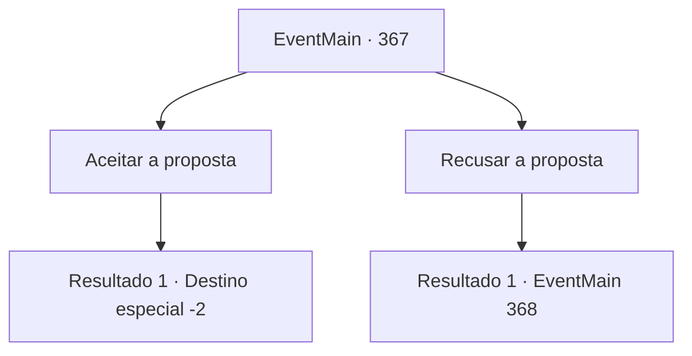

# Eventos principais · 367

[Índice da tabela](index.md) · [Índice geral](../index.md)

ID: `pt:EventMain:367` · Fonte: `EventMain4` · Versão: 1.2.47.

Mapeamento estático dos arquivos; a disponibilidade e a execução dependem do estado da run.

## Texto do evento

*Sem texto no arquivo.*

## Dados de entrada

```json
{
  "id": 367,
  "grade": 1,
  "normalGoal": "",
  "required": ""
}
```

## Mapa das escolhas



## Escolhas e resultados

### Escolha 1

Aceitar a proposta

Requisitos e outros campos da escolha:

```json
{
  "required": ""
}
```

#### Resultado 1.1

Você aceita a proposta de Anton. Então, névoa começa a se formar ao redor de Anton enquanto ele se revela. Ele sorri satisfeito. 

 "Haha... Boa escolha. Eu também vou te ajudar. Quanto à Fiana, vou mantê-la segura. Venha para o Castelo Moneaskur com os mercenários."

 Você sai do coliseu e segue imediatamente para a Ilha Illaha.

Continuação registrada: [Destino especial `-2`](../destinos-especiais.md).

```json
{
  "required": "",
  "chance": "1",
  "nextEvent": -2,
  "type": 2,
  "reward": "13_3_9"
}
```

### Escolha 2

Recusar a proposta

Requisitos e outros campos da escolha:

```json
{
  "required": ""
}
```

#### Resultado 2.1

O silêncio preenche o ar por alguns segundos. Então a névoa começa a se formar ao redor de Anton enquanto ele se revela. Ele está completamente coberto por uma armadura pesada. 

 "Não... se arrependa. Essa última chance que eu te dei, que você jogou fora com sua própria decisão."

 Então, ele salta em você num piscar de olhos.

Continuação registrada: [Evento 368](0368.md) na mesma tabela.

```json
{
  "required": "",
  "chance": "1",
  "nextEvent": 368,
  "type": 2,
  "reward": "6_0_125",
  "place": 7
}
```

## Referências que chegam a este evento

- [Evento 366 · escolha 2 · resultado 1](0366.md#escolha-2)
