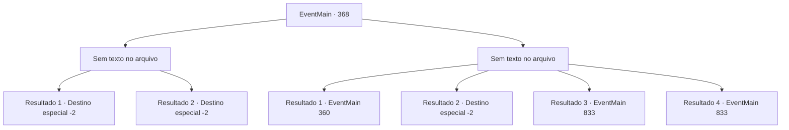

# Eventos principais · 368

[Índice da tabela](index.md) · [Índice geral](../index.md)

ID: `pt:EventMain:368` · Fonte: `EventMain4` · Versão: 1.2.47.

Mapeamento estático dos arquivos; a disponibilidade e a execução dependem do estado da run.

## Texto do evento

*Sem texto no arquivo.*

## Dados de entrada

```json
{
  "id": 368,
  "grade": 1,
  "normalGoal": "",
  "required": ""
}
```

## Mapa das escolhas



## Escolhas e resultados

### Escolha 1

*Sem texto no arquivo; o papel dessa opção depende da interface do jogo.*

Requisitos e outros campos da escolha:

```json
{
  "required": ""
}
```

#### Resultado 1.1

Anton cai antes que seus poderosos sopre. Mas a única coisa que foi destruída é sua armadura. Ele já se transformou em névoa e escapou. Então, Fiana corre para uma parede próxima e pega a lâmpada. Ela então quebra no chão. O fogo se espalha para o tapete no chão e logo a sala é engolida por chamas. 

 "Aquele bastardo Anton ainda deveria estar aqui. Vamos sair daqui!"

 Você e Fiana saem da sala e fecham a porta. Você então puxa uma espada das decorações próximas e trava a porta com ela. 

 Logo, você e a Fiana já escaparam do Coliseu. Fiana solta um suspiro de alívio e fala. 

 "Deve acabar ... certo?"

 Mas algo não parece certo. Você nunca ouviu falar de vampiros queimando até suas mortes. Primeiro, você decide se reportar aos mercenários de Ziwa sobre os vampiros, pede sua ajuda, enquanto Fiana leva o banheiro dentro de um posto próximo de mercenários de Ziwa. 

 "Ser seguro."

 Ela sorri e acena com as mãos em você.

Continuação registrada: [Destino especial `-2`](../destinos-especiais.md).

```json
{
  "required": "24_2_1",
  "chance": "1",
  "nextEvent": -2,
  "type": 2,
  "reward": "13_3_10"
}
```

#### Resultado 1.2

Você inflige um ferimento fatal em Anton. Seu peito começa a queimar, enquanto ele cospe cinzas pela boca. 

 "*tosse* *tosse*... Não... Eu não posso... morrer assim...!!"

 E com isso, Anton se transforma em um monte de cinzas. Você recolhe as cinzas dentro de uma bolsa, para fazer um relatório oficial para os Mercenários de Ziwa. Fiana solta um suspiro de alívio e fala. 

 "Deve ter acabado... certo?"

 Mas algo não parece certo. Você nunca ouviu falar de vampiros queimando até a morte. Primeiro, você decide relatar aos Mercenários de Ziwa sobre os vampiros, pedir sua ajuda, enquanto Fiana se abriga dentro de um posto próximo dos Mercenários de Ziwa. 

 "Fique em segurança."

 Ela sorri e acena com as mãos para você.

Continuação registrada: [Destino especial `-2`](../destinos-especiais.md).

```json
{
  "required": "23_2_1",
  "chance": "1",
  "nextEvent": -2,
  "type": 2,
  "reward": "5_278_1|13_3_10"
}
```

### Escolha 2

*Sem texto no arquivo; o papel dessa opção depende da interface do jogo.*

Requisitos e outros campos da escolha:

```json
{
  "required": ""
}
```

#### Resultado 2.1

Anton o empurra para uma parede próxima e tenta morder você. Então, Fiana se levanta do chão em um instante. Ela então esfaqueia os olhos de Anton com a espada. 

 "Kiyaaaa-!!!!"

 Nenhuma gota de sangue sai da ferida, mas aparentemente ele ainda sente a dor. Ele tropeça para trás, e Fiana rapidamente o arrasta para fora da sala. 

 Você e Fiana correm para suas vidas por um longo tempo e finalmente conseguem escapar do Coliseu. Ela respira pesadamente e fala. 

 "*Ufa*... Anton ... aquele bastardo ... você o ouviu gritar? Ha ... hahaha ..!"

 Fiana ri com entusiasmo, mas logo se torna sério. 

 "Merda ... sem dúvida, ele virá atrás de nós. O que fazemos agora?"


Continuação registrada: [Evento 360](0360.md) na mesma tabela.

```json
{
  "required": "1_0_2|1_1_2|18_256_1",
  "chance": "1",
  "nextEvent": 360,
  "type": 2,
  "reward": "0_0_-1|0_1_-1"
}
```

#### Resultado 2.2

Anton empurra você contra uma parede próxima e tenta te morder. Então, Luan se levanta do chão instantaneamente e lança seu dardo de prata no peito de Anton. Seu peito começa a queimar, enquanto ele cospe cinzas pela boca. 

 "*tosse* *tosse*... Não... Eu não posso... morrer assim...!!"

 E com isso, Anton se transforma em um monte de cinzas. Luan recolhe as cinzas em uma bolsa, para fazer um relatório oficial para os Mercenários de Ziwa. Fiana solta um suspiro de alívio e fala. 

 "Deve ter acabado... certo?"

 Você leva Fiana e Luan para fora do coliseu. Primeiro, você decide informar os Mercenários de Ziwa sobre os vampiros enquanto Fiana se abriga em um posto próximo dos Mercenários de Ziwa. 

 "Fique em segurança."

 Ela sorri e acena para você.

Continuação registrada: [Destino especial `-2`](../destinos-especiais.md).

```json
{
  "required": "5_256_1",
  "chance": "1",
  "nextEvent": -2,
  "type": 2,
  "reward": "13_3_10|5_256_2|5_278_1"
}
```

#### Resultado 2.3

Você e Fiana não são páreo para Anton. Fiana balança sua espada em último recurso, mas sua espada se quebra em pedaços. Aproveitando a oportunidade, Anton soca Fiana com a mão e ela desmaia inconsciente com um estrondo alto. Anton então se aproxima de você, monologando sarcasticamente. 

 "Um cachorro que morde seu dono está destinado a ter um fim miserável."

 Ele então revela suas presas e morde seu pescoço.

Continuação registrada: [Evento 833](0833.md) na mesma tabela.

```json
{
  "required": "2_0_2|18_256_1",
  "chance": "1",
  "nextEvent": 833,
  "type": 2,
  "reward": "0_0_-1|0_1_-1|15_4_1"
}
```

#### Resultado 2.4

Você e Fiana não são páreo para Anton. Fiana balança sua espada em último recurso, mas sua espada se quebra em pedaços. Aproveitando a oportunidade, Anton soca Fiana com a mão e ela desmaia inconsciente com um estrondo alto. Anton então se aproxima de você, monologando sarcasticamente. 

 "Um cachorro que morde seu dono está destinado a ter um fim miserável."

 Ele então revela suas presas e morde seu pescoço.

Continuação registrada: [Evento 833](0833.md) na mesma tabela.

```json
{
  "required": "2_1_2|18_256_1",
  "chance": "1",
  "nextEvent": 833,
  "type": 2,
  "reward": "0_0_-1|0_1_-1|15_4_1"
}
```

## Referências que chegam a este evento

- [Evento 366 · escolha 3 · resultado 1](0366.md#escolha-3)
- [Evento 367 · escolha 2 · resultado 1](0367.md#escolha-2)
