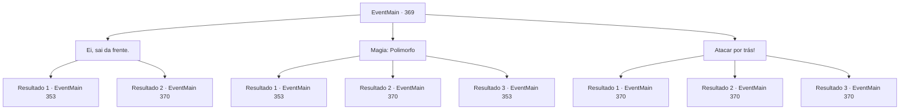

# Eventos principais · 369

[Índice da tabela](index.md) · [Índice geral](../index.md)

ID: `pt:EventMain:369` · Fonte: `EventMain4` · Versão: 1.2.47.

Mapeamento estático dos arquivos; a disponibilidade e a execução dependem do estado da run.

## Texto do evento

*Sem texto no arquivo.*

## Dados de entrada

```json
{
  "id": 369,
  "grade": 1,
  "normalGoal": "",
  "required": ""
}
```

## Mapa das escolhas



## Escolhas e resultados

### Escolha 1

Ei, sai da frente.

Requisitos e outros campos da escolha:

```json
{
  "required": ""
}
```

#### Resultado 1.1

Você se aproxima do gatekeeper. Você então ordena que ele se afaste. Ele se afasta sem sequer perceber. Você facilmente passa pelo portão. Você passa pelo portão e segue as escadas, indo para o porão. |drawing_lomhnePrison| As escadas levam você a uma ampla ocultação. É uma prisão subterrânea, cheia de muitas células. Cada célula é bloqueada com portas de aço com pequenos orifícios apenas o suficiente para um olho. Ao lado da porta está o nome do preso e a quantidade de dívida que resta. Você passa as células, antes de chegar a uma cela com o nome de sua irmã escrito nela.

Continuação registrada: [Evento 353](0353.md) na mesma tabela.

```json
{
  "required": "",
  "chance": "1|0_12_1",
  "nextEvent": 353,
  "type": 0,
  "reward": ""
}
```

#### Resultado 1.2

Você se aproxima do porteiro. Então você diz a ele para sair do caminho. Ele parece confuso por um momento, mas logo prepara sua arma e se prepara para lutar.

Continuação registrada: [Evento 370](0370.md) na mesma tabela.

```json
{
  "required": "",
  "chance": "20",
  "nextEvent": 370,
  "type": 1,
  "reward": "6_3_19",
  "place": 7
}
```

### Escolha 2

Magia: Polimorfo

Requisitos e outros campos da escolha:

```json
{
  "required": "20_0_2|1_1_2"
}
```

#### Resultado 2.1

Você estuda cuidadosamente a aparência do zelador e logo polimorfa nele. Os porteiros deixam você passar sem suspeita e você passa pelo portão, seguindo as escadas e indo para o porão. |drawing_lomhnePrison| As escadas levam você a uma ampla ocultação. É uma prisão subterrânea, cheia de muitas células. Cada célula é bloqueada com portas de aço com pequenos orifícios apenas o suficiente para um olho. Ao lado da porta está o nome do preso e a quantidade de dívida que resta. Você passa as células, antes de chegar a uma cela com o nome de sua irmã escrito nela.

Continuação registrada: [Evento 353](0353.md) na mesma tabela.

```json
{
  "required": "21_0_3",
  "chance": "1|0_7_1|0_12_1",
  "nextEvent": 353,
  "type": 0,
  "reward": "0_1_-1"
}
```

#### Resultado 2.2

Você estuda cuidadosamente a aparência do zelador e logo se transforma nele. Mas aparentemente sua magia está incompleta, pois os guardiões impedem você de entrar. 

 "Uhm... Você não é o verdadeiro zelador, não é?"

 Assim que terminam, eles se preparam para lutar.

Continuação registrada: [Evento 370](0370.md) na mesma tabela.

```json
{
  "required": "21_0_3",
  "chance": "28",
  "nextEvent": 370,
  "type": 1,
  "reward": "6_3_19|0_1_-1",
  "place": 7
}
```

#### Resultado 2.3

Você estuda cuidadosamente a aparência do zelador e logo polimorfa nele. Os porteiros deixam você passar sem suspeita e você passa pelo portão, seguindo as escadas e indo para o porão. |drawing_lomhnePrison| As escadas levam você a uma ampla ocultação. É uma prisão subterrânea, cheia de muitas células. Cada célula é bloqueada com portas de aço com pequenos orifícios apenas o suficiente para um olho. Ao lado da porta está o nome do preso e a quantidade de dívida que resta. Você passa as células, antes de chegar a uma cela com o nome de sua irmã escrito nela.

Continuação registrada: [Evento 353](0353.md) na mesma tabela.

```json
{
  "required": "20_0_3",
  "chance": "1",
  "nextEvent": 353,
  "type": 2,
  "reward": ""
}
```

### Escolha 3

Atacar por trás!

Requisitos e outros campos da escolha:

```json
{
  "required": ""
}
```

#### Resultado 3.1

Você se agacha, escondendo sua presença e se aproxima dos guardiões do portão. Eles nem percebem sua existência antes de serem atacados. Um dos guardiões desmaia com seu ataque, e o outro guardião se prepara rapidamente para contra-atacar.

Continuação registrada: [Evento 370](0370.md) na mesma tabela.

```json
{
  "required": "21_5_3",
  "chance": "1|0_6_1",
  "nextEvent": 370,
  "type": 0,
  "reward": "6_2_19",
  "place": 7
}
```

#### Resultado 3.2

Você se agacha, escondendo sua presença e se aproxima dos guardiões do portão. Eles nem percebem sua existência antes de serem atacados. Um dos guardiões desmaia com seu ataque, e o outro guardião se prepara rapidamente para contra-atacar.

Continuação registrada: [Evento 370](0370.md) na mesma tabela.

```json
{
  "required": "20_5_3",
  "chance": "1|0_6_2",
  "nextEvent": 370,
  "type": 0,
  "reward": "6_2_19",
  "place": 7
}
```

#### Resultado 3.3

Você se agacha, tentando esconder sua presença e se aproximar dos guardiões, mas eles percebem você se aproximando sorrateiramente por trás deles. 

 "Que diabos você está fazendo-!!"

 Eles imediatamente se preparam para lutar.

Continuação registrada: [Evento 370](0370.md) na mesma tabela.

```json
{
  "required": "",
  "chance": "20",
  "nextEvent": 370,
  "type": 1,
  "reward": "6_3_19",
  "place": 7
}
```

## Referências que chegam a este evento

- [Evento 348 · escolha 1 · resultado 1](0348.md#escolha-1)
- [Evento 349 · escolha 2 · resultado 1](0349.md#escolha-2)
- [Evento 349 · escolha 2 · resultado 4](0349.md#escolha-2)
- [Evento 352 · escolha 2 · resultado 2](0352.md#escolha-2)
- [Evento 354 · escolha 2 · resultado 1](0354.md#escolha-2)
