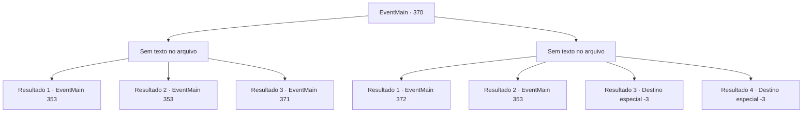

# Eventos principais · 370

[Índice da tabela](index.md) · [Índice geral](../index.md)

ID: `pt:EventMain:370` · Fonte: `EventMain4` · Versão: 1.2.47.

Mapeamento estático dos arquivos; a disponibilidade e a execução dependem do estado da run.

## Texto do evento

*Sem texto no arquivo.*

## Dados de entrada

```json
{
  "id": 370,
  "grade": 1,
  "normalGoal": "",
  "required": ""
}
```

## Mapa das escolhas



## Escolhas e resultados

### Escolha 1

*Sem texto no arquivo; o papel dessa opção depende da interface do jogo.*

Requisitos e outros campos da escolha:

```json
{
  "required": ""
}
```

#### Resultado 1.1

Os porteiros se transformam em pilhas de cinzas de seus ataques. Você coleciona as cinzas de vampiros e vai para a entrada. Você passa pelo portão e segue as escadas, descendo as escadas. |drawing_lomhnePrison| As escadas levam você a uma ampla ocultação. É uma prisão subterrânea, cheia de muitas células. Cada célula é bloqueada com portas de aço com pequenos orifícios apenas o suficiente para um olho. Ao lado da porta está o nome do preso e a quantidade de dívida que resta. Você passa as células, antes de chegar a uma cela com o nome de sua irmã escrito nela.

Continuação registrada: [Evento 353](0353.md) na mesma tabela.

```json
{
  "required": "23_2_1",
  "chance": "1",
  "nextEvent": 353,
  "type": 2,
  "reward": ""
}
```

#### Resultado 1.2

Os porteiros caem, mas logo se levantam em uma pose grotesca. Seus corpos começam a se consertar. Então, Luan puxa alguns dardos de prata de seus bolsos e os joga nos porteiros. Os dardos os transformam em pilhas de cinzas, e Luan continua, coletando as cinzas. 

 "Eles são de fato vampiros, como eu esperava ... vamos para dentro."

 Ele lidera, indo para a entrada. Você passa pelo portão e segue as escadas, descendo as escadas. |drawing_lomhnePrison| As escadas levam você a uma ampla ocultação. É uma prisão subterrânea, cheia de muitas células. Cada célula é bloqueada com portas de aço com pequenos orifícios apenas o suficiente para um olho. Ao lado da porta está o nome do preso e a quantidade de dívida que resta. Você passa as células, antes de chegar a uma cela com o nome de sua irmã escrito nela.

Continuação registrada: [Evento 353](0353.md) na mesma tabela.

```json
{
  "required": "24_2_1|5_256_1",
  "chance": "1",
  "nextEvent": 353,
  "type": 2,
  "reward": ""
}
```

#### Resultado 1.3

Os guardiões caem, mas logo se levantam em uma pose grotesca. Seus corpos se consertam e eles iniciam o ataque novamente.

Continuação registrada: [Evento 371](0371.md) na mesma tabela.

```json
{
  "required": "24_2_1|18_256_1",
  "chance": "1",
  "nextEvent": 371,
  "type": 2,
  "reward": "6_2_19",
  "place": 7
}
```

### Escolha 2

*Sem texto no arquivo; o papel dessa opção depende da interface do jogo.*

Requisitos e outros campos da escolha:

```json
{
  "required": ""
}
```

#### Resultado 2.1

Você é espancado pelos vampiros do porteiro e fica inconsciente. 

 Depois de algum tempo se passou, você acorda com os sons de aplausos altos. À medida que sua visão retorna, você percebe que está sentado nos assentos da platéia do Coliseu. 

 "Então, como é se sentir no assento de um VIP?"

 Anton pede a você um sorriso malicioso no rosto. Ele está sentado ao seu lado. Você tenta responder com os punhos, mas suas mãos e pés estão fortemente amarrados por correntes. 

 "Ei, você deve me agradecer por lhe dar esse assento. Esta é uma combinação que você deve assistir."


Continuação registrada: [Evento 372](0372.md) na mesma tabela.

```json
{
  "required": "18_256_1|1_0_2|1_1_2",
  "chance": "1",
  "nextEvent": 372,
  "type": 2,
  "reward": "0_0_-1|0_1_-1"
}
```

#### Resultado 2.2

Um dardo prateado vem cortando o vento e pousa nos pescoços dos vampiros. Eles olham para o pescoço para ver o que pousou no pescoço, mas é tarde demais. Os vampiros se transformam em pilhas de cinzas, e Luan coloca seus dardos. 

 "Ufa ... graças a você, {1}, pude obter uma foto limpa. Vamos para dentro."

 Luan recolhe as pilhas de cinzas e depois entra na entrada. Você passa pelo portão e segue as escadas, descendo as escadas. |drawing_lomhnePrison| As escadas levam você a uma ampla ocultação. É uma prisão subterrânea, cheia de muitas células. Cada célula é bloqueada com portas de aço com pequenos orifícios apenas o suficiente para um olho. Ao lado da porta está o nome do preso e a quantidade de dívida que resta. Você passa as células, antes de chegar a uma cela com o nome de sua irmã escrito nela.

Continuação registrada: [Evento 353](0353.md) na mesma tabela.

```json
{
  "required": "5_256_1|1_0_2|1_1_2",
  "chance": "1",
  "nextEvent": 353,
  "type": 2,
  "reward": "0_0_-1|0_1_-1"
}
```

#### Resultado 2.3

As afiadas presas dos vampiros pousam em seu pescoço. Você sente seu sangue sendo drenado enquanto perde a consciência.

Continuação registrada: [Destino especial `-3`](../destinos-especiais.md).

```json
{
  "required": "2_0_2",
  "chance": "1",
  "nextEvent": -3,
  "type": 2,
  "reward": "0_0_-1|0_1_-1"
}
```

#### Resultado 2.4

As afiadas presas dos vampiros pousam em seu pescoço. Você sente seu sangue sendo drenado enquanto perde a consciência.

Continuação registrada: [Destino especial `-3`](../destinos-especiais.md).

```json
{
  "required": "2_1_2",
  "chance": "1",
  "nextEvent": -3,
  "type": 2,
  "reward": "0_0_-1|0_1_-1"
}
```

## Referências que chegam a este evento

- [Evento 369 · escolha 1 · resultado 2](0369.md#escolha-1)
- [Evento 369 · escolha 2 · resultado 2](0369.md#escolha-2)
- [Evento 369 · escolha 3 · resultado 1](0369.md#escolha-3)
- [Evento 369 · escolha 3 · resultado 2](0369.md#escolha-3)
- [Evento 369 · escolha 3 · resultado 3](0369.md#escolha-3)
