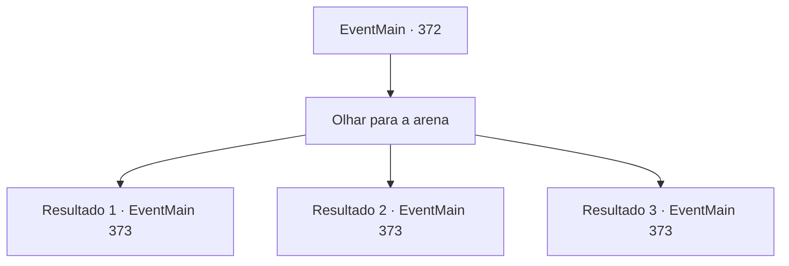

# Eventos principais · 372

[Índice da tabela](index.md) · [Índice geral](../index.md)

ID: `pt:EventMain:372` · Fonte: `EventMain4` · Versão: 1.2.47.

Mapeamento estático dos arquivos; a disponibilidade e a execução dependem do estado da run.

## Texto do evento

*Sem texto no arquivo.*

## Dados de entrada

```json
{
  "id": 372,
  "grade": 1,
  "normalGoal": "",
  "required": ""
}
```

## Mapa das escolhas



## Escolhas e resultados

### Escolha 1

Olhar para a arena

Requisitos e outros campos da escolha:

```json
{
  "required": ""
}
```

#### Resultado 1.1

Você ouve as palavras de Anton e vira seu olhar para a arena. Lá, você vê sua irmãzinha 'Fiana', em pé na frente de um homem musculoso armado com uma espada e um escudo. A voz do comentarista ecoa através do Coliseu. 

 "Bem, bem, bem! A partida entre a única e única, a mais ágil dos participantes, 'Fiana the Squirrel' e 'Karlievich the Red Fist', com força desumana, começa agora!"

 O alvoroço da multidão enche o Coliseu e você sente o suor em suas mãos. 

 Fiana se esquiva dos ataques de seu inimigo graciosamente, antes de derrubá -lo em um único golpe. Karlievich sai da arena, com agentes do Coliseu ajudando -o a andar. Anton palma, parabenizando você. 

 "Eu entendo muito bem o quanto você quer salvar sua irmã. Então ... eu tenho uma proposta. Se você puder completar uma 'pequena tarefa' para mim, vou resolver você e a dívida de sua irmã de graça. Whaddya diz?"

 

Continuação registrada: [Evento 373](0373.md) na mesma tabela.

```json
{
  "required": "5_244_2",
  "chance": "1",
  "nextEvent": 373,
  "type": 2,
  "reward": ""
}
```

#### Resultado 1.2

Você ouve as palavras de Anton e vira seu olhar para a arena. Lá, você vê sua irmãzinha 'Fiana', em pé na frente de um homem musculoso armado com uma espada e um escudo. A voz do comentarista ecoa através do Coliseu. 

 "Bem, bem, bem! A partida entre a única e única, a mais ágil dos participantes, 'Fiana the Squirrel' e 'Karlievich the Red Fist', com força desumana, começa agora!"

 O alvoroço da multidão enche o Coliseu e você sente o suor em suas mãos. 

 Depois de um longo comércio de golpes, Fiana é a única a dar o último golpe. Karlievich sai da arena, com agentes do Coliseu ajudando -o a andar. Anton palma, parabenizando você. 

 "Eu entendo muito bem o quanto você quer salvar sua irmã. Então ... eu tenho uma proposta. Se você puder completar uma 'pequena tarefa' para mim, vou resolver você e a dívida de sua irmã de graça. Whaddya diz?"

 

Continuação registrada: [Evento 373](0373.md) na mesma tabela.

```json
{
  "required": "5_244_1",
  "chance": "1",
  "nextEvent": 373,
  "type": 2,
  "reward": ""
}
```

#### Resultado 1.3

Você ouve as palavras de Anton e vira seu olhar para a arena. Lá, você vê sua irmãzinha 'Fiana', em pé na frente de um homem musculoso armado com uma espada e um escudo. A voz do comentarista ecoa através do Coliseu. 

 "Bem, bem, bem! A partida entre a única e única, a mais ágil dos participantes, 'Fiana the Squirrel' e 'Karlievich the Red Fist', com força desumana, começa agora!"

 O alvoroço da multidão enche o Coliseu e você sente o suor em suas mãos. 

 Após um longo comércio de golpes consecutivos, o sangue de Fiana é derramado na arena. Os trabalhadores do Coliseu trazem uma carruagem para mover seu corpo inconsciente. Karlievich joga os braços no ar, gritando na vitória. 

 "Isso é uma pena. Eu entendo muito bem o quanto você quer salvar sua irmã. Então ... eu tenho uma proposta. Se você puder completar uma 'pequena tarefa' para mim, vou resolver você e a dívida de sua irmã de graça. Whaddya diz?"


Continuação registrada: [Evento 373](0373.md) na mesma tabela.

```json
{
  "required": "5_244_0",
  "chance": "1",
  "nextEvent": 373,
  "type": 2,
  "reward": "5_244_3"
}
```

## Referências que chegam a este evento

- [Evento 359 · escolha 2 · resultado 1](0359.md#escolha-2)
- [Evento 362 · escolha 2 · resultado 1](0362.md#escolha-2)
- [Evento 370 · escolha 2 · resultado 1](0370.md#escolha-2)
- [Evento 371 · escolha 2 · resultado 1](0371.md#escolha-2)
