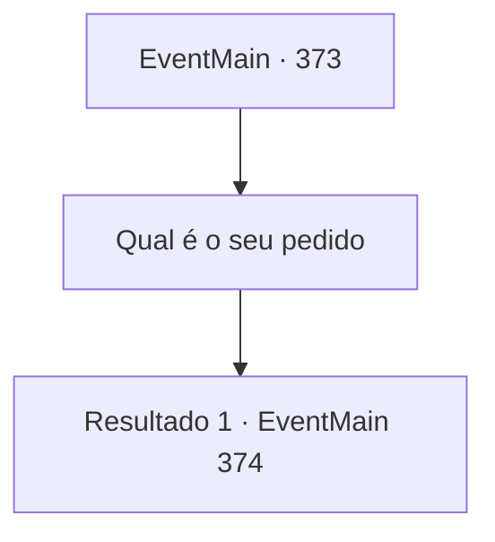

# Eventos principais · 373

[Índice da tabela](index.md) · [Índice geral](../index.md)

ID: `pt:EventMain:373` · Fonte: `EventMain4` · Versão: 1.2.47.

Mapeamento estático dos arquivos; a disponibilidade e a execução dependem do estado da run.

## Texto do evento

*Sem texto no arquivo.*

## Dados de entrada

```json
{
  "id": 373,
  "grade": 1,
  "normalGoal": "",
  "required": ""
}
```

## Mapa das escolhas



## Escolhas e resultados

### Escolha 1

Qual é o seu pedido

Requisitos e outros campos da escolha:

```json
{
  "required": ""
}
```

#### Resultado 1.1

Você decide ouvi-lo primeiro. Usando suas garras afiadas, Anton corta seu próprio pulso. Mas em vez de sangue escorrendo do corte, a ferida se recupera quase instantaneamente. 

 "Eu nunca quis me tornar um vampiro. Já faz anos desde que tive que me esconder do sol como um ratozinho, incapaz de ver meu filho enquanto ele está acordado... Eu... Eu nunca poderei perdoar aquele que me fez assim... o Senhor."

 Ele acrescenta que sempre odiou vampiros, dizendo que se o Senhor dos Vampiros desaparecesse, ele também poderia viver como um 'ser humano comum'. 

 "Este coliseu bárbaro? Também pertence ao Senhor. Eu não sou nada além de um fantoche. Espero que você e seus amigos mercenários possam me ajudar a derrotar o senhor do 'Castelo Moneaskur'."


Continuação registrada: [Evento 374](0374.md) na mesma tabela.

```json
{
  "required": "",
  "chance": "1",
  "nextEvent": 374,
  "type": 2,
  "reward": ""
}
```

## Referências que chegam a este evento

- [Evento 372 · escolha 1 · resultado 1](0372.md#escolha-1)
- [Evento 372 · escolha 1 · resultado 2](0372.md#escolha-1)
- [Evento 372 · escolha 1 · resultado 3](0372.md#escolha-1)
