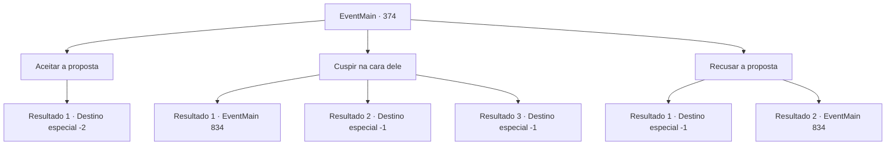

# Eventos principais · 374

[Índice da tabela](index.md) · [Índice geral](../index.md)

ID: `pt:EventMain:374` · Fonte: `EventMain4` · Versão: 1.2.47.

Mapeamento estático dos arquivos; a disponibilidade e a execução dependem do estado da run.

## Texto do evento

*Sem texto no arquivo.*

## Dados de entrada

```json
{
  "id": 374,
  "grade": 1,
  "normalGoal": "",
  "required": ""
}
```

## Mapa das escolhas



## Escolhas e resultados

### Escolha 1

Aceitar a proposta

Requisitos e outros campos da escolha:

```json
{
  "required": ""
}
```

#### Resultado 1.1

Você aceita a proposta de Anton. Então, névoa começa a se formar ao redor de Anton enquanto ele se revela. Ele sorri satisfeito. 

 "Haha... Boa escolha. Eu também vou te ajudar. Quanto à Fiana, vou mantê-la segura. Venha para o Castelo Moneaskur com os mercenários."

 Você sai do coliseu e segue imediatamente para a Ilha Illaha.

Continuação registrada: [Destino especial `-2`](../destinos-especiais.md).

```json
{
  "required": "",
  "chance": "1",
  "nextEvent": -2,
  "type": 2,
  "reward": "13_3_12"
}
```

### Escolha 2

Cuspir na cara dele

Requisitos e outros campos da escolha:

```json
{
  "required": ""
}
```

#### Resultado 2.1

Você cospe uma mistura de sua saliva e catarro no rosto de Anton. Sua expressão escurece num piscar de olhos, e você não segura o riso. Ele limpa sua saliva do rosto e começa a te bater. Somente quando a respiração de Anton fica pesada é que a surra impiedosa para. 

 "Fachada sem sentido... Coloque esse pequeno pedaço na prisão."

 Você é trancado dentro de uma cela estreita e escura pelos capangas de Anton. Eles te jogam dentro da cela e batem a pesada porta de aço em seu rosto.

Continuação registrada: [Evento 834](0834.md) na mesma tabela.

```json
{
  "required": "1_0_2",
  "chance": "1",
  "nextEvent": 834,
  "type": 2,
  "reward": "15_4_19|0_0_-1"
}
```

#### Resultado 2.2

Você cospe uma mistura de sua saliva e catarro no rosto de Anton. Sua expressão escurece num piscar de olhos, e você não segura o riso. Ele limpa sua saliva do rosto e começa a te bater.

Continuação registrada: [Destino especial `-1`](../destinos-especiais.md).

```json
{
  "required": "2_0_2|24_1_1",
  "chance": "1",
  "nextEvent": -1,
  "type": 2,
  "reward": "0_0_-1|15_4_1"
}
```

#### Resultado 2.3

Você cospe uma mistura de sua saliva e catarro no rosto de Anton. Sua expressão escurece num piscar de olhos, e você não segura o riso. Ele limpa sua saliva do rosto e começa a te bater.

Continuação registrada: [Destino especial `-1`](../destinos-especiais.md).

```json
{
  "required": "2_0_2|23_1_1",
  "chance": "1",
  "nextEvent": -1,
  "type": 2,
  "reward": "0_0_-1|15_4_1|25_8_1"
}
```

### Escolha 3

Recusar a proposta

Requisitos e outros campos da escolha:

```json
{
  "required": ""
}
```

#### Resultado 3.1

Você recusa a proposta dele, e Anton ordena que seus homens te arrastem para longe. Você é trancado dentro de uma cela estreita e escura pelos subordinados de Anton. Eles te jogam dentro da cela e batem a pesada porta de aço em seu rosto.

Continuação registrada: [Destino especial `-1`](../destinos-especiais.md).

```json
{
  "required": "24_1_1",
  "chance": "1",
  "nextEvent": -1,
  "type": 2,
  "reward": "15_4_19"
}
```

#### Resultado 3.2

Você recusa a proposta dele, e Anton ordena que seus homens te arrastem para longe. Você é trancado dentro de uma cela estreita e escura pelos subordinados de Anton. Eles te jogam dentro da cela e batem a pesada porta de aço em seu rosto.

Continuação registrada: [Evento 834](0834.md) na mesma tabela.

```json
{
  "required": "23_1_1",
  "chance": "1",
  "nextEvent": 834,
  "type": 2,
  "reward": ""
}
```

## Referências que chegam a este evento

- [Evento 373 · escolha 1 · resultado 1](0373.md#escolha-1)
