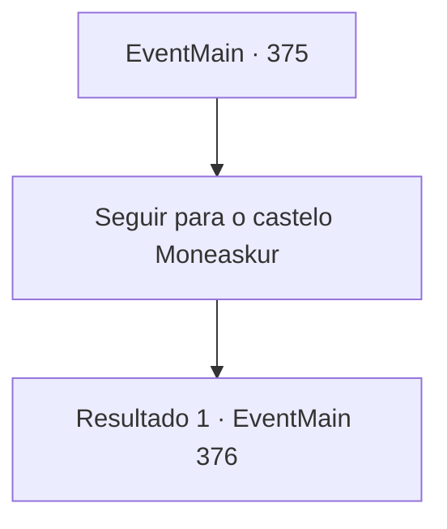

# Eventos principais · 375

[Índice da tabela](index.md) · [Índice geral](../index.md)

ID: `pt:EventMain:375` · Fonte: `EventMain4` · Versão: 1.2.47.

Mapeamento estático dos arquivos; a disponibilidade e a execução dependem do estado da run.

## Texto do evento

|drawing_illahaFortress| Você retorna aos Mercenários Ziwa da Ilha Illaha. Você relata tudo, os eventos que aconteceram em Romb, informações sobre a existência de um 'Lorde Vampiro' e o acordo que você fez com Anton. Irmã Maria fala depois de cuspir fumaça de seu cigarro. 

 "Aqui está o acordo. Você se encontra com esse cara chamado Anton e abre o portão de Moneaskur. Veja se existe esse Lorde Vampiro de quem você falou. Então, rasgue este pergaminho e envie-nos um sinal. Então vamos embosca-los. Nós vamos garantir que nenhum vampiro saia vivo."


## Dados de entrada

```json
{
  "id": 375,
  "grade": 1,
  "normalGoal": "",
  "required": "13_3_9|1_2_100"
}
```

## Mapa das escolhas



## Escolhas e resultados

### Escolha 1

Seguir para o castelo Moneaskur

Requisitos e outros campos da escolha:

```json
{
  "required": ""
}
```

#### Resultado 1.1

Você vai para 'Castle Moneaskur' junto com os mercenários de Ziwa. O castelo está localizado no fundo de uma floresta de neve e iluminado à luz da lua, brilha estranhamente, emitindo uma vibração muito irrealista. |drawing_moneasker| Os merceenários se escondem dentro da floresta e você caminha em direção ao castelo. Anton o cumprimenta quando ele te vê. Você percebe que ele tem uma diligência ao lado dele. O Stagecoach cheira a sangue. 

 "Você está aqui. Venha, sente -se."


Continuação registrada: [Evento 376](0376.md) na mesma tabela.

```json
{
  "required": "",
  "chance": "1",
  "nextEvent": 376,
  "type": 2,
  "reward": "3_54_1"
}
```

## Referências que chegam a este evento

Nenhum `nextEvent` positivo da mesma tabela aponta para este nó. Isso não prova que seja inacessível: sorteio e estado de história podem selecioná-lo.

