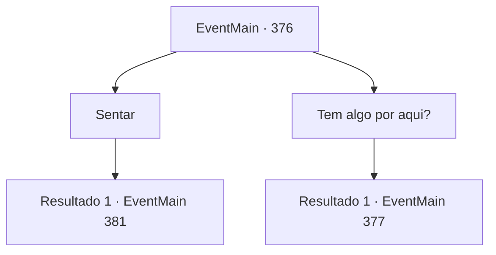

# Eventos principais · 376

[Índice da tabela](index.md) · [Índice geral](../index.md)

ID: `pt:EventMain:376` · Fonte: `EventMain4` · Versão: 1.2.47.

Mapeamento estático dos arquivos; a disponibilidade e a execução dependem do estado da run.

## Texto do evento

*Sem texto no arquivo.*

## Dados de entrada

```json
{
  "id": 376,
  "grade": 1,
  "normalGoal": "",
  "required": ""
}
```

## Mapa das escolhas



## Escolhas e resultados

### Escolha 1

Sentar

Requisitos e outros campos da escolha:

```json
{
  "required": ""
}
```

#### Resultado 1.1

Você senta ao lado de Anton. Anton dirige lentamente a diligência em direção ao portão do castelo, e o morcego sentado no portão pergunta a ele qual é o motivo da visita. Anton limpa a garganta e responde. 

 "Seu humilde súdito, Anton, envia suas saudações. Trouxe ao meu Senhor algumas oferendas coletadas do coliseu. Meu humilde desejo é que o Senhor aceite a oferenda com felicidade."

 O portão de aço branco se abre silenciosamente. Anton tira um cubo inscrito com padrões estranhos, dá uma olhada nele e o coloca de volta no bolso.

Continuação registrada: [Evento 381](0381.md) na mesma tabela.

```json
{
  "required": "",
  "chance": "1",
  "nextEvent": 381,
  "type": 2,
  "reward": ""
}
```

### Escolha 2

Tem algo por aqui?

Requisitos e outros campos da escolha:

```json
{
  "required": ""
}
```

#### Resultado 2.1

Anton responde como se não fosse grande coisa. 

 "Oh, apenas meu tributo mensal. Só posso ter acesso ao castelo se tiver o tributo pronto."

 Você verifica cuidadosamente a carruagem e descobre algumas pessoas inconscientes, com as mãos e os pés amarrados com força por cordas. Fiana também está lá. Você pergunta a Anton por que sua irmã está lá dentro. 

 "Ela está dormindo profundamente, você não vê? É simples, o nome dela apenas aconteceu de estar na lista de tributos deste mês. Não tente nada engraçado... Se passarmos por isso bem, prometo devolver sua irmã intacta."


Continuação registrada: [Evento 377](0377.md) na mesma tabela.

```json
{
  "required": "",
  "chance": "1",
  "nextEvent": 377,
  "type": 2,
  "reward": ""
}
```

## Referências que chegam a este evento

- [Evento 375 · escolha 1 · resultado 1](0375.md#escolha-1)
