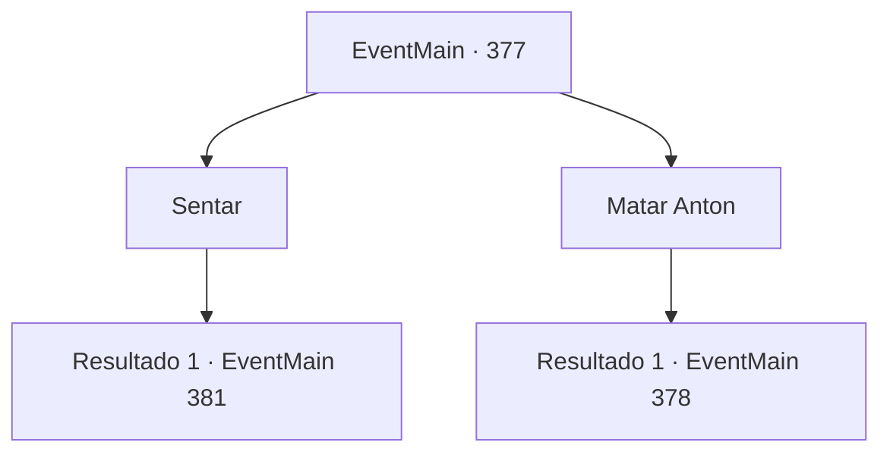

# Eventos principais · 377

[Índice da tabela](index.md) · [Índice geral](../index.md)

ID: `pt:EventMain:377` · Fonte: `EventMain4` · Versão: 1.2.47.

Mapeamento estático dos arquivos; a disponibilidade e a execução dependem do estado da run.

## Texto do evento

*Sem texto no arquivo.*

## Dados de entrada

```json
{
  "id": 377,
  "grade": 1,
  "normalGoal": "",
  "required": ""
}
```

## Mapa das escolhas



## Escolhas e resultados

### Escolha 1

Sentar

Requisitos e outros campos da escolha:

```json
{
  "required": ""
}
```

#### Resultado 1.1

Você ocupa seu assento na diligência. Anton dirige lentamente a diligência em direção ao portão do castelo, e o morcego sentado no portão pergunta a ele qual é o motivo da visita. Anton limpa a garganta e responde. 

 "Seu humilde súdito, Anton, envia seus cumprimentos. Trouxe ao meu Senhor algumas homenagens coletadas do coliseu. Meu humilde desejo é que o Senhor aceite a homenagem com felicidade."

 O portão de aço branco se abre silenciosamente.

Continuação registrada: [Evento 381](0381.md) na mesma tabela.

```json
{
  "required": "",
  "chance": "1",
  "nextEvent": 381,
  "type": 2,
  "reward": ""
}
```

### Escolha 2

Matar Anton

Requisitos e outros campos da escolha:

```json
{
  "required": ""
}
```

#### Resultado 2.1


 "Agora, espero sinceramente que você não vá perturbar o meu..."

 Ele não consegue completar a frase. Você não tem intenção de concordar com a insanidade de Anton. Você ataca Anton, sentado no banco do motorista. Ele desvia do seu ataque e murmura para si mesmo com uma voz áspera. 

 "Hah.... Criaturas tão estúpidas... Eu nunca deveria ter te dado uma segunda chance."

 Ele então começa a balançar suas garras afiadas em sua direção.

Continuação registrada: [Evento 378](0378.md) na mesma tabela.

```json
{
  "required": "",
  "chance": "1",
  "nextEvent": 378,
  "type": 2,
  "reward": "6_0_125",
  "place": 1
}
```

## Referências que chegam a este evento

- [Evento 376 · escolha 2 · resultado 1](0376.md#escolha-2)
