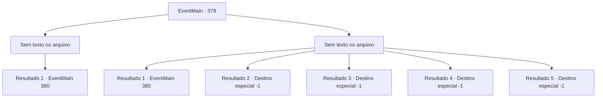

# Eventos principais · 379

[Índice da tabela](index.md) · [Índice geral](../index.md)

ID: `pt:EventMain:379` · Fonte: `EventMain4` · Versão: 1.2.47.

Mapeamento estático dos arquivos; a disponibilidade e a execução dependem do estado da run.

## Texto do evento

*Sem texto no arquivo.*

## Dados de entrada

```json
{
  "id": 379,
  "grade": 1,
  "normalGoal": "",
  "required": ""
}
```

## Mapa das escolhas



## Escolhas e resultados

### Escolha 1

*Sem texto no arquivo; o papel dessa opção depende da interface do jogo.*

Requisitos e outros campos da escolha:

```json
{
  "required": ""
}
```

#### Resultado 1.1

Anton não consegue manter sua forma física e se dissipa no ar como névoa. Ele deixou para trás uma pequena bolsa de couro, onde você encontra um cubo com padrões estranhos gravados. Então você avista mercenários de Ziwa se aproximando de você. 

 "O que está acontecendo? Ouviu-se uma briga."

 Os mercenários se aproximam de você, veem a carruagem e perguntam o que aconteceu. Você explica tudo o que aconteceu entre você e Anton, e os mercenários levam a carruagem para um lugar seguro. Irmã Maria te dá tapinhas nos ombros e fala. 

 "Ótimo trabalho, {1}. Você salvou algumas vidas inocentes, com certeza. Mas o que é esse cubo? Eu consigo sentir um estranho poder vindo dele."


Continuação registrada: [Evento 380](0380.md) na mesma tabela.

```json
{
  "required": "",
  "chance": "1",
  "nextEvent": 380,
  "type": 2,
  "reward": ""
}
```

### Escolha 2

*Sem texto no arquivo; o papel dessa opção depende da interface do jogo.*

Requisitos e outros campos da escolha:

```json
{
  "required": ""
}
```

#### Resultado 2.1

Os ataques de Anton te colocam na defensiva. Ele diz, rindo de você. 

 "Eu te dei outra chance... e mesmo assim, você tem a audácia de jogá-la fora. Quão burro você pode ser?"

 Recebendo seu ataque, você espalha sangue vermelho no campo de neve branca. Vendo isso, Anton fica ainda mais animado e avança em sua direção. De repente, Anton se vê preso na neve. Irmã Maria está em cima dele. Sem hesitar, ela levanta seu punho de prata e esmaga a cabeça de Anton. Logo em seguida, os mercenários se aproximam de você, veem a carruagem e perguntam o que aconteceu. Você explica tudo o que aconteceu entre você e Anton, e os mercenários levam a carruagem para um lugar seguro. Irmã Maria te dá tapinhas nos ombros e fala. 

 "Ótimo trabalho, {1}. Você salvou algumas vidas inocentes, com certeza. Mas o que é esse cubo? Eu consigo sentir um estranho poder vindo dele."


Continuação registrada: [Evento 380](0380.md) na mesma tabela.

```json
{
  "required": "1_0_2|1_1_2",
  "chance": "1",
  "nextEvent": 380,
  "type": 2,
  "reward": "0_0_-1|0_1_-1|5_278_1"
}
```

#### Resultado 2.2

Um torrente de sangue se abre a partir de suas feridas, cortadas pelos ataques de Anton. Ele se aproxima lentamente de você e ri de você. 

 "Eu te dei outra chance... e ainda assim, você tem a audácia de jogá-la fora. Quão burro você pode ser?"

 Então ele afunda suas presas em seu pescoço. Você sente seu sangue sendo drenado enquanto sente perder a consciência.

Continuação registrada: [Destino especial `-1`](../destinos-especiais.md).

```json
{
  "required": "2_0_2|24_1_1",
  "chance": "1",
  "nextEvent": -1,
  "type": 2,
  "reward": "15_4_1|0_0_-1|0_1_-1"
}
```

#### Resultado 2.3

Um torrente de sangue se abre a partir de suas feridas, cortadas pelos ataques de Anton. Ele se aproxima lentamente de você e ri de você. 

 "Eu te dei outra chance... e ainda assim, você tem a audácia de jogá-la fora. Quão burro você pode ser?"

 Então ele afunda suas presas em seu pescoço. Você sente seu sangue sendo drenado enquanto sente perder a consciência.

Continuação registrada: [Destino especial `-1`](../destinos-especiais.md).

```json
{
  "required": "2_0_2|23_1_1",
  "chance": "1",
  "nextEvent": -1,
  "type": 2,
  "reward": "15_4_1|0_0_-1|0_1_-1|25_8_1"
}
```

#### Resultado 2.4

Um torrente de sangue se abre a partir de suas feridas, cortadas pelos ataques de Anton. Ele se aproxima lentamente de você e ri de você. 

 "Eu te dei outra chance... e ainda assim, você tem a audácia de jogá-la fora. Quão burro você pode ser?"

 Então ele afunda suas presas em seu pescoço. Você sente seu sangue sendo drenado enquanto sente perder a consciência.

Continuação registrada: [Destino especial `-1`](../destinos-especiais.md).

```json
{
  "required": "2_1_2|24_1_1",
  "chance": "1",
  "nextEvent": -1,
  "type": 2,
  "reward": "15_4_1|0_0_-1|0_1_-1"
}
```

#### Resultado 2.5

Um torrente de sangue se abre a partir de suas feridas, cortadas pelos ataques de Anton. Ele se aproxima lentamente de você e ri de você. 

 "Eu te dei outra chance... e ainda assim, você tem a audácia de jogá-la fora. Quão burro você pode ser?"

 Então ele afunda suas presas em seu pescoço. Você sente seu sangue sendo drenado enquanto sente perder a consciência.

Continuação registrada: [Destino especial `-1`](../destinos-especiais.md).

```json
{
  "required": "2_1_2|23_1_1",
  "chance": "1",
  "nextEvent": -1,
  "type": 2,
  "reward": "15_4_1|0_0_-1|0_1_-1|25_8_1"
}
```

## Referências que chegam a este evento

- [Evento 378 · escolha 1 · resultado 2](0378.md#escolha-1)
