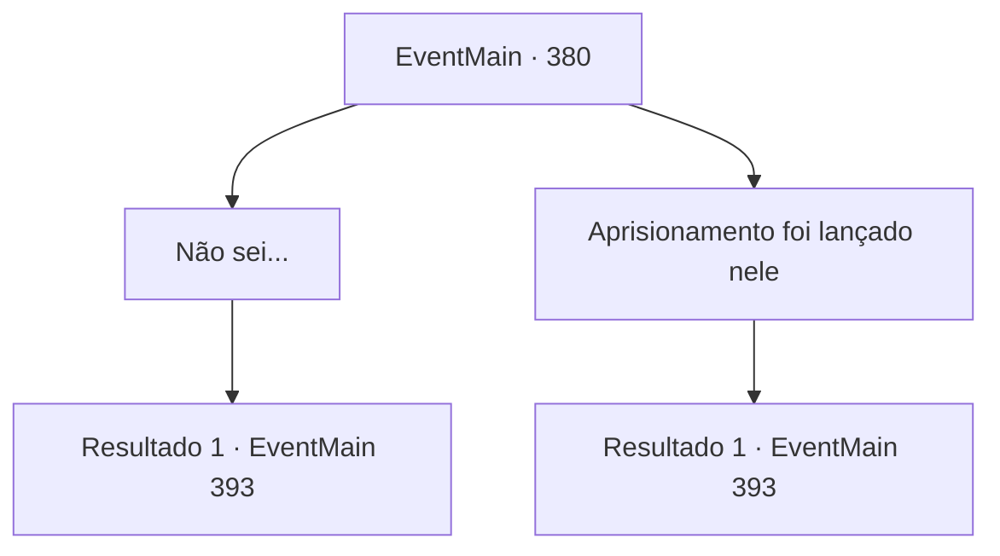

# Eventos principais · 380

[Índice da tabela](index.md) · [Índice geral](../index.md)

ID: `pt:EventMain:380` · Fonte: `EventMain4` · Versão: 1.2.47.

Mapeamento estático dos arquivos; a disponibilidade e a execução dependem do estado da run.

## Texto do evento

*Sem texto no arquivo.*

## Dados de entrada

```json
{
  "id": 380,
  "grade": 1,
  "normalGoal": "",
  "required": ""
}
```

## Mapa das escolhas



## Escolhas e resultados

### Escolha 1

Não sei...

Requisitos e outros campos da escolha:

```json
{
  "required": ""
}
```

#### Resultado 1.1

A freira pega o cubo das suas mãos e o observa. Em seguida, ela entrega o cubo para uma mulher de cabelos azuis, pedindo uma avaliação. 

 "Irmã Yan. Se você pudesse gentilmente inspecionar o que é esse cubo."

 A senhora chamada Yan dá uma olhada de perto no cubo aqui e ali, e chega a um veredicto. 

 "Ele tem uma Gaiola de Força lançada nele."

 A freira sorri e responde. 

 "...Se você pudesse nos fornecer uma explicação mais detalhada, por favor."

 Yan explica o que é uma Gaiola de Força, e depois de ouvir sua explicação, a freira acena com a cabeça e responde. 

 "Hmph. Eu consigo ver como isso vai selar efetivamente o Senhor Vampiro."

 Sem hesitar, ela caminha em direção ao portão do castelo. Depois de rezar por um tempo, Irmã Maria reúne todas as suas forças e abre o portão do castelo com sua força. O portão, feito de aço branco, cede à sua força bruta, e os mercenários invadem o castelo com alvoroço. Ao mesmo tempo, vampiros voam de todos os lados do castelo, com seus olhos ardendo em vermelho. Lutas começam em todos os lugares.

Continuação registrada: [Evento 393](0393.md) na mesma tabela.

```json
{
  "required": "",
  "chance": "1",
  "nextEvent": 393,
  "type": 2,
  "reward": ""
}
```

### Escolha 2

Aprisionamento foi lançado nele

Requisitos e outros campos da escolha:

```json
{
  "required": "20_0_1|1_7_12"
}
```

#### Resultado 2.1

O seu sentido mágico diz-lhe que o cubo está imbuido de uma poderosa 'Gaiola de Força'. Parece ser um dispositivo planeado por Anton, para selar o Senhor Vampiro de uma vez por todas. Depois de ouvir-te, a freira coloca um sorriso satisfeito e fala. 

 "Hmph. Consigo ver como vai selar efetivamente o Senhor Vampiro. Parece que tens muitos talentos, jovem."

 Sem hesitar, ela caminha em direção ao portão do castelo. Depois de rezar por um tempo, Irmã Maria reúne todas as suas forças e abre o portão do castelo com a sua força. O portão, feito de aço branco, cede à sua força bruta, e os mercenários invadem o castelo com alvoroço. Ao mesmo tempo, vampiros voam de todos os lados do castelo, com os olhos ardendo em vermelho. Lutas começam por todo o lado.

Continuação registrada: [Evento 393](0393.md) na mesma tabela.

```json
{
  "required": "",
  "chance": "1",
  "nextEvent": 393,
  "type": 2,
  "reward": ""
}
```

## Referências que chegam a este evento

- [Evento 378 · escolha 1 · resultado 1](0378.md#escolha-1)
- [Evento 378 · escolha 2 · resultado 1](0378.md#escolha-2)
- [Evento 379 · escolha 1 · resultado 1](0379.md#escolha-1)
- [Evento 379 · escolha 2 · resultado 1](0379.md#escolha-2)
