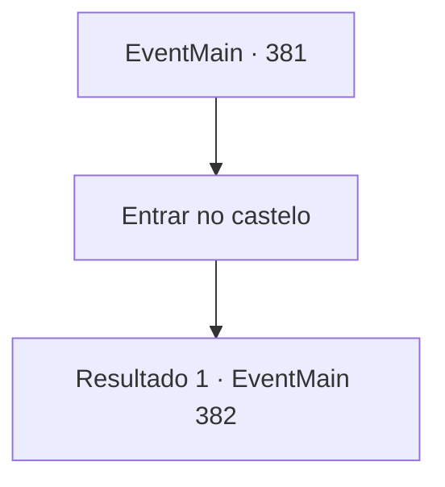

# Eventos principais · 381

[Índice da tabela](index.md) · [Índice geral](../index.md)

ID: `pt:EventMain:381` · Fonte: `EventMain4` · Versão: 1.2.47.

Mapeamento estático dos arquivos; a disponibilidade e a execução dependem do estado da run.

## Texto do evento

*Sem texto no arquivo.*

## Dados de entrada

```json
{
  "id": 381,
  "grade": 1,
  "normalGoal": "",
  "required": ""
}
```

## Mapa das escolhas



## Escolhas e resultados

### Escolha 1

Entrar no castelo

Requisitos e outros campos da escolha:

```json
{
  "required": ""
}
```

#### Resultado 1.1

Você dirige a diligência dentro do castelo com Anton. Vocês dois descem do Stagecoach e abrem o portão para o castelo, entrando no salão principal. |drawing_lordSeat| Há um velho sentado no trono e um menino que parece estar servindo -o. Depois de ver isso, Anton sussurra silenciosamente em seus ouvidos. 

 "Aquele trono ... a luz do sol cai em cima dele durante o dia, então os vampiros comuns não podem se atingir. É um assento destinado apenas ao Supremo Vampire Lord, que superou todas as fraquezas do vampirismo."

 Ele conserta os olhos para o velho no trono, mesmo quando ele está caminhando em sua direção. De pé na frente do Senhor, Anton se inclina e mostra respeito. Ele então gesticula para chamar os mercenários com as mãos.

Continuação registrada: [Evento 382](0382.md) na mesma tabela.

```json
{
  "required": "",
  "chance": "1",
  "nextEvent": 382,
  "type": 2,
  "reward": ""
}
```

## Referências que chegam a este evento

- [Evento 376 · escolha 1 · resultado 1](0376.md#escolha-1)
- [Evento 377 · escolha 1 · resultado 1](0377.md#escolha-1)
