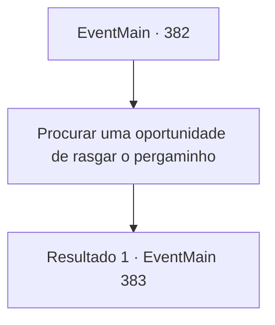

# Eventos principais · 382

[Índice da tabela](index.md) · [Índice geral](../index.md)

ID: `pt:EventMain:382` · Fonte: `EventMain4` · Versão: 1.2.47.

Mapeamento estático dos arquivos; a disponibilidade e a execução dependem do estado da run.

## Texto do evento

*Sem texto no arquivo.*

## Dados de entrada

```json
{
  "id": 382,
  "grade": 1,
  "normalGoal": "",
  "required": ""
}
```

## Mapa das escolhas



## Escolhas e resultados

### Escolha 1

Procurar uma oportunidade de rasgar o pergaminho

Requisitos e outros campos da escolha:

```json
{
  "required": ""
}
```

#### Resultado 1.1

Os servos do Senhor retornam à sala principal com as homenagens de Anton acorrentadas juntas. Após entregar as homenagens humanas, os servos saem. O Senhor os vê e sorri satisfeito. 

 "Estes estão bem frescos. Bom trabalho, Anton."

 Ele se levanta de sua cadeira e caminha lentamente em direção às homenagens. Você aproveita a oportunidade e rasga o pergaminho em pedaços. O sinalizador... deveria ter sido ativado. Mas apesar do pergaminho estar rasgado, você não vê nenhum sinalizador. Anton te encara, amaldiçoando com os olhos.

Continuação registrada: [Evento 383](0383.md) na mesma tabela.

```json
{
  "required": "",
  "chance": "1",
  "nextEvent": 383,
  "type": 2,
  "reward": "4_54_1"
}
```

## Referências que chegam a este evento

- [Evento 381 · escolha 1 · resultado 1](0381.md#escolha-1)
