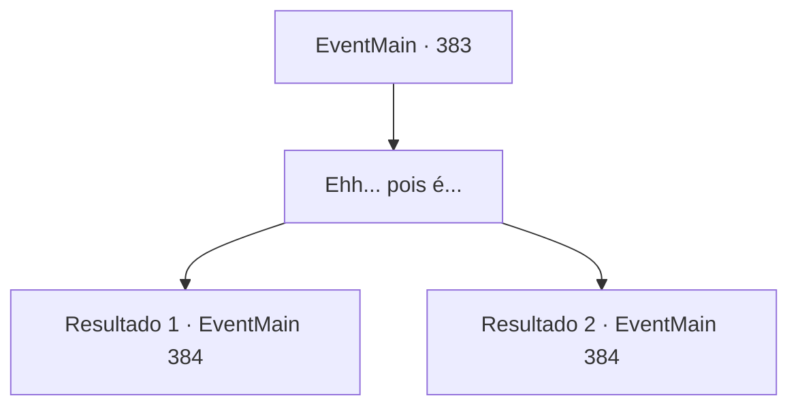

# Eventos principais · 383

[Índice da tabela](index.md) · [Índice geral](../index.md)

ID: `pt:EventMain:383` · Fonte: `EventMain4` · Versão: 1.2.47.

Mapeamento estático dos arquivos; a disponibilidade e a execução dependem do estado da run.

## Texto do evento

*Sem texto no arquivo.*

## Dados de entrada

```json
{
  "id": 383,
  "grade": 1,
  "normalGoal": "",
  "required": ""
}
```

## Mapa das escolhas



## Escolhas e resultados

### Escolha 1

Ehh... pois é...

Requisitos e outros campos da escolha:

```json
{
  "required": ""
}
```

#### Resultado 1.1

Então, o Senhor caminha entre você e Anton, falando. 

 "Algo não está indo de acordo com o seu plano, não é...? Ah, entendi. Quando você rasgou o pergaminho, era para sinalizar seus amigos escondidos na floresta, certo?"

 Anton não consegue esconder o nervosismo de seu rosto. Ele tira uma adaga de seus bolsos e grita. 

 "Merda...! Você seja o Cavaleiro da Morte!"

 Ele avança em direção ao Senhor, e o Senhor desvia de seu ataque, falando com uma voz assustadora. 

 "Mate-os."

 Atendendo ao chamado do Senhor, um Cavaleiro da Morte aparece das sombras. Ele está equipado com uma peça de armadura brilhante forjada com aço negro como breu, e tem uma espada longa prateada em suas mãos. Ele emana uma aura mortal enquanto se aproxima de você e Anton.

Continuação registrada: [Evento 384](0384.md) na mesma tabela.

```json
{
  "required": "21_3_3",
  "chance": "1",
  "nextEvent": 384,
  "type": 2,
  "reward": "6_3_54",
  "place": 10
}
```

#### Resultado 1.2

Então, o Senhor caminha entre você e Anton, falando. 

 "Algo não está indo de acordo com o seu plano, não é...? Ah, entendi. Quando você rasgou o pergaminho, era para sinalizar seus amigos escondidos na floresta, certo?"

 Anton não consegue esconder o nervosismo de seu rosto. Ele tira uma adaga de seus bolsos e grita. 

 "Merda...! Você seja o Cavaleiro da Morte!"

 Ele avança em direção ao Senhor, e o Senhor desvia de seu ataque, falando com uma voz assustadora. 

 "Mate-os."

 Atendendo ao chamado do Senhor, um Cavaleiro da Morte aparece das sombras. Ele está equipado com uma peça de armadura brilhante forjada em aço negro e tem uma espada longa prateada em suas mãos. Sua aura sagrada parece neutralizar a escuridão do Cavaleiro da Morte. Ele se contorce desconfortavelmente, mas logo avança em sua direção e de Anton, com seus olhos brilhando em azul.

Continuação registrada: [Evento 384](0384.md) na mesma tabela.

```json
{
  "required": "20_3_3",
  "chance": "1",
  "nextEvent": 384,
  "type": 2,
  "reward": "6_0_54",
  "place": 10
}
```

## Referências que chegam a este evento

- [Evento 382 · escolha 1 · resultado 1](0382.md#escolha-1)
