# Eventos principais · 384

[Índice da tabela](index.md) · [Índice geral](../index.md)

ID: `pt:EventMain:384` · Fonte: `EventMain4` · Versão: 1.2.47.

Mapeamento estático dos arquivos; a disponibilidade e a execução dependem do estado da run.

## Texto do evento

*Sem texto no arquivo.*

## Dados de entrada

```json
{
  "id": 384,
  "grade": 1,
  "normalGoal": "",
  "required": ""
}
```

## Mapa das escolhas

```mermaid
flowchart TD
  E["EventMain · 384"]
  C0["Sem texto no arquivo"]
  E --> C0
  R0_0["Resultado 1 · EventMain 385"]
  C0 --> R0_0
  C1["Sem texto no arquivo"]
  E --> C1
  R1_0["Resultado 1 · EventMain 385"]
  C1 --> R1_0
  R1_1["Resultado 2 · Destino especial -1"]
  C1 --> R1_1
  R1_2["Resultado 3 · Destino especial -1"]
  C1 --> R1_2
  R1_3["Resultado 4 · Destino especial -1"]
  C1 --> R1_3
  R1_4["Resultado 5 · Destino especial -1"]
  C1 --> R1_4
  R1_5["Resultado 6 · Destino especial -1"]
  C1 --> R1_5
  R1_6["Resultado 7 · Destino especial -1"]
  C1 --> R1_6
  R1_7["Resultado 8 · Destino especial -1"]
  C1 --> R1_7
  R1_8["Resultado 9 · Destino especial -1"]
  C1 --> R1_8
  R1_9["Resultado 10 · Destino especial -1"]
  C1 --> R1_9
  R1_10["Resultado 11 · Destino especial -1"]
  C1 --> R1_10
  R1_11["Resultado 12 · Destino especial -1"]
  C1 --> R1_11
  R1_12["Resultado 13 · Destino especial -1"]
  C1 --> R1_12
  R1_13["Resultado 14 · Destino especial -1"]
  C1 --> R1_13
  R1_14["Resultado 15 · Destino especial -1"]
  C1 --> R1_14
  R1_15["Resultado 16 · Destino especial -1"]
  C1 --> R1_15
  R1_16["Resultado 17 · Destino especial -1"]
  C1 --> R1_16
  R1_17["Resultado 18 · Destino especial -1"]
  C1 --> R1_17
```



## Escolhas e resultados

### Escolha 1

*Sem texto no arquivo; o papel dessa opção depende da interface do jogo.*

Requisitos e outros campos da escolha:

```json
{
  "required": ""
}
```

#### Resultado 1.1

Você despedaça o Cavaleiro da Morte em pedaços. Seus restos são jogados no chão, e Anton finalmente consegue matar o velho Lorde. Mas seu rosto não está radiante. 

 "Isso... isso não é o verdadeiro Lorde. É apenas um mero meio-vampiro..."

 Ele então se aproxima do menino servo, agarrando-o pelo pescoço. Anton grita onde está o Lorde, intimidando o menino. Mas então, o braço do menino perfura o peito de Anton. Um cubo inscrito com símbolos estranhos cai de Anton. O Lorde, tendo se revelado, pergunta a Anton com seus olhos brilhando em vermelho. 

 "Anton. Você sequer sabe quantos vampiros cobiçam o trono do Lorde? Nenhum vampiro escapa da minha rocha."

 Anton critica o Lorde por usar tais truques, mas o menino apenas ri. 

 "Heh. Um coelho sábio cava muitos buracos."


Continuação registrada: [Evento 385](0385.md) na mesma tabela.

```json
{
  "required": "",
  "chance": "1",
  "nextEvent": 385,
  "type": 2,
  "reward": ""
}
```

### Escolha 2

*Sem texto no arquivo; o papel dessa opção depende da interface do jogo.*

Requisitos e outros campos da escolha:

```json
{
  "required": ""
}
```

#### Resultado 2.1

Você está lutando em um impasse com o cavaleiro da morte. De repente, Anton voa rapidamente e derrota o cavaleiro da morte. 

 "Tsk... você deveria ter sido capaz de lidar com um cavaleiro da morte sozinho."

 Ele começa a dizer algo mais, mas suas palavras são interrompidas. Isso porque um pequeno braço irrompeu em seu peito. Pertence ao menino que estava ao lado do senhor. Um cubo inscrito com símbolos estranhos cai de Anton. O Senhor, tendo se revelado, pergunta a Anton com os olhos brilhando em vermelho. 

 "Anton. Você sequer sabe quantos vampiros cobiçam o trono do Lorde? Nenhum vampiro escapa da minha rocha."

  Anton critica o Lorde por usar tais truques, mas o menino apenas ri.  

 "Heh. Um coelho sábio cava muitos buracos."


Continuação registrada: [Evento 385](0385.md) na mesma tabela.

```json
{
  "required": "1_0_2|1_1_2",
  "chance": "1",
  "nextEvent": 385,
  "type": 2,
  "reward": "0_0_-1|0_1_-1"
}
```

#### Resultado 2.2

O Cavaleiro da Morte corta sua cabeça. Bem antes de sua consciência desaparecer, você vê seu corpo sem cabeça colapsando. Mas então, você ouve os mercenários de Ziwa correndo em sua direção.

Continuação registrada: [Destino especial `-1`](../destinos-especiais.md).

```json
{
  "required": "2_0_2|24_1_1",
  "chance": "1",
  "nextEvent": -1,
  "type": 2,
  "reward": "0_0_-1|0_1_-1|15_4_0|15_4_14"
}
```

#### Resultado 2.3

O Cavaleiro da Morte corta sua cabeça. Bem antes de sua consciência desaparecer, você vê seu corpo sem cabeça colapsando. Mas então, você ouve os mercenários de Ziwa correndo em sua direção.

Continuação registrada: [Destino especial `-1`](../destinos-especiais.md).

```json
{
  "required": "2_0_2|23_1_1",
  "chance": "1",
  "nextEvent": -1,
  "type": 2,
  "reward": "0_0_-1|0_1_-1|15_4_0|15_4_14|25_8_1"
}
```

#### Resultado 2.4

O Cavaleiro da Morte corta sua cabeça. Bem antes de sua consciência desaparecer, você vê seu corpo sem cabeça colapsando. Mas então, você ouve os mercenários de Ziwa correndo em sua direção.

Continuação registrada: [Destino especial `-1`](../destinos-especiais.md).

```json
{
  "required": "2_0_2|23_1_1",
  "chance": "1",
  "nextEvent": -1,
  "type": 2,
  "reward": "0_0_-1|0_1_-1|15_4_0|15_4_14|25_8_1"
}
```

#### Resultado 2.5

O Cavaleiro da Morte corta sua cabeça. Bem antes de sua consciência desaparecer, você vê seu corpo sem cabeça colapsando. Mas então, você ouve os mercenários de Ziwa correndo em sua direção.

Continuação registrada: [Destino especial `-1`](../destinos-especiais.md).

```json
{
  "required": "2_0_2|23_1_1",
  "chance": "1",
  "nextEvent": -1,
  "type": 2,
  "reward": "0_0_-1|0_1_-1|15_4_0|15_4_14|25_8_1"
}
```

#### Resultado 2.6

O Cavaleiro da Morte corta sua cabeça. Bem antes de sua consciência desaparecer, você vê seu corpo sem cabeça colapsando. Mas então, você ouve os mercenários de Ziwa correndo em sua direção.

Continuação registrada: [Destino especial `-1`](../destinos-especiais.md).

```json
{
  "required": "2_0_2|23_1_1",
  "chance": "1",
  "nextEvent": -1,
  "type": 2,
  "reward": "0_0_-1|0_1_-1|15_4_0|15_4_14|25_8_1"
}
```

#### Resultado 2.7

O Cavaleiro da Morte corta sua cabeça. Bem antes de sua consciência desaparecer, você vê seu corpo sem cabeça colapsando. Mas então, você ouve os mercenários de Ziwa correndo em sua direção.

Continuação registrada: [Destino especial `-1`](../destinos-especiais.md).

```json
{
  "required": "2_0_2|23_1_1",
  "chance": "1",
  "nextEvent": -1,
  "type": 2,
  "reward": "0_0_-1|0_1_-1|15_4_0|15_4_14|25_8_1"
}
```

#### Resultado 2.8

O Cavaleiro da Morte corta sua cabeça. Bem antes de sua consciência desaparecer, você vê seu corpo sem cabeça colapsando. Mas então, você ouve os mercenários de Ziwa correndo em sua direção.

Continuação registrada: [Destino especial `-1`](../destinos-especiais.md).

```json
{
  "required": "2_0_2|23_1_1",
  "chance": "1",
  "nextEvent": -1,
  "type": 2,
  "reward": "0_0_-1|0_1_-1|15_4_0|15_4_14|25_8_1"
}
```

#### Resultado 2.9

O Cavaleiro da Morte corta sua cabeça. Bem antes de sua consciência desaparecer, você vê seu corpo sem cabeça colapsando. Mas então, você ouve os mercenários de Ziwa correndo em sua direção.

Continuação registrada: [Destino especial `-1`](../destinos-especiais.md).

```json
{
  "required": "2_0_2|23_1_1",
  "chance": "1",
  "nextEvent": -1,
  "type": 2,
  "reward": "0_0_-1|0_1_-1|15_4_0|15_4_14|25_8_1"
}
```

#### Resultado 2.10

O Cavaleiro da Morte corta sua cabeça. Bem antes de sua consciência desaparecer, você vê seu corpo sem cabeça colapsando. Mas então, você ouve os mercenários de Ziwa correndo em sua direção.

Continuação registrada: [Destino especial `-1`](../destinos-especiais.md).

```json
{
  "required": "2_0_2|23_1_1",
  "chance": "1",
  "nextEvent": -1,
  "type": 2,
  "reward": "0_0_-1|0_1_-1|15_4_0|15_4_14|25_8_1"
}
```

#### Resultado 2.11

O Cavaleiro da Morte corta sua cabeça. Bem antes de sua consciência desaparecer, você vê seu corpo sem cabeça colapsando. Mas então, você ouve os mercenários de Ziwa correndo em sua direção.

Continuação registrada: [Destino especial `-1`](../destinos-especiais.md).

```json
{
  "required": "2_1_2|23_1_1",
  "chance": "1",
  "nextEvent": -1,
  "type": 2,
  "reward": "0_0_-1|0_1_-1|15_4_0|15_4_14|25_8_1"
}
```

#### Resultado 2.12

O Cavaleiro da Morte corta sua cabeça. Bem antes de sua consciência desaparecer, você vê seu corpo sem cabeça colapsando. Mas então, você ouve os mercenários de Ziwa correndo em sua direção.

Continuação registrada: [Destino especial `-1`](../destinos-especiais.md).

```json
{
  "required": "2_1_2|23_1_1",
  "chance": "1",
  "nextEvent": -1,
  "type": 2,
  "reward": "0_0_-1|0_1_-1|15_4_0|15_4_14|25_8_1"
}
```

#### Resultado 2.13

O Cavaleiro da Morte corta sua cabeça. Bem antes de sua consciência desaparecer, você vê seu corpo sem cabeça colapsando. Mas então, você ouve os mercenários de Ziwa correndo em sua direção.

Continuação registrada: [Destino especial `-1`](../destinos-especiais.md).

```json
{
  "required": "2_1_2|23_1_1",
  "chance": "1",
  "nextEvent": -1,
  "type": 2,
  "reward": "0_0_-1|0_1_-1|15_4_0|15_4_14|25_8_1"
}
```

#### Resultado 2.14

O Cavaleiro da Morte corta sua cabeça. Bem antes de sua consciência desaparecer, você vê seu corpo sem cabeça colapsando. Mas então, você ouve os mercenários de Ziwa correndo em sua direção.

Continuação registrada: [Destino especial `-1`](../destinos-especiais.md).

```json
{
  "required": "2_1_2|23_1_1",
  "chance": "1",
  "nextEvent": -1,
  "type": 2,
  "reward": "0_0_-1|0_1_-1|15_4_0|15_4_14|25_8_1"
}
```

#### Resultado 2.15

O Cavaleiro da Morte corta sua cabeça. Bem antes de sua consciência desaparecer, você vê seu corpo sem cabeça colapsando. Mas então, você ouve os mercenários de Ziwa correndo em sua direção.

Continuação registrada: [Destino especial `-1`](../destinos-especiais.md).

```json
{
  "required": "2_1_2|23_1_1",
  "chance": "1",
  "nextEvent": -1,
  "type": 2,
  "reward": "0_0_-1|0_1_-1|15_4_0|15_4_14|25_8_1"
}
```

#### Resultado 2.16

O Cavaleiro da Morte corta sua cabeça. Bem antes de sua consciência desaparecer, você vê seu corpo sem cabeça colapsando. Mas então, você ouve os mercenários de Ziwa correndo em sua direção.

Continuação registrada: [Destino especial `-1`](../destinos-especiais.md).

```json
{
  "required": "2_1_2|23_1_1",
  "chance": "1",
  "nextEvent": -1,
  "type": 2,
  "reward": "0_0_-1|0_1_-1|15_4_0|15_4_14|25_8_1"
}
```

#### Resultado 2.17

O Cavaleiro da Morte corta sua cabeça. Bem antes de sua consciência desaparecer, você vê seu corpo sem cabeça colapsando. Mas então, você ouve os mercenários de Ziwa correndo em sua direção.

Continuação registrada: [Destino especial `-1`](../destinos-especiais.md).

```json
{
  "required": "2_1_2|23_1_1",
  "chance": "1",
  "nextEvent": -1,
  "type": 2,
  "reward": "0_0_-1|0_1_-1|15_4_0|15_4_14|25_8_1"
}
```

#### Resultado 2.18

O Cavaleiro da Morte corta sua cabeça. Bem antes de sua consciência desaparecer, você vê seu corpo sem cabeça colapsando. Mas então, você ouve os mercenários de Ziwa correndo em sua direção.

Continuação registrada: [Destino especial `-1`](../destinos-especiais.md).

```json
{
  "required": "2_1_2|23_1_1",
  "chance": "1",
  "nextEvent": -1,
  "type": 2,
  "reward": "0_0_-1|0_1_-1|15_4_0|15_4_14|25_8_1"
}
```

## Referências que chegam a este evento

- [Evento 383 · escolha 1 · resultado 1](0383.md#escolha-1)
- [Evento 383 · escolha 1 · resultado 2](0383.md#escolha-1)
