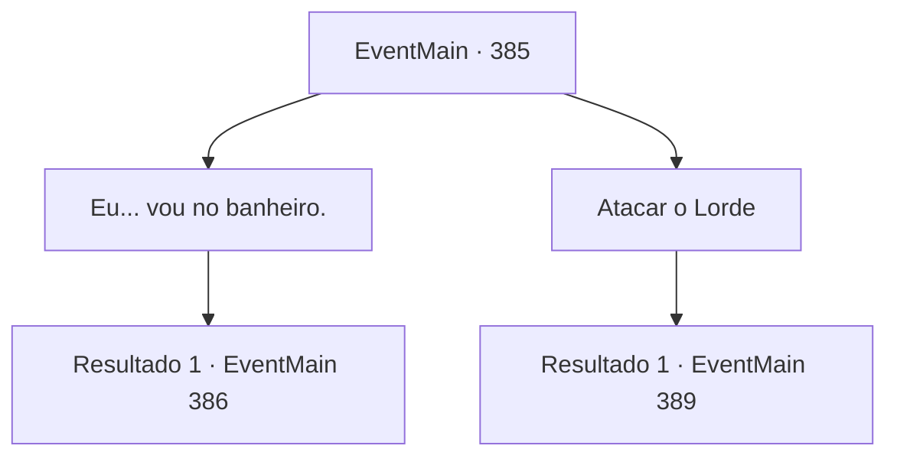

# Eventos principais · 385

[Índice da tabela](index.md) · [Índice geral](../index.md)

ID: `pt:EventMain:385` · Fonte: `EventMain4` · Versão: 1.2.47.

Mapeamento estático dos arquivos; a disponibilidade e a execução dependem do estado da run.

## Texto do evento

*Sem texto no arquivo.*

## Dados de entrada

```json
{
  "id": 385,
  "grade": 1,
  "normalGoal": "",
  "required": ""
}
```

## Mapa das escolhas



## Escolhas e resultados

### Escolha 1

Eu... vou no banheiro.

Requisitos e outros campos da escolha:

```json
{
  "required": ""
}
```

#### Resultado 1.1

Enquanto você dá passos lentos para trás, o portão se fecha e o Senhor caminha em sua direção. 

 "Você viu minha verdadeira identidade e receio que não posso simplesmente deixar você ir. Você parece muito capaz... Se estiver disposto a substituir Anton como meu campeão, concederei a você uma parte do meu poder e o levarei sob meu comando. Claro, se você não quiser fazer isso..."

 Ele olha para Anton, caído no chão. Seu corpo se contorce de dor, como se estivesse próximo da rigidez cadavérica.

Continuação registrada: [Evento 386](0386.md) na mesma tabela.

```json
{
  "required": "",
  "chance": "1",
  "nextEvent": 386,
  "type": 2,
  "reward": ""
}
```

### Escolha 2

Atacar o Lorde

Requisitos e outros campos da escolha:

```json
{
  "required": ""
}
```

#### Resultado 2.1

O Senhor tenta dizer algo, mas seus ataques não o deixam terminar. O garoto de corpo minúsculo emite uma aura forte e horrível, e lesas em você. Seus olhos brilham de vermelho, como se estivesse queimando por dentro. 

 "Você é exatamente o tipo de criaturas que eu mais odeio ... as que não aprendem o lugar deles no mundo e cruzam sua linha."|drawing_VampLord| O Senhor muda da forma de um menino para um monstro gigante, revelando sua verdadeira forma. Ele voa em sua direção com suas enormes asas.

Continuação registrada: [Evento 389](0389.md) na mesma tabela.

```json
{
  "required": "",
  "chance": "1",
  "nextEvent": 389,
  "type": 2,
  "reward": "6_0_41",
  "place": 10
}
```

## Referências que chegam a este evento

- [Evento 384 · escolha 1 · resultado 1](0384.md#escolha-1)
- [Evento 384 · escolha 2 · resultado 1](0384.md#escolha-2)
