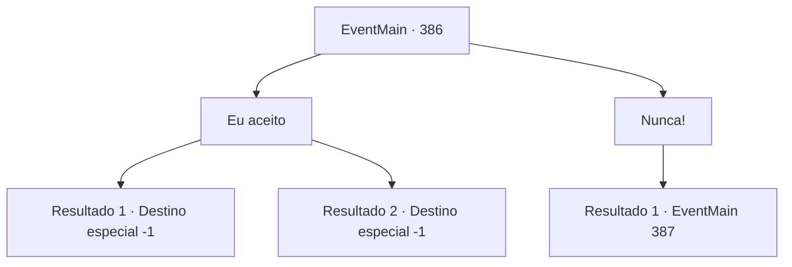

# Eventos principais · 386

[Índice da tabela](index.md) · [Índice geral](../index.md)

ID: `pt:EventMain:386` · Fonte: `EventMain4` · Versão: 1.2.47.

Mapeamento estático dos arquivos; a disponibilidade e a execução dependem do estado da run.

## Texto do evento

*Sem texto no arquivo.*

## Dados de entrada

```json
{
  "id": 386,
  "grade": 1,
  "normalGoal": "",
  "required": ""
}
```

## Mapa das escolhas



## Escolhas e resultados

### Escolha 1

Eu aceito 

Requisitos e outros campos da escolha:

```json
{
  "required": ""
}
```

#### Resultado 1.1

O menino pisa no crânio de Anton, esmagando-o em uma massa ensanguentada e se aproxima de você. Em seguida, ele morde o seu pescoço. Você sente seu sangue sendo drenado. Os poderes do Senhor preenchem suas veias vazias. E assim, você se torna a posse do Senhor.

Continuação registrada: [Destino especial `-1`](../destinos-especiais.md).

```json
{
  "required": "24_1_1",
  "chance": "1",
  "nextEvent": -1,
  "type": 2,
  "reward": "15_4_4|15_4_10"
}
```

#### Resultado 1.2

O menino pisa no crânio de Anton, esmagando-o em uma massa ensanguentada e se aproxima de você. Em seguida, ele morde o seu pescoço. Você sente seu sangue sendo drenado. Os poderes do Senhor preenchem suas veias vazias. E assim, você se torna a posse do Senhor.

Continuação registrada: [Destino especial `-1`](../destinos-especiais.md).

```json
{
  "required": "23_1_1",
  "chance": "1",
  "nextEvent": -1,
  "type": 2,
  "reward": "15_4_22|15_4_10|29_0_7|29_5_5|29_5_7|29_5_8|29_7_9|29_9_2|29_9_4|29_9_6|29_11_4|29_11_14|29_11_18"
}
```

### Escolha 2

Nunca!

Requisitos e outros campos da escolha:

```json
{
  "required": ""
}
```

#### Resultado 2.1

O garoto pisa no crânio de Anton, esmagando -o a uma gosma sangrenta. Ele então se transforma em um monstro gigante, revelando sua verdadeira forma. |drawing_VampLord| Ele voa em sua direção com suas enormes asas. 

Continuação registrada: [Evento 387](0387.md) na mesma tabela.

```json
{
  "required": "",
  "chance": "1",
  "nextEvent": 387,
  "type": 2,
  "reward": "6_0_41",
  "place": 10
}
```

## Referências que chegam a este evento

- [Evento 385 · escolha 1 · resultado 1](0385.md#escolha-1)
