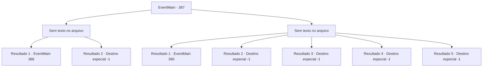

# Eventos principais · 387

[Índice da tabela](index.md) · [Índice geral](../index.md)

ID: `pt:EventMain:387` · Fonte: `EventMain4` · Versão: 1.2.47.

Mapeamento estático dos arquivos; a disponibilidade e a execução dependem do estado da run.

## Texto do evento

*Sem texto no arquivo.*

## Dados de entrada

```json
{
  "id": 387,
  "grade": 1,
  "normalGoal": "",
  "required": ""
}
```

## Mapa das escolhas



## Escolhas e resultados

### Escolha 1

*Sem texto no arquivo; o papel dessa opção depende da interface do jogo.*

Requisitos e outros campos da escolha:

```json
{
  "required": ""
}
```

#### Resultado 1.1

Você mal consegue derrotar o Senhor após uma longa luta. Você o termina com a espada longa de prata do Cavaleiro da Morte, perfurando o peito nas paredes. Mas ele não morre e, em vez disso, se dissipa no ar como a névoa. Você percebe que o cubo que Anton estava segurando é alimentado com um feitiço chamado 'gaiola de força'. Você corre apressadamente em direção ao cubo e o pega. |drawing_openCube| Ao abrir o cubo, a magia da caixa é ativada com uma faísca azul. O Senhor, transformado em névoa, é sugado dentro do cubo. Depois de chupar a névoa do Senhor, o cubo se fecha e não brilha mais. Então, o portão se abre e os mercenários de Ziwa Storm in. A freira vem para verificar suas feridas. 

 "Você está bem? Sinto muito ... não chegamos a tempo. Você machuca?"

 Você diz a eles que selou com sucesso o Senhor dentro do cubo após uma batalha feita. Cada um deles se assusta depois de ouvir sua história. A irmã Maria dá um tapinha nos ombros e o encoraja. 

 "Trabalho muito impressionante, {1}. Se você não se importar, manteremos esse cubo seguro, sob o nome de mercenários de Ziwa."


Continuação registrada: [Evento 388](0388.md) na mesma tabela.

```json
{
  "required": "20_0_3",
  "chance": "1",
  "nextEvent": 388,
  "type": 2,
  "reward": "3_233_1"
}
```

#### Resultado 1.2

Você mal consegue derrotar o Senhor após uma longa luta. Você o termina com a espada longa de prata do Cavaleiro da Morte, perfurando o peito nas paredes. Naquele momento, os mercenários de Ziwa invadiram o salão principal. A irmã Maria olha para o Senhor, empalada nas paredes e grita. 

 "É o Senhor dos Vampiros ...! O Senhor está lá!"

 Então, o Lord vampiro tenta se transformar em névoa e fugir. A irmã Maris grita o nome de Yan, e ela pega o cubo do chão. |drawing_openCube| Quando ela abre o cubo, a magia da caixa é ativada com uma faísca azul. O Senhor, transformado em névoa, é sugado dentro do cubo. Depois de chupar a névoa do Senhor, o cubo se fecha e não brilha mais. Os mercenários gritam na vitória, esquecendo a dor de suas feridas. 

 "Bom trabalho, todos. E você, {1}. Trabalho muito impressionante também. Manteremos este cubo seguro, sob o nome de mercenários de Ziwa."

 Yan entrega o cubo com o Senhor selado para Maria. Outros mercenários Obrigado quando você sai. Você carrega Fiana, que adormece, nas costas e deixa o castelo branco gelado.

Continuação registrada: [Destino especial `-1`](../destinos-especiais.md).

```json
{
  "required": "21_0_3",
  "chance": "1",
  "nextEvent": -1,
  "type": 2,
  "reward": "15_4_5"
}
```

### Escolha 2

*Sem texto no arquivo; o papel dessa opção depende da interface do jogo.*

Requisitos e outros campos da escolha:

```json
{
  "required": ""
}
```

#### Resultado 2.1

Você desmorona sob os ataques do Senhor, incapaz de suportar o dano. Então, o portão se abre e os Mercenários de Ziwa invadem o salão principal. Irmã Maria, liderando os mercenários, grita uma ordem. 

 "ATAQUE!"

 Os mercenários avançam, cada um deles gritando seus próprios gritos de guerra. A batalha entre os mercenários e o Senhor Vampiro começa. Irmã Maria te joga uma poção e grita. 

 "Rápido, beba isso e se levante logo!"

 Ela termina, arregaça as mangas e avança em direção ao Senhor.

Continuação registrada: [Evento 390](0390.md) na mesma tabela.

```json
{
  "required": "1_0_2|1_1_2",
  "chance": "1",
  "nextEvent": 390,
  "type": 2,
  "reward": "0_0_-1|0_1_-1|3_36_1|3_37_1|6_2_41",
  "place": 10
}
```

#### Resultado 2.2

O Senhor te levanta do chão. Ele então crava suas presas em seu pescoço. Você sente seu sangue sendo drenado. Os poderes do Senhor preenchem suas veias vazias. E assim, você se torna a posse do Senhor.

Continuação registrada: [Destino especial `-1`](../destinos-especiais.md).

```json
{
  "required": "2_0_2|24_1_1",
  "chance": "1",
  "nextEvent": -1,
  "type": 2,
  "reward": "15_4_4|0_0_-1|0_1_-1|29_11_15|29_11_11"
}
```

#### Resultado 2.3

O Senhor te levanta do chão. Ele então crava suas presas em seu pescoço. Você sente seu sangue sendo drenado. Os poderes do Senhor preenchem suas veias vazias. E assim, você se torna a posse do Senhor.

Continuação registrada: [Destino especial `-1`](../destinos-especiais.md).

```json
{
  "required": "2_1_2|24_1_1",
  "chance": "1",
  "nextEvent": -1,
  "type": 2,
  "reward": "15_4_4|0_0_-1|0_1_-1|29_11_15|29_11_11"
}
```

#### Resultado 2.4

O Senhor te levanta do chão. Ele então crava suas presas em seu pescoço. Você sente seu sangue sendo drenado. Os poderes do Senhor preenchem suas veias vazias. E assim, você se torna a posse do Senhor.

Continuação registrada: [Destino especial `-1`](../destinos-especiais.md).

```json
{
  "required": "2_0_2|23_1_1",
  "chance": "1",
  "nextEvent": -1,
  "type": 2,
  "reward": "15_4_22|0_0_-1|0_1_-1|25_8_1"
}
```

#### Resultado 2.5

O Senhor te levanta do chão. Ele então crava suas presas em seu pescoço. Você sente seu sangue sendo drenado. Os poderes do Senhor preenchem suas veias vazias. E assim, você se torna a posse do Senhor.

Continuação registrada: [Destino especial `-1`](../destinos-especiais.md).

```json
{
  "required": "2_1_2|23_1_1",
  "chance": "1",
  "nextEvent": -1,
  "type": 2,
  "reward": "15_4_22|0_0_-1|0_1_-1|25_8_1"
}
```

## Referências que chegam a este evento

- [Evento 386 · escolha 2 · resultado 1](0386.md#escolha-2)
