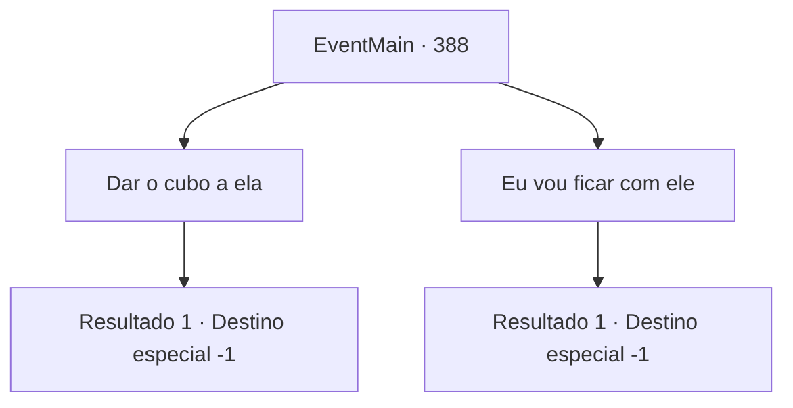

# Eventos principais · 388

[Índice da tabela](index.md) · [Índice geral](../index.md)

ID: `pt:EventMain:388` · Fonte: `EventMain4` · Versão: 1.2.47.

Mapeamento estático dos arquivos; a disponibilidade e a execução dependem do estado da run.

## Texto do evento

*Sem texto no arquivo.*

## Dados de entrada

```json
{
  "id": 388,
  "grade": 1,
  "normalGoal": "",
  "required": ""
}
```

## Mapa das escolhas



## Escolhas e resultados

### Escolha 1

Dar o cubo a ela

Requisitos e outros campos da escolha:

```json
{
  "required": ""
}
```

#### Resultado 1.1

Você entrega o cubo para a freira. Ela observa o cubo e sorri felizmente. 

 "Devemos-lhe muito, {1}. Obrigado."

 Outros mercenários agradecem enquanto você sai. Você carrega Fiana, que está profundamente adormecida, nas costas e deixa o castelo branco e gelado.

Continuação registrada: [Destino especial `-1`](../destinos-especiais.md).

```json
{
  "required": "",
  "chance": "1",
  "nextEvent": -1,
  "type": 2,
  "reward": "15_4_5|4_233_1|0_4_500"
}
```

### Escolha 2

Eu vou ficar com ele

Requisitos e outros campos da escolha:

```json
{
  "required": ""
}
```

#### Resultado 2.1

Você se recusa a entregar o cubo para ela. Ela parece descontente, mas ainda te ouve. 

 "Hm... Sim, eu entendo. Por que não. Mas devo te avisar, você deve ter muito cuidado em mantê-lo seguro. Pelo menos pelas próximas 24 horas... NÃO o abra."

 Você dá uma olhada no cubo e assente. Você carrega Fiana, que está profundamente adormecida, em suas costas e sai do castelo branco e gelado.

Continuação registrada: [Destino especial `-1`](../destinos-especiais.md).

```json
{
  "required": "",
  "chance": "1",
  "nextEvent": -1,
  "type": 2,
  "reward": "15_4_3"
}
```

## Referências que chegam a este evento

- [Evento 387 · escolha 1 · resultado 1](0387.md#escolha-1)
- [Evento 392 · escolha 1 · resultado 1](0392.md#escolha-1)
