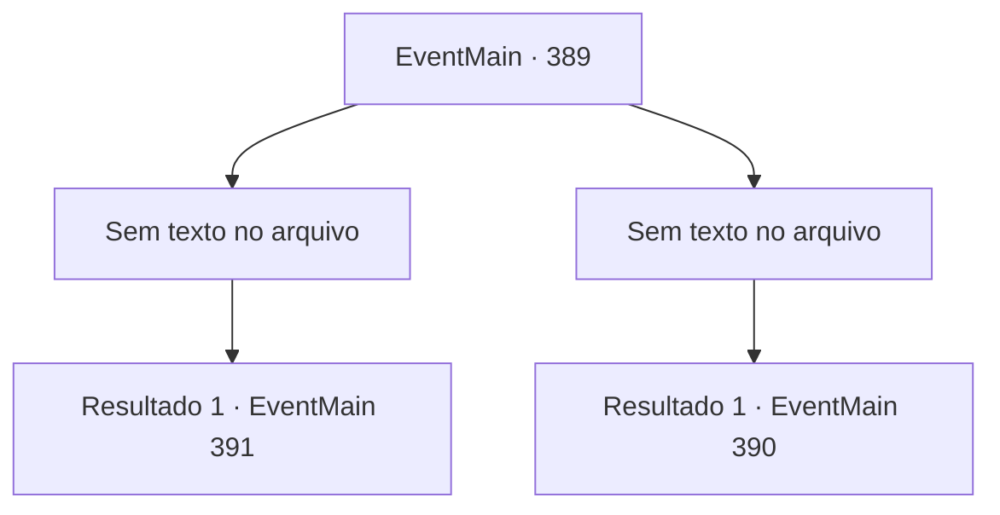

# Eventos principais · 389

[Índice da tabela](index.md) · [Índice geral](../index.md)

ID: `pt:EventMain:389` · Fonte: `EventMain4` · Versão: 1.2.47.

Mapeamento estático dos arquivos; a disponibilidade e a execução dependem do estado da run.

## Texto do evento

*Sem texto no arquivo.*

## Dados de entrada

```json
{
  "id": 389,
  "grade": 1,
  "normalGoal": "",
  "required": ""
}
```

## Mapa das escolhas



## Escolhas e resultados

### Escolha 1

*Sem texto no arquivo; o papel dessa opção depende da interface do jogo.*

Requisitos e outros campos da escolha:

```json
{
  "required": ""
}
```

#### Resultado 1.1

Você mal consegue derrotar o Senhor após uma longa luta. Você o termina com a espada longa de prata do Cavaleiro da Morte, perfurando o peito nas paredes. Mas, em vez de morrer, ele se dissipa no ar como a névoa. Então Anton, que milagrosamente se recuperou de suas feridas, grita com você para abrir o cubo. Você pega o cubo do chão. |drawing_openCube| Ao abrir o cubo, a magia da caixa é ativada com uma faísca azul. O Senhor, transformado em névoa, é sugado dentro do cubo. Depois de chupar a névoa do Senhor, o cubo se fecha e não brilha mais. 

 "Haha ... nós realmente selamos o senhor do vampiro ... ha ... hahahaha !!"

 Anton sorri alegremente e pede que você entregue o cubo.

Continuação registrada: [Evento 391](0391.md) na mesma tabela.

```json
{
  "required": "",
  "chance": "1",
  "nextEvent": 391,
  "type": 2,
  "reward": "3_233_1"
}
```

### Escolha 2

*Sem texto no arquivo; o papel dessa opção depende da interface do jogo.*

Requisitos e outros campos da escolha:

```json
{
  "required": ""
}
```

#### Resultado 2.1

Você desmorona sob os ataques do Senhor, incapaz de suportar o dano. Então, o portão se abre e os Mercenários de Ziwa invadem o salão principal. Irmã Maria, liderando os mercenários, grita uma ordem. 

 "AVANÇAR!"

 Os mercenários avançam, cada um deles gritando seus próprios gritos de guerra. A batalha entre os mercenários e o Senhor Vampiro começa. Irmã Maria te joga uma poção e grita. 

 "Rápido, beba isso e se levante logo!"

 Ela termina, arregaça as mangas e avança em direção ao Senhor.

Continuação registrada: [Evento 390](0390.md) na mesma tabela.

```json
{
  "required": "",
  "chance": "1",
  "nextEvent": 390,
  "type": 2,
  "reward": "6_2_41",
  "place": 10
}
```

## Referências que chegam a este evento

- [Evento 385 · escolha 2 · resultado 1](0385.md#escolha-2)
