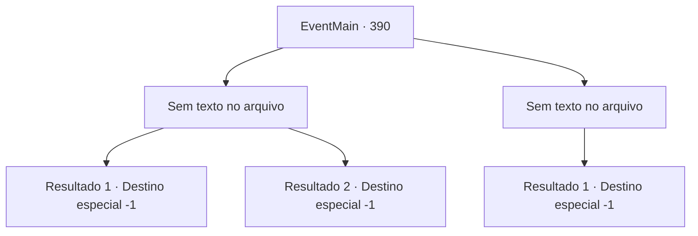

# Eventos principais · 390

[Índice da tabela](index.md) · [Índice geral](../index.md)

ID: `pt:EventMain:390` · Fonte: `EventMain4` · Versão: 1.2.47.

Mapeamento estático dos arquivos; a disponibilidade e a execução dependem do estado da run.

## Texto do evento

*Sem texto no arquivo.*

## Dados de entrada

```json
{
  "id": 390,
  "grade": 1,
  "normalGoal": "",
  "required": ""
}
```

## Mapa das escolhas



## Escolhas e resultados

### Escolha 1

*Sem texto no arquivo; o papel dessa opção depende da interface do jogo.*

Requisitos e outros campos da escolha:

```json
{
  "required": ""
}
```

#### Resultado 1.1

Você e os mercenários lutam contra o Senhor dos Vampiros. Finalmente, a irmã Maria oblitera a mandíbula do Senhor com seu espanador de articulação prateada. Mas, em vez de morrer, ele se dissipa no ar como a névoa. Você percebe que o cubo que Anton caiu está imbuído de uma magia chamada 'Force Cage'. Você percebe que agora é o momento perfeito para abrir o cubo. Você pega o cubo no chão. |drawing_openCube| Quando você abre o cubo, a magia da caixa é ativada com uma faísca azul. O Senhor, transformado em névoa, é sugado dentro do cubo. Depois de chupar a névoa do Senhor, o cubo se fecha e não brilha mais. Os mercenários gritam na vitória, esquecendo a dor de suas feridas. 

 "Bom trabalho, todos. E você, {1}. Trabalho muito impressionante também. Manteremos este cubo seguro, sob o nome de mercenários de Ziwa."

 Você entrega o cubo com o Senhor selado para Maria. Outros mercenários Obrigado quando você sai. Você carrega Fiana, que adormece, nas costas e deixa o castelo branco gelado.

Continuação registrada: [Destino especial `-1`](../destinos-especiais.md).

```json
{
  "required": "20_0_3",
  "chance": "1",
  "nextEvent": -1,
  "type": 2,
  "reward": "15_4_5"
}
```

#### Resultado 1.2

Você e os mercenários lutam contra o Senhor dos Vampiros. Finalmente, a irmã Maria oblitera a mandíbula do Senhor com seu espanador de articulação prateada. Mas, em vez de morrer, ele se dissipa no ar como a névoa. Então, um dos mercenários, uma senhora de cabelos azuis, pega o cubo do chão. |drawing_openCube| Quando ela abre o cubo, a magia da caixa é ativada com uma faísca azul. O Senhor, transformado em névoa, é sugado dentro do cubo. Depois de chupar a névoa do Senhor, o cubo se fecha e não brilha mais. Os mercenários gritam na vitória, esquecendo a dor de suas feridas. 

 "Bom trabalho, todos. E você, {1}. Trabalho muito impressionante também. Manteremos este cubo seguro, sob o nome de mercenários de Ziwa."

 Você entrega o cubo com o Senhor selado para Maria. Outros mercenários Obrigado quando você sai. Você carrega Fiana, que adormece, nas costas e deixa o castelo branco gelado.

Continuação registrada: [Destino especial `-1`](../destinos-especiais.md).

```json
{
  "required": "21_0_3",
  "chance": "1",
  "nextEvent": -1,
  "type": 2,
  "reward": "15_4_5"
}
```

### Escolha 2

*Sem texto no arquivo; o papel dessa opção depende da interface do jogo.*

Requisitos e outros campos da escolha:

```json
{
  "required": ""
}
```

#### Resultado 2.1

Você e os mercenários lutam contra o Senhor Vampiro. Mas o Senhor demonstra uma força enorme, jogando os mercenários para o ar. Ele então quebra as janelas próximas e pula para fora. Você tenta segui-lo, mas ele já desapareceu na floresta escura. Irmã Maria te dá tapinhas nos ombros e fala. 

 "Nós o perdemos desta vez... mas haverá outra chance. {1}, bom trabalho."

 Ela tira um cigarro do bolso e o acende. Então ela reúne os outros mercenários. 

 "Bom trabalho, irmãos e irmãs. Devemos voltar para a ilha e cuidar dos feridos."

 Você carrega Fiana, que está profundamente adormecida, em suas costas e deixa o castelo branco e gelado.

Continuação registrada: [Destino especial `-1`](../destinos-especiais.md).

```json
{
  "required": "",
  "chance": "1",
  "nextEvent": -1,
  "type": 2,
  "reward": "15_4_10|15_4_13"
}
```

## Referências que chegam a este evento

- [Evento 387 · escolha 2 · resultado 1](0387.md#escolha-2)
- [Evento 389 · escolha 2 · resultado 1](0389.md#escolha-2)
