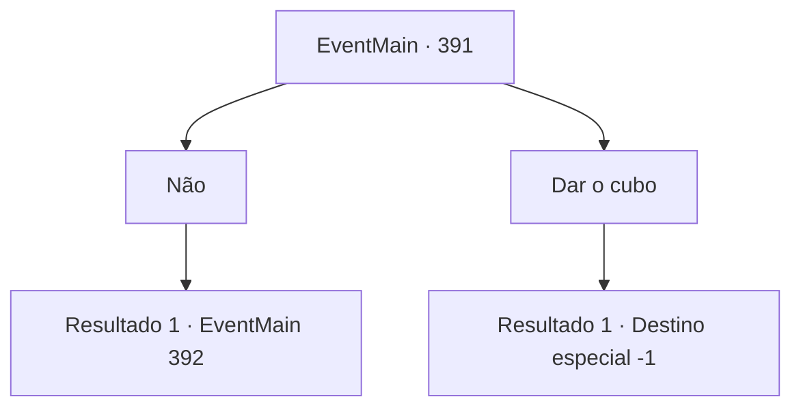

# Eventos principais · 391

[Índice da tabela](index.md) · [Índice geral](../index.md)

ID: `pt:EventMain:391` · Fonte: `EventMain4` · Versão: 1.2.47.

Mapeamento estático dos arquivos; a disponibilidade e a execução dependem do estado da run.

## Texto do evento

*Sem texto no arquivo.*

## Dados de entrada

```json
{
  "id": 391,
  "grade": 1,
  "normalGoal": "",
  "required": ""
}
```

## Mapa das escolhas



## Escolhas e resultados

### Escolha 1

Não

Requisitos e outros campos da escolha:

```json
{
  "required": ""
}
```

#### Resultado 1.1

Depois de ouvir sua resposta, Anton franze a testa e rosna. 

 "Sabe o que os idiotas como você têm em comum? Você diz algo e, em seguida, diz o oposto completo em questão de segundos... Vocês NUNCA cumprem promessas. Esqueça. Foi estúpido da minha parte depositar fé em você em primeiro lugar. Apenas morra."

 Ele afia suas garras e salta em cima de você.

Continuação registrada: [Evento 392](0392.md) na mesma tabela.

```json
{
  "required": "",
  "chance": "1",
  "nextEvent": 392,
  "type": 2,
  "reward": "6_0_125",
  "place": 10
}
```

### Escolha 2

Dar o cubo

Requisitos e outros campos da escolha:

```json
{
  "required": ""
}
```

#### Resultado 2.1

Ele olha fixamente para o cubo, com os olhos brilhando de felicidade. Ele nem sequer olha para você enquanto continua. 

 "O acordo está fechado. Você e sua irmã não precisarão mais se preocupar com a dívida."

 Então Anton desaparece na escuridão num piscar de olhos. Em seguida, o portão para o salão principal se abre e os mercenários de Ziwa invadem. Assim que você os vê, desaba devido a todos os eventos pelos quais passou.

Continuação registrada: [Destino especial `-1`](../destinos-especiais.md).

```json
{
  "required": "",
  "chance": "1",
  "nextEvent": -1,
  "type": 2,
  "reward": "15_4_6|4_233_1|15_4_13"
}
```

## Referências que chegam a este evento

- [Evento 389 · escolha 1 · resultado 1](0389.md#escolha-1)
