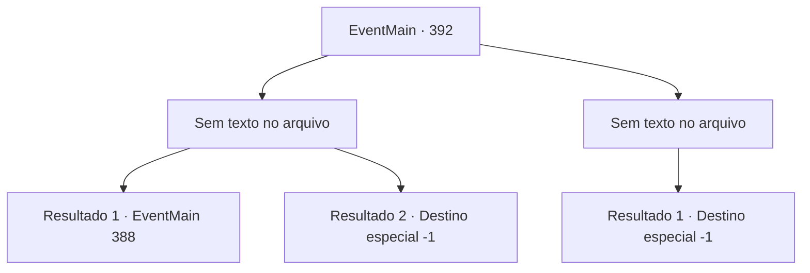

# Eventos principais · 392

[Índice da tabela](index.md) · [Índice geral](../index.md)

ID: `pt:EventMain:392` · Fonte: `EventMain4` · Versão: 1.2.47.

Mapeamento estático dos arquivos; a disponibilidade e a execução dependem do estado da run.

## Texto do evento

*Sem texto no arquivo.*

## Dados de entrada

```json
{
  "id": 392,
  "grade": 1,
  "normalGoal": "",
  "required": ""
}
```

## Mapa das escolhas



## Escolhas e resultados

### Escolha 1

*Sem texto no arquivo; o papel dessa opção depende da interface do jogo.*

Requisitos e outros campos da escolha:

```json
{
  "required": ""
}
```

#### Resultado 1.1

Você envia a cabeça de Anton voando, longe de seu corpo. <link=shake>

 "V-você..!! Você terá uma morte terrível... maldições para você !!!"

</link> Ele continua a amaldiçoar, enquanto todo o seu corpo se transforma em cinzas. Em seguida, os mercenários abrem o portão para o salão principal e entram. A irmã Maria se aproxima de você e pergunta o que aconteceu. Você diz a ela que derrotou o Senhor e lutou contra Anton. Eles parecem muito surpresos depois de ouvir que você não apenas cuidou do Senhor, mas também de Seus Sinions. Maria dá um tapinha nos ombros com as duas mãos e continua. 

 "Trabalho muito impressionante, {1}. Se você não se importar, manteremos esse cubo seguro, sob o nome de mercenários de Ziwa."


Continuação registrada: [Evento 388](0388.md) na mesma tabela.

```json
{
  "required": "23_2_1",
  "chance": "1",
  "nextEvent": 388,
  "type": 2,
  "reward": ""
}
```

#### Resultado 1.2

Você derrota Anton, mas ele se levanta quase instantaneamente. Ele então salta em cima de você, agarrando seu pescoço. Em seguida, o portão se abre e os Mercenários de Ziwa entram, liderados pela Irmã Maria. 

 "Deus... maldição...!!"

 Anton amaldiçoa, joga você de volta contra as paredes e foge. Maria e alguns outros mercenários vão atrás dele. Assim que você os vê, desaba devido a todos os eventos pelos quais passou.

Continuação registrada: [Destino especial `-1`](../destinos-especiais.md).

```json
{
  "required": "24_2_1",
  "chance": "1",
  "nextEvent": -1,
  "type": 2,
  "reward": "15_4_5|15_4_7|15_4_13"
}
```

### Escolha 2

*Sem texto no arquivo; o papel dessa opção depende da interface do jogo.*

Requisitos e outros campos da escolha:

```json
{
  "required": ""
}
```

#### Resultado 2.1

Anton tira o cubo das suas mãos e te sufoca. 

 "Você nem vai sentir dor em alguns se.."

 Mas ele não consegue terminar a frase. O portão se abre e mercenários de Ziwa invadem o salão principal. Anton xinga e tenta fugir, mas logo é cercado pelos mercenários. Assim que você os vê, desmaia devido a todos os eventos pelos quais passou.

Continuação registrada: [Destino especial `-1`](../destinos-especiais.md).

```json
{
  "required": "",
  "chance": "1",
  "nextEvent": -1,
  "type": 2,
  "reward": "15_4_8|4_233_1|15_4_13"
}
```

## Referências que chegam a este evento

- [Evento 391 · escolha 1 · resultado 1](0391.md#escolha-1)
