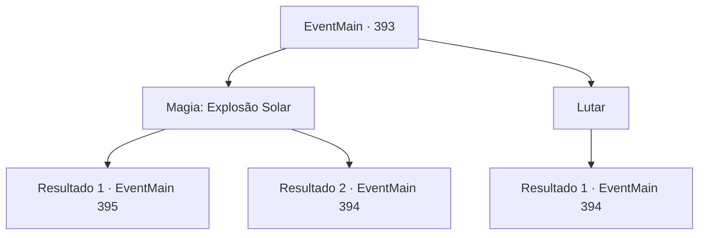

# Eventos principais · 393

[Índice da tabela](index.md) · [Índice geral](../index.md)

ID: `pt:EventMain:393` · Fonte: `EventMain4` · Versão: 1.2.47.

Mapeamento estático dos arquivos; a disponibilidade e a execução dependem do estado da run.

## Texto do evento

*Sem texto no arquivo.*

## Dados de entrada

```json
{
  "id": 393,
  "grade": 1,
  "normalGoal": "",
  "required": ""
}
```

## Mapa das escolhas



## Escolhas e resultados

### Escolha 1

Magia: Explosão Solar

Requisitos e outros campos da escolha:

```json
{
  "required": "20_0_4|1_1_2"
}
```

#### Resultado 1.1

Você tenta reunir seu foco no caótico campo de batalha, lançar um feitiço. A irmã Maria percebe que o que você precisa agora é hora. Ela fica na sua frente, impedindo que os vampiros se aproximem de você. Então, uma explosão brilhante faísca da ponta dos dedos e, em um instante, os vampiros se transformam em pilhas de cinzas. 

 "Incrível!! Simplesmente incrível!!"

 "Você acabou de tornar nosso trabalho muito mais fácil. Obrigada."

 Os mercenários exclamam com admiração e abrem o portão para o salão principal. |drawing_lordSeat| O trono do Senhor é iluminado pela luar azul. O velho sentado no trono se levanta e grita. 

 "Você...! Este não é um lugar para uma interrupção tão mesquinha! MATAR TODOS ELES!"

 Um Cavaleiro da Morte atende seu chamado, aparecendo da escuridão. Está equipado com uma armadura brilhante forjada com aço preto e tem uma espada longa de prata em suas mãos. A irmã Maria dá uma olhada e murmura para si mesma. 

 "Um cavaleiro da morte ... isso não será fácil."

 Mas o Cavaleiro da Morte não é seu único inimigo. Uma companhia de morcegos aparece na escuridão e desce no topo dos mercenários. Então, o Senhor dos Vampiros pula em você para atacar.

Continuação registrada: [Evento 395](0395.md) na mesma tabela.

```json
{
  "required": "",
  "chance": "1|0_14_1",
  "nextEvent": 395,
  "type": 0,
  "reward": "6_0_126|0_1_-1",
  "place": 10
}
```

#### Resultado 1.2

Tentas lançar um feitiço no campo de batalha caótico, mas falhas em concentrar-te. Enquanto um vampiro te ataca, perdes toda a concentração. Ai de ti, preparas-te para lutar com a tua arma.

Continuação registrada: [Evento 394](0394.md) na mesma tabela.

```json
{
  "required": "",
  "chance": "18",
  "nextEvent": 394,
  "type": 1,
  "reward": "6_0_19|0_1_-1",
  "place": 10
}
```

### Escolha 2

Lutar

Requisitos e outros campos da escolha:

```json
{
  "required": ""
}
```

#### Resultado 2.1

Você prepara sua arma e se prepara para lutar contra os vampiros.

Continuação registrada: [Evento 394](0394.md) na mesma tabela.

```json
{
  "required": "",
  "chance": "1",
  "nextEvent": 394,
  "type": 2,
  "reward": "6_0_19",
  "place": 10
}
```

## Referências que chegam a este evento

- [Evento 380 · escolha 1 · resultado 1](0380.md#escolha-1)
- [Evento 380 · escolha 2 · resultado 1](0380.md#escolha-2)
