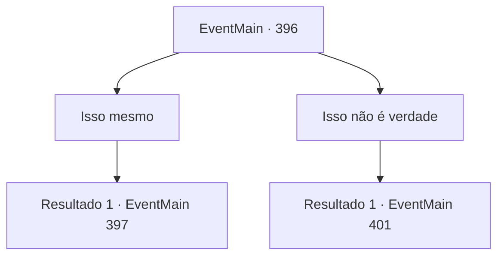

# Eventos principais · 396

[Índice da tabela](index.md) · [Índice geral](../index.md)

ID: `pt:EventMain:396` · Fonte: `EventMain4` · Versão: 1.2.47.

Mapeamento estático dos arquivos; a disponibilidade e a execução dependem do estado da run.

## Texto do evento

Você vai para o 'Castelo Moneaskur'. O castelo está localizado no fundo de uma floresta nevada. Iluminado pelo luar, ele brilha misteriosamente, emitindo uma vibração muito irreal. |drawing_moneasker| Você se encontra com os mercenários Ziwa na floresta nevada. Eles parecem nervosos, com motivo, mas fazem o possível para lhe dar uma recepção calorosa. Irmã Maria se aproxima de você. Ela aponta para Anton, com seu corpo inteiro coberto de correntes de prata, e faz uma pergunta. 

 "Você está aqui. Encontramos este homem na floresta. Nós o identificamos como um vampiro e o pegamos. Ele mencionou que você o conhece e também que ele é crucial para o sucesso do seu plano. Isso é verdade?"

 Anton não faz nenhum som, mas move a boca para dizer: 'Pense na sua irmãzinha'. 

## Dados de entrada

```json
{
  "id": 396,
  "grade": 1,
  "normalGoal": "",
  "required": "13_3_12|1_2_100"
}
```

## Mapa das escolhas



## Escolhas e resultados

### Escolha 1

Isso mesmo

Requisitos e outros campos da escolha:

```json
{
  "required": ""
}
```

#### Resultado 1.1

Depois de ouvir sua história, Maria desacorrenta Anton e continua. 

 "Nunca pensei que estaríamos cooperando com um vampiro."

 Anton estica os braços e fala. 

 "Fique aqui, na floresta. Eu vou abrir o portão sozinho. Você pode entrar no castelo então."

 Os mercenários ouvem você, escondidos na floresta com você. Anton pega sua carruagem e a dirige até o portão do Castelo Moneaskur. Ele diz algo para o portão, e o portão de aço branco se abre completamente. Assim que o portão se abre, os mercenários preparam suas armas e invadem o castelo. Os vampiros avistam os mercenários e revidam, mas a surpresa acaba sendo melhor para eles. Logo, todos eles se transformam em pilhas de cinzas.

Continuação registrada: [Evento 397](0397.md) na mesma tabela.

```json
{
  "required": "",
  "chance": "1",
  "nextEvent": 397,
  "type": 2,
  "reward": ""
}
```

### Escolha 2

Isso não é verdade

Requisitos e outros campos da escolha:

```json
{
  "required": ""
}
```

#### Resultado 2.1

Você responde não, e Anton parece assustado. 

 "O quê..?! Ei! Você nunca passará por aquele portão sem mim. Nem terá a chance de lutar contra o L..."

 Mas antes que ele possa terminar, Maria soca seu rosto tão forte que quebra seu crânio. Anton se transforma em um monte de cinzas. Irmã Maria murmura para si mesma. 

 "Vá para o inferno."

 Depois de rezar por um tempo, Irmã Maria reúne todas as suas forças e abre o portão do castelo com sua força. O portão, feito de aço branco, cede à sua força bruta, e os mercenários invadem o castelo com alvoroço. Ao mesmo tempo, vampiros voam de todos os lados do castelo, com seus olhos ardendo em vermelho. Lutas começam em todos os lugares.

Continuação registrada: [Evento 401](0401.md) na mesma tabela.

```json
{
  "required": "",
  "chance": "1",
  "nextEvent": 401,
  "type": 2,
  "reward": ""
}
```

## Referências que chegam a este evento

Nenhum `nextEvent` positivo da mesma tabela aponta para este nó. Isso não prova que seja inacessível: sorteio e estado de história podem selecioná-lo.

