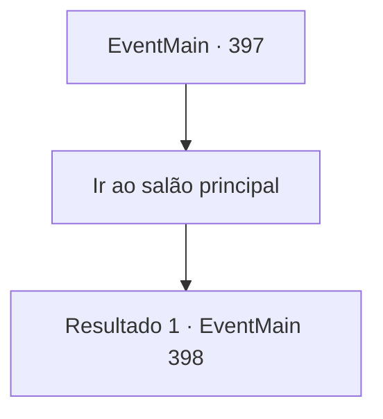

# Eventos principais · 397

[Índice da tabela](index.md) · [Índice geral](../index.md)

ID: `pt:EventMain:397` · Fonte: `EventMain4` · Versão: 1.2.47.

Mapeamento estático dos arquivos; a disponibilidade e a execução dependem do estado da run.

## Texto do evento

*Sem texto no arquivo.*

## Dados de entrada

```json
{
  "id": 397,
  "grade": 1,
  "normalGoal": "",
  "required": ""
}
```

## Mapa das escolhas



## Escolhas e resultados

### Escolha 1

Ir ao salão principal

Requisitos e outros campos da escolha:

```json
{
  "required": ""
}
```

#### Resultado 1.1

Você chega ao salão principal com os mercenários, onde está o Senhor. Você vai primeiro, abrindo a porta e fica cara a cara com o Senhor. |drawing_lordSeat| O trono do Senhor é iluminado pela luar azul. O velho sentado no trono se levanta e grita. 

 "Anton ... você ousa ... !! MATAR TODOS ELES!"

 Um Cavaleiro da Morte atende seu chamado, aparecendo da escuridão. Está equipado com uma armadura brilhante forjada com aço preto e tem uma espada longa de prata em suas mãos. A irmã Maria dá uma olhada e murmura para si mesma. 

 "Um cavaleiro da morte ... isso não será fácil."

 Mas o Cavaleiro da Morte não é seu único inimigo. Uma companhia de morcegos aparece na escuridão e desce no topo dos mercenários. O Senhor dos Vampiros pula para Anton. Mas Anton responde empurrando você ao ataque do Senhor.

Continuação registrada: [Evento 398](0398.md) na mesma tabela.

```json
{
  "required": "",
  "chance": "1",
  "nextEvent": 398,
  "type": 2,
  "reward": "6_0_126",
  "place": 10
}
```

## Referências que chegam a este evento

- [Evento 396 · escolha 1 · resultado 1](0396.md#escolha-1)
