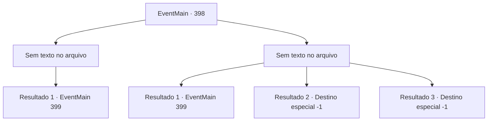

# Eventos principais · 398

[Índice da tabela](index.md) · [Índice geral](../index.md)

ID: `pt:EventMain:398` · Fonte: `EventMain4` · Versão: 1.2.47.

Mapeamento estático dos arquivos; a disponibilidade e a execução dependem do estado da run.

## Texto do evento

*Sem texto no arquivo.*

## Dados de entrada

```json
{
  "id": 398,
  "grade": 1,
  "normalGoal": "",
  "required": ""
}
```

## Mapa das escolhas



## Escolhas e resultados

### Escolha 1

*Sem texto no arquivo; o papel dessa opção depende da interface do jogo.*

Requisitos e outros campos da escolha:

```json
{
  "required": ""
}
```

#### Resultado 1.1

Você derrota com sucesso o Senhor Vampiro. O Senhor cai no chão, derramando sangue negro. ... O que significa que ele não é o Senhor Vampiro, muito menos um vampiro puro. Irmã Maria, depois de derrotar o Cavaleiro da Morte, se aproxima do cadáver e mergulha o dedo na poça de sangue. 

 "Isso... é um dhampir. Um meio-vampiro. A informação sobre o Senhor estar aqui... acaba sendo falsa."

 Anton agarra o menino servo, que está rastejando ao lado do trono com medo, e grita. 

 "Isso não pode ser...! Onde está o Senhor?! PARA ONDE ELE FOI!!"

 O pequeno menino servo apenas balança a cabeça com medo, assustado.

Continuação registrada: [Evento 399](0399.md) na mesma tabela.

```json
{
  "required": "",
  "chance": "1",
  "nextEvent": 399,
  "type": 2,
  "reward": ""
}
```

### Escolha 2

*Sem texto no arquivo; o papel dessa opção depende da interface do jogo.*

Requisitos e outros campos da escolha:

```json
{
  "required": ""
}
```

#### Resultado 2.1

O Senhor é, obviamente, um inimigo difícil de enfrentar. Enquanto você luta desesperadamente, Maria entra para aniquilar a mandíbula do Senhor com seu soco inglês. Parece que o Cavaleiro da Morte não foi um problema para ela. O Senhor cai no chão, derramando sangue negro. ... O que significa que ele não é o Senhor Vampiro, muito menos um vampiro puro. Irmã Maria, depois de derrotar o Cavaleiro da Morte, se aproxima do cadáver e mergulha o dedo na poça de sangue. 

 "Isso... é um dhampir. Um meio-vampiro. A informação sobre o Senhor estar aqui... acaba sendo falsa."

 Anton agarra o menino servo, que está rastejando ao lado do trono com medo, e grita. 

 "Isso não pode ser...! Onde está o Senhor?! PARA ONDE ELE FOI!!"

 O pequeno menino servo apenas balança a cabeça com medo, assustado.

Continuação registrada: [Evento 399](0399.md) na mesma tabela.

```json
{
  "required": "1_0_2|1_1_2",
  "chance": "1",
  "nextEvent": 399,
  "type": 2,
  "reward": "0_0_-1|0_1_-1"
}
```

#### Resultado 2.2

O Senhor separa sua cabeça do seu corpo com suas garras. A última coisa que você vê antes de desmaiar é seu corpo sem cabeça desabando no chão.

Continuação registrada: [Destino especial `-1`](../destinos-especiais.md).

```json
{
  "required": "2_0_2",
  "chance": "1",
  "nextEvent": -1,
  "type": 2,
  "reward": "15_4_14|0_0_-1|0_1_-1|25_8_1"
}
```

#### Resultado 2.3

O Senhor separa sua cabeça do seu corpo com suas garras. A última coisa que você vê antes de desmaiar é seu corpo sem cabeça desabando no chão.

Continuação registrada: [Destino especial `-1`](../destinos-especiais.md).

```json
{
  "required": "2_1_2",
  "chance": "1",
  "nextEvent": -1,
  "type": 2,
  "reward": "15_4_14|0_0_-1|0_1_-1|25_8_1"
}
```

## Referências que chegam a este evento

- [Evento 397 · escolha 1 · resultado 1](0397.md#escolha-1)
