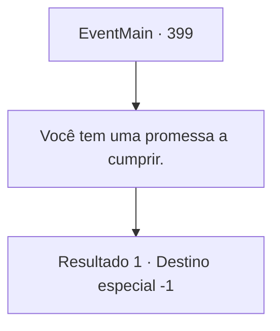

# Eventos principais · 399

[Índice da tabela](index.md) · [Índice geral](../index.md)

ID: `pt:EventMain:399` · Fonte: `EventMain4` · Versão: 1.2.47.

Mapeamento estático dos arquivos; a disponibilidade e a execução dependem do estado da run.

## Texto do evento

*Sem texto no arquivo.*

## Dados de entrada

```json
{
  "id": 399,
  "grade": 1,
  "normalGoal": "",
  "required": ""
}
```

## Mapa das escolhas



## Escolhas e resultados

### Escolha 1

Você tem uma promessa a cumprir.

Requisitos e outros campos da escolha:

```json
{
  "required": ""
}
```

#### Resultado 1.1

Você diz a Anton que cuidou de 'o Senhor do Castelo Moneaskur', dizendo que ele tem uma promessa a cumprir. Anton solta o garoto servo, tenta gritar com você, mas olha ao redor e tenta pensar logicamente. 

 "Aquilo... aquilo é verdade..."

 Ele solta um longo suspiro. Irmã Maria fala, olhando para o Senhor caído. 

 "Agora, ele pode não ser O Senhor Vampiro que estávamos procurando, mas ainda era uma figura maligna, comandando um grande grupo de vampiros."

 Ela então envolve os braços ao redor de Anton e continua. 

 "Agora... É hora de cuidar dos vampiros em Romb. Certo, cooperador?"

 Você espiada o rosto de Anton. Ele tenta agir como se nada estivesse errado, mas não consegue impedir seus olhos de tremerem. Os Mercenários Ziwa seguem direto para Romb, e você viaja com eles para resgatar sua irmãzinha daquele coliseu.

Continuação registrada: [Destino especial `-1`](../destinos-especiais.md).

```json
{
  "required": "",
  "chance": "1",
  "nextEvent": -1,
  "type": 2,
  "reward": "15_4_11|15_4_15"
}
```

## Referências que chegam a este evento

- [Evento 398 · escolha 1 · resultado 1](0398.md#escolha-1)
- [Evento 398 · escolha 2 · resultado 1](0398.md#escolha-2)
