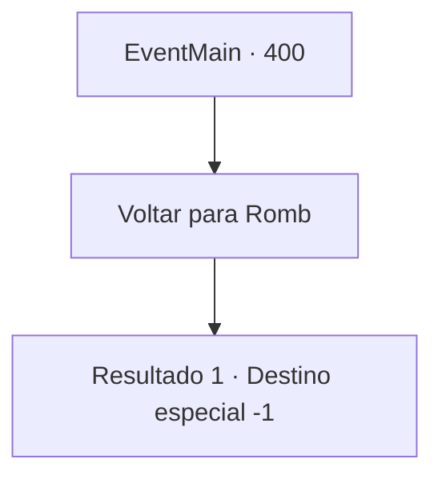

# Eventos principais · 400

[Índice da tabela](index.md) · [Índice geral](../index.md)

ID: `pt:EventMain:400` · Fonte: `EventMain4` · Versão: 1.2.47.

Mapeamento estático dos arquivos; a disponibilidade e a execução dependem do estado da run.

## Texto do evento

*Sem texto no arquivo.*

## Dados de entrada

```json
{
  "id": 400,
  "grade": 1,
  "normalGoal": "",
  "required": ""
}
```

## Mapa das escolhas



## Escolhas e resultados

### Escolha 1

Voltar para Romb

Requisitos e outros campos da escolha:

```json
{
  "required": ""
}
```

#### Resultado 1.1

Você e os mercenários de Ziwa vão para Romb, para limpar o Coliseu dos vampiros restantes. A viagem leva cerca de meio dia. Mas, ao contrário das suas expectativas, o Coliseu está completamente vazio. Ninguém vem para impedi -lo de entrar na prisão subterrânea. Enquanto os mercenários se separam e verificam as celas da prisão, um deles grita. 

 "AQUI!! Você tem que dar uma olhada nisso!"

 Você se aproxima do mercenário que gritou. Lá está sua irmãzinha. |drawing_priceOfbetray| Seu corpo sem vida está no chão, e na parede da cela contém uma frase escrita em sangue. 'Preço da traição'. Você entra em colapso no chão, incapaz de suportar o choque.

Continuação registrada: [Destino especial `-1`](../destinos-especiais.md).

```json
{
  "required": "",
  "chance": "1",
  "nextEvent": -1,
  "type": 2,
  "reward": "15_4_16"
}
```

## Referências que chegam a este evento

- [Evento 403 · escolha 1 · resultado 1](0403.md#escolha-1)
- [Evento 403 · escolha 2 · resultado 1](0403.md#escolha-2)
