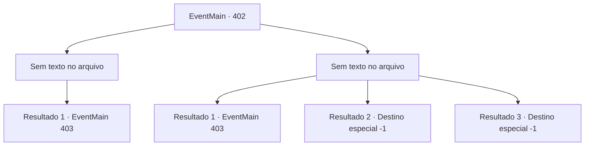

# Eventos principais · 402

[Índice da tabela](index.md) · [Índice geral](../index.md)

ID: `pt:EventMain:402` · Fonte: `EventMain4` · Versão: 1.2.47.

Mapeamento estático dos arquivos; a disponibilidade e a execução dependem do estado da run.

## Texto do evento

*Sem texto no arquivo.*

## Dados de entrada

```json
{
  "id": 402,
  "grade": 1,
  "normalGoal": "",
  "required": ""
}
```

## Mapa das escolhas



## Escolhas e resultados

### Escolha 1

*Sem texto no arquivo; o papel dessa opção depende da interface do jogo.*

Requisitos e outros campos da escolha:

```json
{
  "required": ""
}
```

#### Resultado 1.1

Você derrota os vampiros. A batalha continua, e os mercenários são feridos aqui e ali. Mas os mercenários emergem vitoriosos e abrem o portão para o salão principal. |drawing_lordSeat| O trono do Senhor é iluminado pelo luar azul. O velho sentado no trono se levanta e grita. 

 "Você...! Este não é um lugar para uma interrupção tão mesquinha! MATAR TODOS ELES!"

 Um Cavaleiro da Morte atende seu chamado, aparecendo da escuridão. Ele está equipado com um pedaço de armadura brilhante forjado com aço preto e tem uma espada longa de prata em suas mãos. A irmã Maria dá uma olhada e murmura para si mesma. 

 "Um cavaleiro da morte ... isso não será fácil."

 Mas o Cavaleiro da Morte não é seu único inimigo. Uma companhia de morcegos aparece na escuridão e desce no topo dos mercenários. Então, o Senhor dos Vampiros pula em você para atacar.

Continuação registrada: [Evento 403](0403.md) na mesma tabela.

```json
{
  "required": "",
  "chance": "1",
  "nextEvent": 403,
  "type": 2,
  "reward": "6_3_126",
  "place": 10
}
```

### Escolha 2

*Sem texto no arquivo; o papel dessa opção depende da interface do jogo.*

Requisitos e outros campos da escolha:

```json
{
  "required": ""
}
```

#### Resultado 2.1

Você está prestes a ser mordido por um vampiro. Então, uma maça prateada esmaga o crânio do vampiro. 

 "Você está certo? Aqui, deixe -me ajudá -lo."

 Você pega a mão do mercenário barbudo e levanta -se. A batalha continua, e os mercenários são feridos aqui e ali. Mas os mercenários emergem vitoriosos e abrem o portão para o salão principal. |drawing_lordSeat| O trono do Senhor é iluminado pela luar azul. O velho sentado no trono se levanta e grita. 

 "Você...! Este não é um lugar para uma interrupção tão mesquinha! MATAR TODOS ELES!"

 Um Cavaleiro da Morte atende seu chamado, aparecendo da escuridão. Está equipado com uma armadura brilhante forjada com aço preto e tem uma espada longa de prata em suas mãos. A irmã Maria dá uma olhada e murmura para si mesma. 

 "Um cavaleiro da morte ... isso não será fácil."

 Mas o Cavaleiro da Morte não é seu único inimigo. Uma companhia de morcegos aparece na escuridão e desce no topo dos mercenários. Então, o Senhor dos Vampiros pula em você para atacar.

Continuação registrada: [Evento 403](0403.md) na mesma tabela.

```json
{
  "required": "",
  "chance": "1",
  "nextEvent": 403,
  "type": 2,
  "reward": "6_3_126|0_0_-1|0_1_-1",
  "place": 10
}
```

#### Resultado 2.2

O vampiro te perfura com suas garras afiadas. Você sente o frio do chão nevado levando embora o calor do seu corpo, enquanto seu coração para de bater.

Continuação registrada: [Destino especial `-1`](../destinos-especiais.md).

```json
{
  "required": "",
  "chance": "1",
  "nextEvent": -1,
  "type": 2,
  "reward": "0_0_-1|0_1_-1|15_4_14|25_8_1"
}
```

#### Resultado 2.3

O vampiro te perfura com suas garras afiadas. Você sente o frio do chão nevado levando embora o calor do seu corpo, enquanto seu coração para de bater.

Continuação registrada: [Destino especial `-1`](../destinos-especiais.md).

```json
{
  "required": "",
  "chance": "1",
  "nextEvent": -1,
  "type": 2,
  "reward": "0_0_-1|0_1_-1|15_4_14|25_8_1"
}
```

## Referências que chegam a este evento

- [Evento 401 · escolha 1 · resultado 2](0401.md#escolha-1)
- [Evento 401 · escolha 2 · resultado 1](0401.md#escolha-2)
