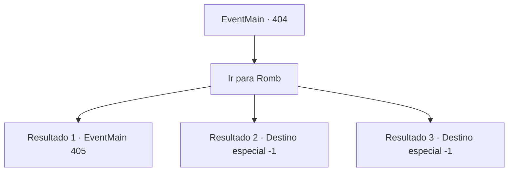

# Eventos principais · 404

[Índice da tabela](index.md) · [Índice geral](../index.md)

ID: `pt:EventMain:404` · Fonte: `EventMain4` · Versão: 1.2.47.

Mapeamento estático dos arquivos; a disponibilidade e a execução dependem do estado da run.

## Texto do evento

|drawing_illahaFortress| Você retorna à Fortaleza de Illaha, de volta aos Mercenários de Ziwa. Você relata tudo sobre os vampiros de Romb e as coisas que eles estão fazendo. Os mercenários imediatamente explodem em ressentimento, dizendo que deveriam estar invadindo o local, matando cada uma das criaturas malditas. Irmã Maria parece concordar com eles, pois continua com uma expressão séria. 

 "Parece que eles simplesmente não conseguiram derramamento de sangue suficiente. Nós vamos cuidar desses vampiros. Não se preocupe com sua irmã. Nossos homens a manterão segura. Vamos lá."


## Dados de entrada

```json
{
  "id": 404,
  "grade": 1,
  "normalGoal": "",
  "required": "13_3_10|1_2_100"
}
```

## Mapa das escolhas



## Escolhas e resultados

### Escolha 1

Ir para Romb

Requisitos e outros campos da escolha:

```json
{
  "required": ""
}
```

#### Resultado 1.1

Você segue para Romb, junto com os Mercenários Ziwa. Enquanto você e os mercenários estão passando pela 'Floresta Negra', uma quantidade absurda de morcegos aparece do nada. Cavalos gritam aqui e ali, e os mercenários começam a lutar contra os morcegos.

Continuação registrada: [Evento 405](0405.md) na mesma tabela.

```json
{
  "required": "18_278_1",
  "chance": "1",
  "nextEvent": 405,
  "type": 2,
  "reward": "6_0_66",
  "place": 1
}
```

#### Resultado 1.2

Você e os mercenários passam pela Floresta Negra e chegam a Romb. Os mercenários vão imediatamente para o coliseu, mas não há um único vampiro lá dentro. Parece que todos eles fugiram depois de ouvirem a morte de Anton. Os mercenários investigam os terrenos do coliseu e encontram humanos trancados na prisão subterrânea, morrendo de fome. Maria reúne os mercenários e fala. 

 "Irmãos e irmãs. Parece que os vampiros de Romb já fugiram do local. Devemos priorizar ajudar as pessoas trancadas aqui. Ir atrás dos vampiros pode esperar."

 Os mercenários começam a libertar os prisioneiros. Você se despede de Maria e dos mercenários e segue em direção à sua cidade natal.

Continuação registrada: [Destino especial `-1`](../destinos-especiais.md).

```json
{
  "required": "5_278_1|5_256_2",
  "chance": "1",
  "nextEvent": -1,
  "type": 2,
  "reward": "15_4_2|15_4_11|15_4_20"
}
```

#### Resultado 1.3

Você e os mercenários passam pela Floresta Negra e chegam a Romb. Os mercenários vão imediatamente para o coliseu, mas não há um único vampiro lá dentro. Parece que todos eles fugiram depois de ouvirem a morte de Anton. Os mercenários investigam os terrenos do coliseu e encontram humanos trancados na prisão subterrânea, morrendo de fome. Maria reúne os mercenários e fala. 

 "Irmãos e irmãs. Parece que os vampiros de Romb já fugiram do local. Devemos priorizar ajudar as pessoas trancadas aqui. Ir atrás dos vampiros pode esperar."

 Os mercenários começam a libertar os prisioneiros. Você se despede de Maria e dos mercenários e segue em direção à sua cidade natal.

Continuação registrada: [Destino especial `-1`](../destinos-especiais.md).

```json
{
  "required": "5_278_1|18_256_2",
  "chance": "1",
  "nextEvent": -1,
  "type": 2,
  "reward": "15_4_2|15_4_11"
}
```

## Referências que chegam a este evento

Nenhum `nextEvent` positivo da mesma tabela aponta para este nó. Isso não prova que seja inacessível: sorteio e estado de história podem selecioná-lo.

