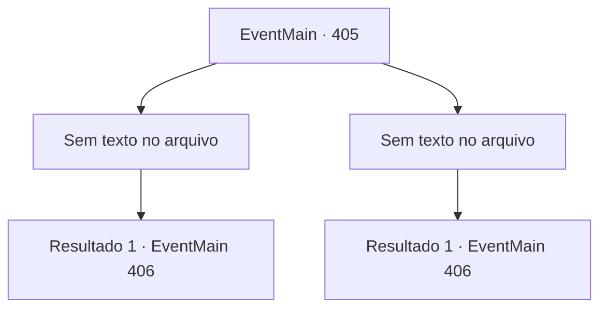

# Eventos principais · 405

[Índice da tabela](index.md) · [Índice geral](../index.md)

ID: `pt:EventMain:405` · Fonte: `EventMain4` · Versão: 1.2.47.

Mapeamento estático dos arquivos; a disponibilidade e a execução dependem do estado da run.

## Texto do evento

*Sem texto no arquivo.*

## Dados de entrada

```json
{
  "id": 405,
  "grade": 1,
  "normalGoal": "",
  "required": ""
}
```

## Mapa das escolhas



## Escolhas e resultados

### Escolha 1

*Sem texto no arquivo; o papel dessa opção depende da interface do jogo.*

Requisitos e outros campos da escolha:

```json
{
  "required": ""
}
```

#### Resultado 1.1

No meio da batalha feroz, a companhia de morcegos de repente começa a fugir. Então, os mercenários vão atrás dos morcegos.

Continuação registrada: [Evento 406](0406.md) na mesma tabela.

```json
{
  "required": "",
  "chance": "1",
  "nextEvent": 406,
  "type": 2,
  "reward": ""
}
```

### Escolha 2

*Sem texto no arquivo; o papel dessa opção depende da interface do jogo.*

Requisitos e outros campos da escolha:

```json
{
  "required": ""
}
```

#### Resultado 2.1

No meio da batalha feroz, a companhia de morcegos de repente começa a fugir. Então, os mercenários vão atrás dos morcegos.

Continuação registrada: [Evento 406](0406.md) na mesma tabela.

```json
{
  "required": "",
  "chance": "1",
  "nextEvent": 406,
  "type": 2,
  "reward": ""
}
```

## Referências que chegam a este evento

- [Evento 404 · escolha 1 · resultado 1](0404.md#escolha-1)
