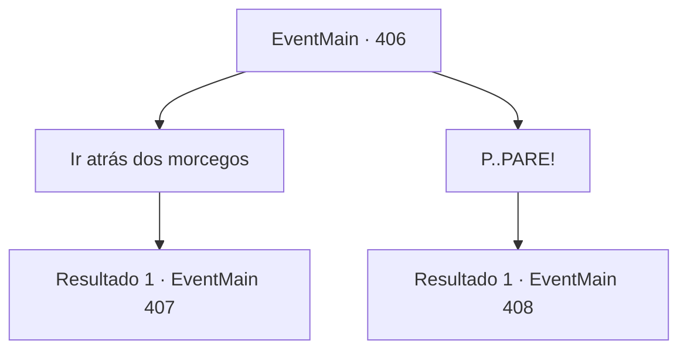

# Eventos principais · 406

[Índice da tabela](index.md) · [Índice geral](../index.md)

ID: `pt:EventMain:406` · Fonte: `EventMain4` · Versão: 1.2.47.

Mapeamento estático dos arquivos; a disponibilidade e a execução dependem do estado da run.

## Texto do evento

*Sem texto no arquivo.*

## Dados de entrada

```json
{
  "id": 406,
  "grade": 1,
  "normalGoal": "",
  "required": ""
}
```

## Mapa das escolhas



## Escolhas e resultados

### Escolha 1

Ir atrás dos morcegos

Requisitos e outros campos da escolha:

```json
{
  "required": ""
}
```

#### Resultado 1.1

Você e os mercenários vão atrás dos vampiros, gritando. Logo, o chão embaixo de você desmoronar e gritar pode ser ouvido. Por acaso você também está naquele andar. Um enorme poço com o fundo cheio de espinhos nítidos o engole. |drawing_pit|

Continuação registrada: [Evento 407](0407.md) na mesma tabela.

```json
{
  "required": "",
  "chance": "1",
  "nextEvent": 407,
  "type": 2,
  "reward": ""
}
```

### Escolha 2

P..PARE!

Requisitos e outros campos da escolha:

```json
{
  "required": "1_14_13"
}
```

#### Resultado 2.1

Você grita com os mercenários para parar. Você cuidadosamente dá um passo à frente e logo descobre que o solo está preso. Você notifica seus aliados da armadilha e os mercenários começam a desarmar a armadilha imediatamente. Mas então, com uma ruptura alta, os vampiros se revelam dos arbustos próximos. Você reconhece essa voz como de Anton. Assim que a luta começa. Anton vê você e cobra por você com olhos vermelhos e brilhantes. <color=red> 

 "você é uma merda ingrata! Eu vou te matar !!"

 </color>

Continuação registrada: [Evento 408](0408.md) na mesma tabela.

```json
{
  "required": "",
  "chance": "1",
  "nextEvent": 408,
  "type": 2,
  "reward": "6_2_125",
  "place": 1
}
```

## Referências que chegam a este evento

- [Evento 405 · escolha 1 · resultado 1](0405.md#escolha-1)
- [Evento 405 · escolha 2 · resultado 1](0405.md#escolha-2)
