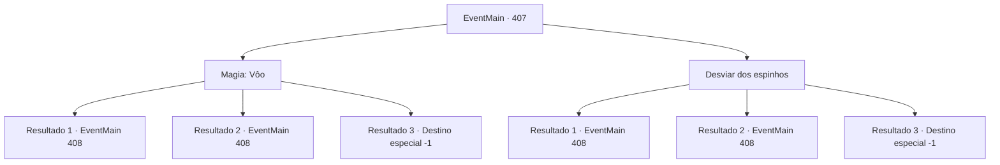

# Eventos principais · 407

[Índice da tabela](index.md) · [Índice geral](../index.md)

ID: `pt:EventMain:407` · Fonte: `EventMain4` · Versão: 1.2.47.

Mapeamento estático dos arquivos; a disponibilidade e a execução dependem do estado da run.

## Texto do evento

*Sem texto no arquivo.*

## Dados de entrada

```json
{
  "id": 407,
  "grade": 1,
  "normalGoal": "",
  "required": ""
}
```

## Mapa das escolhas



## Escolhas e resultados

### Escolha 1

Magia: Vôo

Requisitos e outros campos da escolha:

```json
{
  "required": "20_0_2|1_1_2"
}
```

#### Resultado 1.1

Você consegue ativar um feitiço, subindo no ar. Assim que você sai da armadilha, os vampiros se revelam dos arbustos próximos. Com uma batalha alta, eles cobram os mercenários. Você reconhece essa voz como de Anton. Assim que a luta começa. Anton vê você e cobra por você com olhos vermelhos e brilhantes. <color=red> 

 "você é uma merda ingrata! Eu vou te matar !!"

 </color>

Continuação registrada: [Evento 408](0408.md) na mesma tabela.

```json
{
  "required": "",
  "chance": "1|0_14_1",
  "nextEvent": 408,
  "type": 0,
  "reward": "6_0_125|0_1_-1",
  "place": 1
}
```

#### Resultado 1.2

Você tenta ativar um feitiço para subir no ar, mas falha. Você cai no poço, é esfaqueado por um dos picos de madeira. Você sangrou. Com feridas em todo o seu corpo, você mal consegue sair do poço. Você vê os mercenários que não caíram na armadilha lutando contra os vampiros. Então, você vê um rosto familiar entre os vampiros. É Anton. Assim que ele vê você, ele carrega com você com olhos vermelhos e brilhantes. <color=red> 

 "você é uma merda ingrata! Eu vou te matar !!"

 </color>

Continuação registrada: [Evento 408](0408.md) na mesma tabela.

```json
{
  "required": "1_0_2",
  "chance": "12",
  "nextEvent": 408,
  "type": 1,
  "reward": "0_0_-1|6_0_125|0_1_-1",
  "place": 1
}
```

#### Resultado 1.3

Tentas ativar um feitiço para voar pelo ar, mas falhas. Caíste no buraco e foste espetado por um dos espinhos de madeira. Sangras.

Continuação registrada: [Destino especial `-1`](../destinos-especiais.md).

```json
{
  "required": "2_0_2",
  "chance": "12",
  "nextEvent": -1,
  "type": 1,
  "reward": "0_0_-1|15_4_12|15_4_14|0_1_-1|25_8_1"
}
```

### Escolha 2

Desviar dos espinhos

Requisitos e outros campos da escolha:

```json
{
  "required": ""
}
```

#### Resultado 2.1

Você cai no poço, mas consegue evitar os picos com movimento ágil. Você rasteja com segurança do lado de fora do poço. Você vê os mercenários que não caíram na armadilha lutando contra os vampiros. Então, você vê um rosto familiar entre os vampiros. É Anton. Assim que ele vê você, ele carrega com você com olhos vermelhos e brilhantes. <color=red> 

 "você é uma merda ingrata! Eu vou te matar !!"

 </color>

Continuação registrada: [Evento 408](0408.md) na mesma tabela.

```json
{
  "required": "",
  "chance": "1|0_6_1",
  "nextEvent": 408,
  "type": 0,
  "reward": "6_0_125",
  "place": 1
}
```

#### Resultado 2.2

Você cai no poço, é esfaqueado por um dos picos de madeira. Você sangrou. Com feridas em todo o seu corpo, você mal consegue sair do poço. Você vê os mercenários que não caíram na armadilha lutando contra os vampiros. Então, você vê um rosto familiar entre os vampiros. É Anton. Assim que ele vê você, ele carrega com você com olhos vermelhos e brilhantes. <color=red> 

 "você é uma merda ingrata! Eu vou te matar !!"

 </color>

Continuação registrada: [Evento 408](0408.md) na mesma tabela.

```json
{
  "required": "1_0_2",
  "chance": "16",
  "nextEvent": 408,
  "type": 1,
  "reward": "0_0_-1|6_0_125",
  "place": 1
}
```

#### Resultado 2.3

Você cai no buraco, é esfaqueado por um dos espinhos de madeira. Você sangra.

Continuação registrada: [Destino especial `-1`](../destinos-especiais.md).

```json
{
  "required": "2_0_2",
  "chance": "16",
  "nextEvent": -1,
  "type": 1,
  "reward": "0_0_-1|15_4_12|15_4_14|25_8_1"
}
```

## Referências que chegam a este evento

- [Evento 406 · escolha 1 · resultado 1](0406.md#escolha-1)
