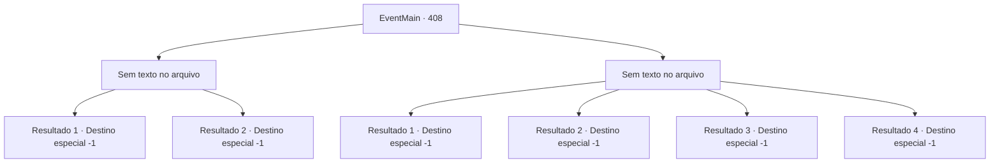

# Eventos principais · 408

[Índice da tabela](index.md) · [Índice geral](../index.md)

ID: `pt:EventMain:408` · Fonte: `EventMain4` · Versão: 1.2.47.

Mapeamento estático dos arquivos; a disponibilidade e a execução dependem do estado da run.

## Texto do evento

*Sem texto no arquivo.*

## Dados de entrada

```json
{
  "id": 408,
  "grade": 1,
  "normalGoal": "",
  "required": ""
}
```

## Mapa das escolhas



## Escolhas e resultados

### Escolha 1

*Sem texto no arquivo; o papel dessa opção depende da interface do jogo.*

Requisitos e outros campos da escolha:

```json
{
  "required": ""
}
```

#### Resultado 1.1

Você derrota Anton, prendendo seus braços e pernas. Seus subordinados se transformam em pilhas de cinzas pelas espadas dos mercenários. Os mercenários gritam em vitória, nem percebendo todas as feridas em que estão cobertos. 

 "Esperem! Eu tenho informações valiosas que vocês gostariam de saber..."

 Anton tenta sugerir algo, mas Irmã Maria chega e esmaga seu crânio com seu soco inglês. 

 "...Bom trabalho, mercenários. Mas Deus sabe quantos vampiros ainda restam em Romb. Vamos para lá agora mesmo."

 Os mercenários decidem seguir direto para Romb.

Continuação registrada: [Destino especial `-1`](../destinos-especiais.md).

```json
{
  "required": "5_256_2",
  "chance": "1",
  "nextEvent": -1,
  "type": 2,
  "reward": "15_4_11|15_4_2|15_4_20"
}
```

#### Resultado 1.2

Você derrota Anton, prendendo seus braços e pernas. Seus subordinados se transformam em pilhas de cinzas pelas espadas dos mercenários. Os mercenários gritam em vitória, nem percebendo todas as feridas que estão cobertos. 

 "Esperem! Eu tenho informações valiosas que vocês..."

 Anton tenta sugerir algo, mas Irmã Maria chega e esmaga seu crânio com seu soco inglês. 

 "...Bom trabalho, mercenários. Mas Deus sabe quantos vampiros ainda restam em Romb. Vamos para lá agora mesmo."

 Os mercenários decidem seguir direto para Romb.

Continuação registrada: [Destino especial `-1`](../destinos-especiais.md).

```json
{
  "required": "18_256_2",
  "chance": "1",
  "nextEvent": -1,
  "type": 2,
  "reward": "15_4_11|15_4_2"
}
```

### Escolha 2

*Sem texto no arquivo; o papel dessa opção depende da interface do jogo.*

Requisitos e outros campos da escolha:

```json
{
  "required": ""
}
```

#### Resultado 2.1

Você luta contra Anton, mas não é páreo para ele. Enquanto ele está prestes a rasgar seu pescoço, o soco inglês de Maria destrói o braço de Anton. 

 "Você nos deu algum tempo. Agora deixe comigo."

 Anton olha ao redor e só percebe em que situação está depois de ver os vampiros se transformarem em cinzas um por um. 

 "M... maldição, RETIRADA!!"

 Ele ordena que os vampiros recuem e foge da floresta com os vampiros restantes. Alguns dos mercenários te carregam para longe do campo de batalha. Após a batalha ter terminado, você é enviado de volta à fortaleza da Ilha Illaha com os outros mercenários feridos. Quanto aos outros, eles continuam a caminhar em direção a Romb, para libertar a cidade dos vampiros.

Continuação registrada: [Destino especial `-1`](../destinos-especiais.md).

```json
{
  "required": "1_0_2|1_1_2|5_256_2",
  "chance": "1",
  "nextEvent": -1,
  "type": 2,
  "reward": "15_4_11|15_4_13|15_4_7|0_0_-1|0_1_-1|15_4_20"
}
```

#### Resultado 2.2

Você luta contra Anton, mas não é páreo para ele. Enquanto ele está prestes a rasgar seu pescoço, o soco inglês de Maria destrói o braço de Anton. 

 "Você nos deu algum tempo. Agora deixe comigo."

 Anton olha ao redor e só percebe a situação em que está depois de ver os vampiros se transformarem em cinzas um por um. 

 "M... maldição, RETIRADA!!"

 Ele ordena que os vampiros recuem e foge da floresta com os vampiros restantes. Alguns dos mercenários te carregam para longe do campo de batalha. Após o fim da batalha, você é enviado de volta à fortaleza da Ilha de Illaha com os outros mercenários feridos. Quanto aos outros, eles continuam a caminhar em direção a Romb, para libertar a cidade dos vampiros.

Continuação registrada: [Destino especial `-1`](../destinos-especiais.md).

```json
{
  "required": "1_0_2|1_1_2|18_256_2",
  "chance": "1",
  "nextEvent": -1,
  "type": 2,
  "reward": "15_4_11|15_4_13|15_4_7|0_0_-1|0_1_-1"
}
```

#### Resultado 2.3

Anton te soca, te fazendo voar alguns metros e cair no chão. Você desmaia e, quando abre os olhos novamente, os mercenários estão fugindo. Você está amarrado em um cavalo de alguém, sendo levado para algum lugar. Você simplesmente não consegue se concentrar. Perde a consciência novamente, caindo em um estado de sono.

Continuação registrada: [Destino especial `-1`](../destinos-especiais.md).

```json
{
  "required": "2_0_2",
  "chance": "1",
  "nextEvent": -1,
  "type": 2,
  "reward": "15_4_12|15_4_13|0_0_-1|0_1_-1"
}
```

#### Resultado 2.4

Anton te soca, te fazendo voar alguns metros até o chão. Você desmaia e quando abre os olhos novamente, os mercenários estão fugindo. Você está amarrado em um cavalo de alguém, sendo levado para algum lugar. Você simplesmente não consegue se concentrar. Você perde a consciência novamente, caindo em um estado de sono.

Continuação registrada: [Destino especial `-1`](../destinos-especiais.md).

```json
{
  "required": "2_1_2",
  "chance": "1",
  "nextEvent": -1,
  "type": 2,
  "reward": "15_4_12|15_4_13|0_0_-1|0_1_-1"
}
```

## Referências que chegam a este evento

- [Evento 406 · escolha 2 · resultado 1](0406.md#escolha-2)
- [Evento 407 · escolha 1 · resultado 1](0407.md#escolha-1)
- [Evento 407 · escolha 1 · resultado 2](0407.md#escolha-1)
- [Evento 407 · escolha 2 · resultado 1](0407.md#escolha-2)
- [Evento 407 · escolha 2 · resultado 2](0407.md#escolha-2)
