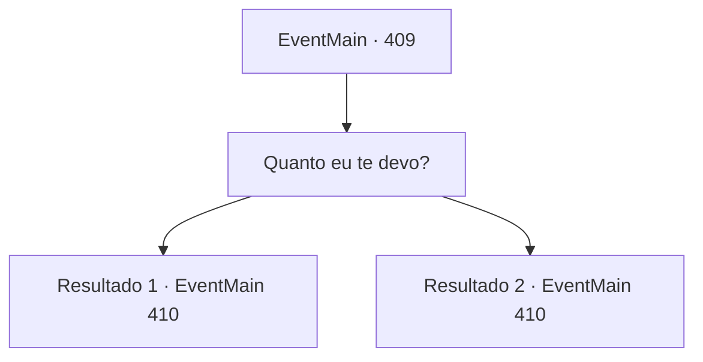

# Eventos principais · 409

[Índice da tabela](index.md) · [Índice geral](../index.md)

ID: `pt:EventMain:409` · Fonte: `EventMain4` · Versão: 1.2.47.

Mapeamento estático dos arquivos; a disponibilidade e a execução dependem do estado da run.

## Texto do evento

Você visita uma cidade chamada 'Rang Rud', para descansar seu corpo cansado. Mas antes que você possa encontrar um lugar para descansar, dois cobradores de dívidas de Anton se aproximam de você. 

 "Estivemos procurando por você em todos os lugares, {1}. Então, você está economizando algum ouro?"

 "Você pega dinheiro, você tem que pagá!"

 Eles sorriem avidamente, expondo seus dentes sujos.

## Dados de entrada

```json
{
  "id": 409,
  "grade": 1,
  "normalGoal": "",
  "required": "13_3_11|1_2_50"
}
```

## Mapa das escolhas



## Escolhas e resultados

### Escolha 1

Quanto eu te devo?

Requisitos e outros campos da escolha:

```json
{
  "required": ""
}
```

#### Resultado 1.1

Um deles responde, revirando os olhos. 

 "Vamos ver... A quantia original era de 1500 ouro. Agora, com os juros... e sua irmãzinha... Serão 4400 ouro no total."

 Ele acrescenta que sua irmãzinha teve um papel enorme na redução do valor da dívida.

Continuação registrada: [Evento 410](0410.md) na mesma tabela.

```json
{
  "required": "5_244_1",
  "chance": "1",
  "nextEvent": 410,
  "type": 2,
  "reward": ""
}
```

#### Resultado 1.2

Um deles responde, revirando os olhos. 

 "Vamos ver... A quantia original era de 1500 ouro. Agora, com os juros... e sua irmãzinha... Serão 4000 ouro no total."

 Ele acrescenta que sua irmãzinha teve um papel enorme na redução da quantia da dívida.

Continuação registrada: [Evento 410](0410.md) na mesma tabela.

```json
{
  "required": "18_244_1",
  "chance": "1",
  "nextEvent": 410,
  "type": 2,
  "reward": ""
}
```

## Referências que chegam a este evento

Nenhum `nextEvent` positivo da mesma tabela aponta para este nó. Isso não prova que seja inacessível: sorteio e estado de história podem selecioná-lo.

