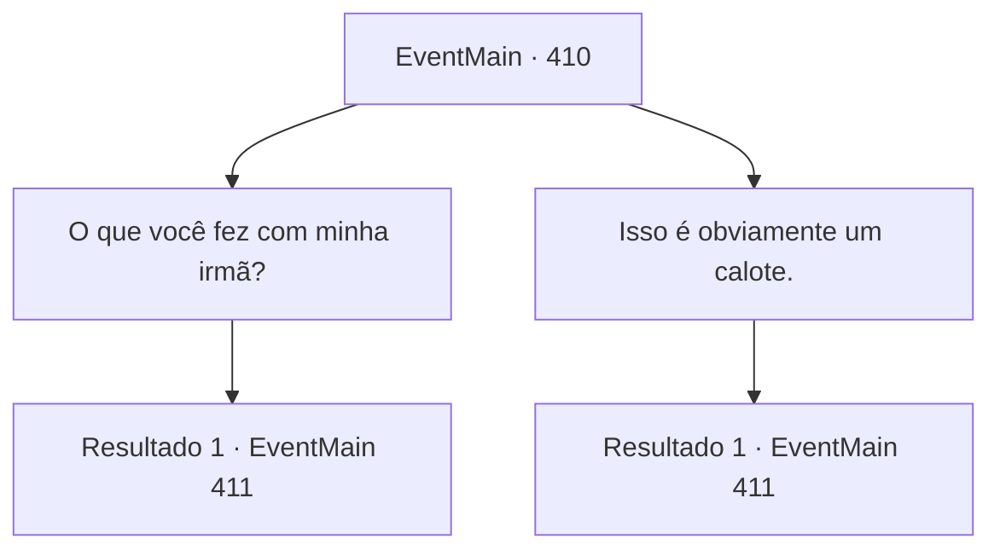

# Eventos principais · 410

[Índice da tabela](index.md) · [Índice geral](../index.md)

ID: `pt:EventMain:410` · Fonte: `EventMain4` · Versão: 1.2.47.

Mapeamento estático dos arquivos; a disponibilidade e a execução dependem do estado da run.

## Texto do evento

*Sem texto no arquivo.*

## Dados de entrada

```json
{
  "id": 410,
  "grade": 1,
  "normalGoal": "",
  "required": ""
}
```

## Mapa das escolhas



## Escolhas e resultados

### Escolha 1

O que você fez com minha irmã?

Requisitos e outros campos da escolha:

```json
{
  "required": ""
}
```

#### Resultado 1.1

O cobrador de dívidas responde sarcasticamente. 

 "Bem... Eu tenho que te informar que sua irmã está fazendo tudo o que pode para ajudar com a dívida. Você sabe que o Anton é dono de um coliseu, certo? Ela está se matando de trabalhar lá! Nós não a obrigamos, aliás. Leve isso em consideração."


Continuação registrada: [Evento 411](0411.md) na mesma tabela.

```json
{
  "required": "",
  "chance": "1",
  "nextEvent": 411,
  "type": 2,
  "reward": ""
}
```

### Escolha 2

Isso é obviamente um calote.

Requisitos e outros campos da escolha:

```json
{
  "required": ""
}
```

#### Resultado 2.1

Surpreendido pela quantidade, você não pode deixar de perguntar novamente a eles. Os cobradores de dívidas começam a rir, e o magro começa a falar. 

 "Sim, é isso que você ganha por não pagar sua dívida a tempo. Talvez seus pais não tenham pensado nisso quando pegaram o dinheiro emprestado, né? Ah... é verdade, eles estão mortos. Mas que diabos! Você não acha que deveria honrar o nome da sua família pagando a dívida? Pelo menos sua irmã parece estar trabalhando duro. Você sabe que Anton é dono de um coliseu, né? Ela está se esforçando muito lá."


Continuação registrada: [Evento 411](0411.md) na mesma tabela.

```json
{
  "required": "",
  "chance": "1",
  "nextEvent": 411,
  "type": 2,
  "reward": ""
}
```

## Referências que chegam a este evento

- [Evento 409 · escolha 1 · resultado 1](0409.md#escolha-1)
- [Evento 409 · escolha 1 · resultado 2](0409.md#escolha-1)
