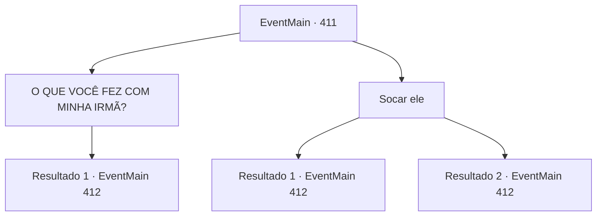

# Eventos principais · 411

[Índice da tabela](index.md) · [Índice geral](../index.md)

ID: `pt:EventMain:411` · Fonte: `EventMain4` · Versão: 1.2.47.

Mapeamento estático dos arquivos; a disponibilidade e a execução dependem do estado da run.

## Texto do evento

*Sem texto no arquivo.*

## Dados de entrada

```json
{
  "id": 411,
  "grade": 1,
  "normalGoal": "",
  "required": ""
}
```

## Mapa das escolhas



## Escolhas e resultados

### Escolha 1

O QUE VOCÊ FEZ COM MINHA IRMÃ?

Requisitos e outros campos da escolha:

```json
{
  "required": ""
}
```

#### Resultado 1.1

Eles riem ainda mais, como se sua raiva fosse um entretenimento para eles. 

 "Kiyahaha! Acalme -se, acalme -se. Seu rosto está todo vermelho!"

 O cobrador de dívidas esbelta passa por você e envolve os braços em volta do pescoço. Ele então continua com uma voz contaminada por catarro. 

 "Romb. A cidade de deboche. Sua irmã está trabalhando lá incansavelmente, trazendo felicidade e alegria ao povo. Em um lugar onde, à medida que mais sangue é derramado, a multidão fica mais selvagem. Eu diria que trabalhar lá é muito mais interessante do que viajar pelo mundo coletando dívidas como nós."

 Ele superexagremente gesticula para o céu com os braços e depois se curva, assim como um artista de circo se curvando ao público. Então ele fala com você. 

 "Não estou dizendo que você deve pagar o valor inteiro agora. Anton pode ser muito 'generoso'. 200 ouro por enquanto seria suficiente."


Continuação registrada: [Evento 412](0412.md) na mesma tabela.

```json
{
  "required": "",
  "chance": "1",
  "nextEvent": 412,
  "type": 2,
  "reward": ""
}
```

### Escolha 2

Socar ele

Requisitos e outros campos da escolha:

```json
{
  "required": ""
}
```

#### Resultado 2.1

Você soca o cobrador de dívidas magro no rosto. Com um som pesado de ossos se quebrando, você pode sentir a energia transmitida desse golpe com seu braço. 

 "AACK...!!!"

 Ele grita de dor e cai para trás. Mas o outro cobrador de dívidas nem sequer se mexe. Ele olha para o cobrador de dívidas magro e abre a boca. 

 "Olha, nos matar não vai facilitar as coisas. Você só estará adicionando mais ouro à sua dívida. Pense bem antes de agir..."

 Ele limpa a garganta e continua. 

 "Não estou dizendo que você deve pagar o valor total agora. 400 ouros seriam suficientes como sinal de confiança."


Continuação registrada: [Evento 412](0412.md) na mesma tabela.

```json
{
  "required": "",
  "chance": "1|0_5_1",
  "nextEvent": 412,
  "type": 0,
  "reward": ""
}
```

#### Resultado 2.2

Você soca o cobrador de dívidas magro no rosto. Com um forte estalo, seu rosto  

 "AACK...!!!"

 Ele grita de dor e recua, segurando o nariz. Ele limpa o sangue do nariz, resmungando. 

 "Sério, seus pobres bastardos realmente precisam aprender algum bom senso. Olha, ficar irritado com isso não vai fazer sua dívida desaparecer magicamente. Você quer me matar? Claro, talvez você consiga fazer isso. Mas isso só vai adicionar mais ouro à sua dívida. Use esse cérebro seu, pelo menos uma vez. Aquela coisa em cima dos seus ombros tem mais utilidades do que isso."

 O outro cobrador de dívidas ao lado dele empurra o homem magro para longe e fala. 

 "Não estou dizendo que você deve pagar o valor total agora. 400 ouros seriam suficientes como sinal de confiança."


Continuação registrada: [Evento 412](0412.md) na mesma tabela.

```json
{
  "required": "",
  "chance": "12",
  "nextEvent": 412,
  "type": 1,
  "reward": ""
}
```

## Referências que chegam a este evento

- [Evento 410 · escolha 1 · resultado 1](0410.md#escolha-1)
- [Evento 410 · escolha 2 · resultado 1](0410.md#escolha-2)
