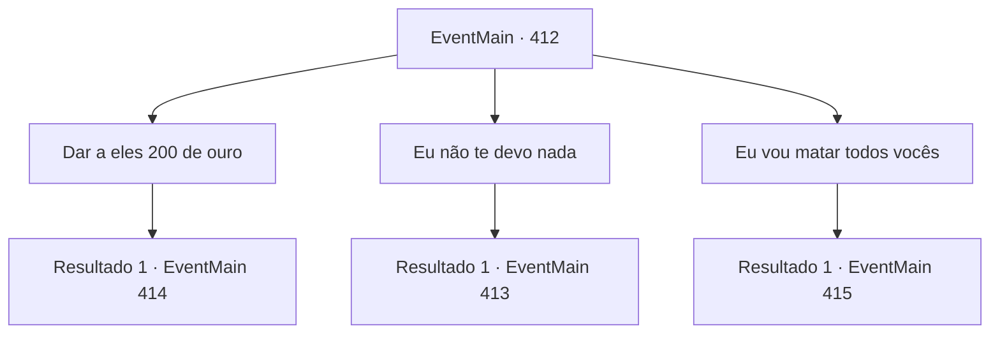

# Eventos principais · 412

[Índice da tabela](index.md) · [Índice geral](../index.md)

ID: `pt:EventMain:412` · Fonte: `EventMain4` · Versão: 1.2.47.

Mapeamento estático dos arquivos; a disponibilidade e a execução dependem do estado da run.

## Texto do evento

*Sem texto no arquivo.*

## Dados de entrada

```json
{
  "id": 412,
  "grade": 1,
  "normalGoal": "",
  "required": ""
}
```

## Mapa das escolhas



## Escolhas e resultados

### Escolha 1

Dar a eles 200 de ouro

Requisitos e outros campos da escolha:

```json
{
  "required": "1_4_200"
}
```

#### Resultado 1.1

Você decide pagar uma parte da sua dívida primeiro. Os cobradores de dívidas colocam um sorriso satisfatório, pegam o ouro e vão embora. Então, um velho aparece do nada, estala a língua e fala com você. 

 "Eles nunca vão te deixar livre. Não importa o quanto você pague... a dívida não vai desaparecer."


Continuação registrada: [Evento 414](0414.md) na mesma tabela.

```json
{
  "required": "",
  "chance": "1",
  "nextEvent": 414,
  "type": 2,
  "reward": "0_4_-200"
}
```

### Escolha 2

Eu não te devo nada

Requisitos e outros campos da escolha:

```json
{
  "required": "2_4_200"
}
```

#### Resultado 2.1

Você diz que não deve nada a eles. Um dos cobradores de dívidas cruza os braços e resmunga. 

 "Hmm... Isso vai tornar a vida da sua irmã muito mais difícil... Bem, paciência."


Continuação registrada: [Evento 413](0413.md) na mesma tabela.

```json
{
  "required": "",
  "chance": "1",
  "nextEvent": 413,
  "type": 2,
  "reward": ""
}
```

### Escolha 3

Eu vou matar todos vocês

Requisitos e outros campos da escolha:

```json
{
  "required": "2_3_-10"
}
```

#### Resultado 3.1

Você não tem intenção de deixar esses cobradores de dívidas irem embora livres. Enquanto você saca sua arma, os cobradores de dívidas também sacam adagas. 

 "Então... você quer fazer do jeito difícil, huh?"


Continuação registrada: [Evento 415](0415.md) na mesma tabela.

```json
{
  "required": "",
  "chance": "1",
  "nextEvent": 415,
  "type": 2,
  "reward": "6_0_127",
  "place": 4
}
```

## Referências que chegam a este evento

- [Evento 411 · escolha 1 · resultado 1](0411.md#escolha-1)
- [Evento 411 · escolha 2 · resultado 1](0411.md#escolha-2)
- [Evento 411 · escolha 2 · resultado 2](0411.md#escolha-2)
