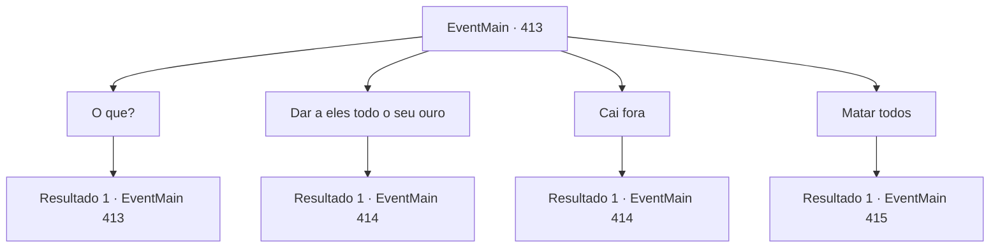

# Eventos principais · 413

[Índice da tabela](index.md) · [Índice geral](../index.md)

ID: `pt:EventMain:413` · Fonte: `EventMain4` · Versão: 1.2.47.

Mapeamento estático dos arquivos; a disponibilidade e a execução dependem do estado da run.

## Texto do evento

*Sem texto no arquivo.*

## Dados de entrada

```json
{
  "id": 413,
  "grade": 1,
  "normalGoal": "",
  "required": ""
}
```

## Mapa das escolhas



## Escolhas e resultados

### Escolha 1

O que?

Requisitos e outros campos da escolha:

```json
{
  "required": "5_252_0"
}
```

#### Resultado 1.1


 "Rapaz, você faz muitas perguntas. Olha, se você não vai pagar, pelo menos pare de ser tão irritante. Isso significa que sua irmã vai ter que trabalhar muito mais para pagar a dívida, o que mais há?"

 O cobrador de dívidas resmunga enquanto responde.

Continuação registrada: [Evento 413](0413.md) na mesma tabela.

```json
{
  "required": "",
  "chance": "1",
  "nextEvent": 413,
  "type": 2,
  "reward": "5_252_1"
}
```

### Escolha 2

Dar a eles todo o seu ouro

Requisitos e outros campos da escolha:

```json
{
  "required": ""
}
```

#### Resultado 2.1

Você entrega aos cobradores de dívidas todo o ouro que possui, dizendo-lhes para entregá-lo a Anton. Eles dão uma olhada dentro da bolsa que você lhes deu e assentem com a cabeça. Eles pegam o ouro e vão embora. Então, um velho aparece do nada, estala a língua e fala com você. 

 "Eles nunca vão te deixar livre. Não importa o quanto você pague a eles... a dívida não vai desaparecer."


Continuação registrada: [Evento 414](0414.md) na mesma tabela.

```json
{
  "required": "",
  "chance": "1",
  "nextEvent": 414,
  "type": 2,
  "reward": "0_4_-200|5_244_1"
}
```

### Escolha 3

Cai fora

Requisitos e outros campos da escolha:

```json
{
  "required": ""
}
```

#### Resultado 3.1

Você grita com os cobradores de dívidas para irem embora. Eles dão de ombros e saem. Então, um velho aparece do nada, estala a língua e fala com você. 

 "Eles nunca vão te deixar livre. Não importa o quanto você pague... a dívida não vai desaparecer."


Continuação registrada: [Evento 414](0414.md) na mesma tabela.

```json
{
  "required": "",
  "chance": "1",
  "nextEvent": 414,
  "type": 2,
  "reward": "5_244_2"
}
```

### Escolha 4

Matar todos

Requisitos e outros campos da escolha:

```json
{
  "required": "2_3_-10"
}
```

#### Resultado 4.1

Você não tem intenção de deixar esses cobradores de dívidas irem embora livres. Enquanto você saca sua arma, os cobradores de dívidas também sacam adagas. 

 "Então... você quer fazer do jeito difícil, huh?"


Continuação registrada: [Evento 415](0415.md) na mesma tabela.

```json
{
  "required": "",
  "chance": "1",
  "nextEvent": 415,
  "type": 2,
  "reward": "6_0_127",
  "place": 4
}
```

## Referências que chegam a este evento

- [Evento 412 · escolha 2 · resultado 1](0412.md#escolha-2)
- [Evento 413 · escolha 1 · resultado 1](0413.md#escolha-1)
