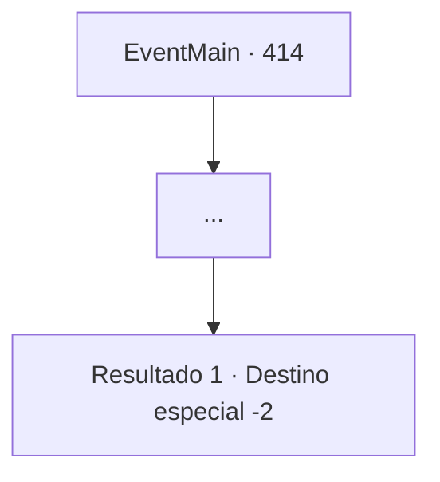

# Eventos principais · 414

[Índice da tabela](index.md) · [Índice geral](../index.md)

ID: `pt:EventMain:414` · Fonte: `EventMain4` · Versão: 1.2.47.

Mapeamento estático dos arquivos; a disponibilidade e a execução dependem do estado da run.

## Texto do evento

*Sem texto no arquivo.*

## Dados de entrada

```json
{
  "id": 414,
  "grade": 1,
  "normalGoal": "",
  "required": ""
}
```

## Mapa das escolhas



## Escolhas e resultados

### Escolha 1

...

Requisitos e outros campos da escolha:

```json
{
  "required": ""
}
```

#### Resultado 1.1


 "Oh, você vai descobrir eventualmente conforme for ficando mais velho... O mundo realmente não é um ótimo lugar. Aqueles tubarões ali atrás? Não são tão diferentes. Eles sugam as pessoas de seu ouro precioso... assim como vampiros. Pessoas bondosas e honestas como você... São sugadas e sugadas por toda a vida antes de sucumbir."

 Ele então estala a língua para os cobradores de dívidas. Ele então se afasta lentamente. Após ouvir as sábias palavras do velho, você decide resgatar sua irmãzinha, que está sendo mantida como refém. Então você decide ir para 'Romb', a cidade onde está o coliseu.

Continuação registrada: [Destino especial `-2`](../destinos-especiais.md).

```json
{
  "required": "",
  "chance": "1",
  "nextEvent": -2,
  "type": 2,
  "reward": "13_3_13"
}
```

## Referências que chegam a este evento

- [Evento 412 · escolha 1 · resultado 1](0412.md#escolha-1)
- [Evento 413 · escolha 2 · resultado 1](0413.md#escolha-2)
- [Evento 413 · escolha 3 · resultado 1](0413.md#escolha-3)
- [Evento 415 · escolha 2 · resultado 1](0415.md#escolha-2)
